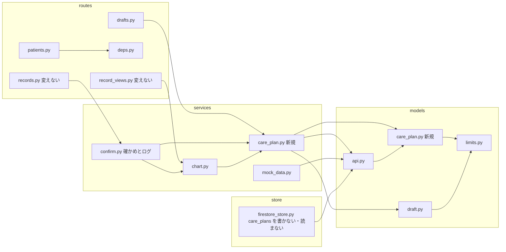
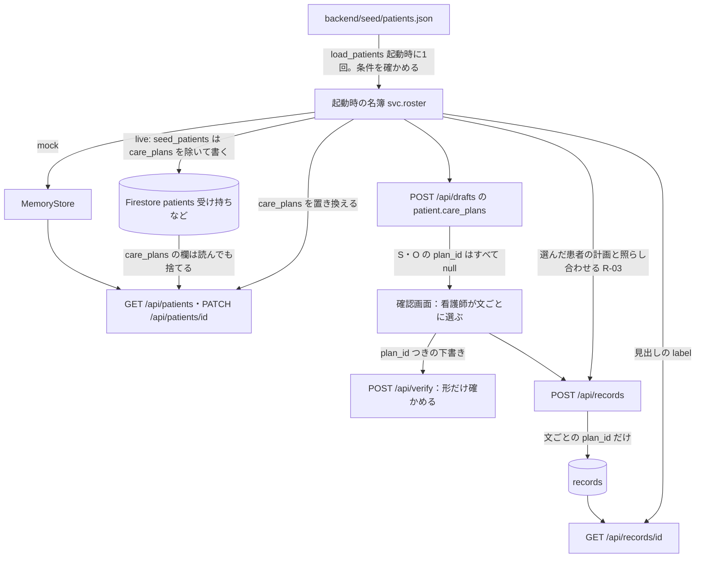
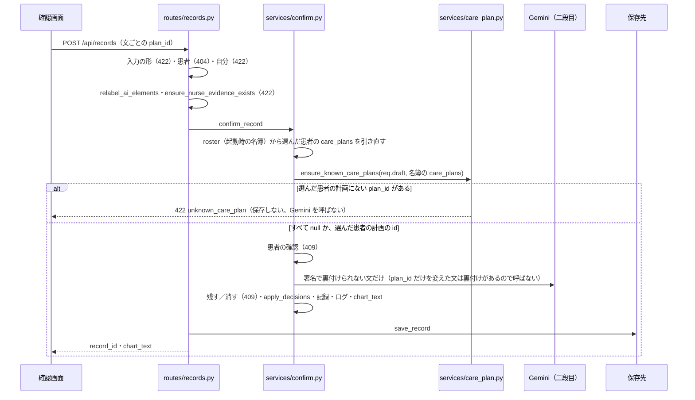

# Design Document

## Overview

### 結論

- 看護計画は名簿の患者（`Patient`）に `care_plans: [{"id", "label"}]` として足し、S・O の文（`SoapSentence`）に `plan_id`（id の形の文字列か `null`、既定 `null`）を足す。記録の保存（`services/record_documents.py`）は、今のコードのまま `plan_id` を運ぶ（変えない）
- 看護計画は Firestore に書かない。`store/firestore_store.py` は、名簿を書くときに `care_plans` を除き、読むときに `care_plans` の欄を捨てる（数行。決定3 の変更、review-1 の指摘4）
- 看護計画の `id` は、名簿全体で重ならない、中身の分からない番号（`cp01`〜`cp08`）にする。名簿全体での重なりは `load_patients()` が起動のときに確かめる（review-1 の指摘9）
- 新しいコードは2ファイルに集める。`models/care_plan.py`（看護計画の型と条件）と `services/care_plan.py`（下書きの印を消す、確定のときの確かめ、計画ごとのまとめ、ログの数）
- 確定API の `plan_id` の確かめは、`services/confirm.py` の `confirm_record` の先頭（患者の照合の前）に置く。患者の確認（409）と二段目の呼び直し（Gemini）より先になる（決定8）。記録を作る入口が増えても（機能2）、`confirm_record` を通る限り確かめを通る（review-1 の指摘3）
- 看護計画の正は「起動時の名簿」（`svc.roster`）にそろえる。確定API・記録閲覧API はもともと起動時の名簿を使う。名簿API・受け持ちAPI も、保存先から読んだ患者の `care_plans` を起動時の名簿の値で置き換えて返す
- カルテ用の文（`services/chart.py`）は、どの文にも `plan_id` がないとき、今の行の組み立てをそのまま通る。5つの場面の見本と境目の例で、今の関数の写しと1字も違わないことを確かめる
- 確認画面では、「残す／消す」を覚える指紋から `plan_id` を除き、文のオブジェクトを置き換えずに `plan_id` を書く。そうしないと、看護計画を選ぶたびにその文の「残す／消す」が外れ、確定ボタンが押せなくなる（「画面（Aさん）に渡すデータの形」の節。review-1 の指摘1）
- Gemini と Speech-to-Text の呼び出しは増えない。二段目の署名と `draft_token` に `plan_id` が入らないことを、コードを読んで確かめた（「お金がかかる呼び出し」の節）
- 名簿seed の看護計画の条件は pydantic の型の制約で書く。`load_patients()` が、条件に合わないときに場所と種類だけをログに出し、起動を止める
- テストは新しいライブラリを入れず、`pytest.mark.parametrize` の例の表で書く。性質の節の各性質も、例の表で確かめる。バックエンドの約15時間（テストと文書は3時間）に収めるため（review-1 の指摘2）

### この文書の書き方

- **事実**：11/18 時点のコードを読んで確かめたこと。ファイル名と関数名を書く
- **案**：この設計で決めること。Cさんが確かめて直す
- ファイルの場所：`models/`・`services/`・`routes/`・`store/` は `backend/app/` の下
- 1回目の設計レビュー（`review-1.md`）の対応で直した所には「review-1 の指摘N」と書く

### 範囲

requirements の「作らないこと」のとおり。AI による自動の仕分け、看護計画ごとの A・P、看護計画の編集画面、電子カルテとのつなぎ込み、仮確定、下書きの指示文の変更は作らない。この設計で新しく足すものはない。

## Architecture

### 依存の向き（変えない）

今の向き `routes → services → checks・store・live → models` を守る。新しいファイルは `services/` と `models/` の直下に置く。



- `services/care_plan.py` が import するのは `app.models.*`・`app.errors`・`app.services.safe_log` だけ。`services/chart.py` は `services/care_plan.py` の `plan_sections` を使う
- `models/care_plan.py` が import するのは `app.models.limits` だけ（`models` は `services` を import しない）
- 変更の理由ごとにファイルを分ける。看護計画の決まり（A-14・R-03・計画ごとのまとめ）は `services/care_plan.py`、カルテ用の文の行の形（R-01）は `services/chart.py`、確定の判定（S-03・A-05）は `services/confirm.py` に残す

### 看護計画の流れ



### 確定の流れと止める順番（決定8）

**事実**：今の `POST /api/records` は、次の順に確かめる（`routes/records.py` の `create_record` → `services/confirm.py` の `confirm_record`）。認証（401）と本文の大きさ（413）は、ルートに入る前に止まる。

**案**：5 の `ensure_known_care_plans` を、`confirm_record` の先頭（`match_patient` の前）に足す。ほかの順番は変えない。`routes/records.py` は変えない（review-1 の指摘3）。

| 順 | 場所 | 確かめること | 止めるとき | Gemini |
|---|---|---|---|---|
| 0 | FastAPI（`RecordRequest` の検証） | 入力の形。`plan_id` の形（要件3の3）もここ | 422 `invalid_request` | 呼ばない |
| 1 | `routes/records.py`：`find_patient`・`with_current_assignee` | 名簿にいるか | 404 `patient_not_found` | 呼ばない |
| 2 | `routes/records.py`：`ensure_reported_by` | 自己申告の「自分」が一覧にいるか | 422 `unknown_nurse` | 呼ばない |
| 3 | `routes/records.py`：`relabel_ai_elements` | 看護師が足したと偽った要素を AI の要素に戻す | — | 呼ばない |
| 4 | `routes/records.py`：`ensure_nurse_evidence_exists` | 看護師が足した要素の根拠の番号 | 422 `unknown_evidence` | 呼ばない |
| 5 | **新** `confirm.py`：`confirm_record` の先頭で、引数の `roster`（起動時の名簿）から選んだ患者の `care_plans` を引き直し、`ensure_known_care_plans(req.draft, その値)` | S・O のすべての文（看護師が足した文、消すと決めた文を含む）の `plan_id` が `null` か、選んだ患者の計画の `id` か | 422 `unknown_care_plan` | 呼ばない |
| 6 | `confirm.py`：`match_patient` → `_ensure_patient_confirmed` | 患者の照合が黄・赤なら確認済みか | 409 `patient_not_confirmed` | 呼ばない |
| 7 | `confirm.py`：`judge_entail()`（`drafting.recheck_entail`） | 署名で裏付けられない文だけ二段目 | — | 呼ぶことがある（live は1回を数える） |
| 8 | `confirm.py`：`_ensure_all_decided` | 「止める」の残す／消す | 409 `undecided_checks` | — |
| 9 | `confirm.py`：`apply_decisions` | 指された場所があるか | 422 `invalid_decision` | — |
| 10 | `confirm.py`：`record_document`・`_log_confirmed`・`chart_text` | — | — | — |
| 11 | `routes/records.py`：`svc.store.save_record` | — | — | — |

**決定8（患者の確認と二段目の呼び直しより前）を満たしていること**

| 決定8 の条件 | この表で | 結果 |
|---|---|---|
| 患者の確認（409 `patient_not_confirmed`）より前 | 5 は 6 より前 | `unknown_care_plan` と `patient_not_confirmed` の両方に当たる下書きは 422（要件6の8・9） |
| 二段目の呼び直しより前 | 5 は 7 より前 | 5 で止まると 7 に届かないので、Gemini を呼ばず、1日の上限にも数えない（要件7の7。live の回数は 7 の中の `_gemini_within_limit` でだけ数える） |
| 残す／消すの確かめ（409 `undecided_checks`）より前 | 5 は 8 より前 | `unknown_care_plan` と `undecided_checks` の両方に当たる下書きも 422（要件6の9） |
| 保存より前 | 5 は 11 より前 | 記録とタスクを保存しない。同じ `confirm_id` で前に保存したものも書き換えない（要件6の3） |

- 前の版の design（`routes/records.py` で `confirm_record` の前）と比べて、4（`unknown_evidence`）との前後が入れ替わる。要件はこの2つの前後を決めていない。両方に当たる下書きは `unknown_evidence` を返す
- 5 で確かめる下書きは、3 で AI の要素に戻した後のもの。`relabel_ai_elements` は `added_by` だけを変え、`plan_id` は `model_copy(deep=True)` で運ぶ（**事実**：`services/nurse_added.py` の `relabel_ai_elements`）。5 は `added_by` によらずすべての文を見るので、確かめる文と値は届いた下書きと同じ
- 5 で照らし合わせる `care_plans` は、`confirm_record` が引数の `roster`（ルートが渡す `svc.roster`、起動時の名簿）から `patient.id` で引き直した値（名簿にいなければ `[]`）。渡された `patient.care_plans` は使わない（要件6の1）。今の入口では、1 の `find_patient` が起動時の名簿から引き、`with_current_assignee` は `assigned_to` だけを替える（`model_copy(update={"assigned_to": ...})`）ので同じ値になる（**事実**）。機能2 の入口が保存先の `get_patient` の患者を渡しても（live では `care_plans` が `[]`。`store/firestore_store.py` の節）、照らす値は起動時の名簿になり、live でだけ 422 になる道を作らない（review-2 の指摘1）
- 記録を作る入口が増えても（機能2 の仮保存・確定し直し）、その入口が `confirm_record` を通れば、看護計画の確かめも通る。機能2 の Spec（Bさん）に「記録を作る入口は `confirm_record` を通す」と伝える（患者の引き方は問わない）



### 照らし合わせる名簿の値

requirements の「前提・制約」で未決だった、名簿API と確定API の名簿の食い違いの扱いを決める。

**事実**

- `container.build_services` が起動時に `roster = load_patients()` を読み、`svc.roster` に置く。mock は `MemoryStore(roster, ...)`、live は `FirestoreStore`。mock では `load_demo_tasks` の中でも `load_patients()` をもう一度呼ぶ（`services/mock_data.py`）。同じファイルを読むので、条件に合わなければ1回目で止まり、動きは変わらない（review-1 の指摘14）
- live は起動のとき（`main.create_app` の `lifespan`）に `seed_patients(svc)` が名簿を Firestore に書く。失敗しても起動は止めず、`seed_patients_failed` をログに出す。そのときは前回の名簿が Firestore に残る
- 下書きAPI・確定API は `find_patient`（`svc.roster`）で患者を引く。記録閲覧API の `_patient_of` も `svc.roster` から引く
- 名簿API は `svc.store.list_patients()`、受け持ちAPI は `svc.store.set_patient_assignee()` の戻り値を返す。live ではどちらも Firestore の値（`Patient(id=doc.id, **doc.to_dict())`）
- そのため、何もしなければ、live で seed の書き込みに失敗したとき、名簿API と受け持ちAPI は前回の `care_plans` を、下書きAPI・確定API・記録閲覧API は今回の `care_plans` を使う

**比べた案**

| 案 | 中身 | 良い点 | 悪い点 |
|---|---|---|---|
| **A（選ぶ）** 起動時の名簿を正にする | 名簿API・受け持ちAPI でも、患者の `care_plans` を起動時の名簿の値に置き換えて返す（`routes/deps.py` の `with_roster_care_plans`）。起動時の名簿にいない患者（Firestore にだけ残った患者）は `[]`。Firestore には `care_plans` を書かない（(c)、決定3 の変更） | どの API も、確定で照らし合わせる値と同じ `care_plans` を返す。Firestore の読み書きは増えない（メモリを引くだけ）。要件6の1・8の12・8の14 がすでに起動時の名簿を指している | 名簿API・受け持ちAPI で、起動時の名簿から引き直す手間（メモリの検索）が要る |
| B Firestore を正にする | 確定API・記録閲覧API も、保存先から読んだ患者の `care_plans` を使う | 名簿API と同じ値になる | 要件6の1・8の12 と食い違い、requirements の書き換えが要る。seed の書き込みに失敗したとき、前回の計画で確かめる。記録閲覧で Firestore の読みが1回増える |
| C 今のまま（食い違いを許す） | 名簿API は Firestore、ほかは起動時の名簿 | 変更が最小 | seed の書き込みに失敗したとき、名簿API で見えた計画が確定で `unknown_care_plan` になりうる。要件2の1 は失敗の場合を除いているので要件には反しないが、画面から見て説明しにくい |

**案 A を選ぶ理由**：看護計画は画面で変えられず、名簿seed からだけ入る（要件2の7）。正を1つにすれば、名簿API で見えた計画が確定で拒まれることが、seed の書き込みの失敗のときにも起きない。費用はメモリの検索だけ。確認画面の選択肢は下書きAPI の `patient.care_plans` から作る（要件5の1）ので、名簿API の `care_plans` は表示にだけ使われる。案 A では Firestore の `care_plans` を使う API が1つもないので、Firestore には書かない（要件2の9、(c)）。

### 比べた案と選んだ理由

#### (a) 文を別の配列に移す案と、`plan_id` の印を付ける案

| 案 | 中身 | 結果 |
|---|---|---|
| 移す | 看護計画ごとの配列（例 `soap.plans[{plan_id, S[], O[]}]`）や、計画外の配列（例 `side_notes`）へ文を移す | 捨てる |
| **印（選ぶ）** | 文は `soap.S`・`soap.O` の同じ番号に置いたまま、`plan_id` を付ける | 選ぶ |

**事実**：二段目の署名は、`services/entail_seal.py` の `trusted_outcomes` が `index_by_path = {t.path: i ...}` で **場所（`soap.S[0]` など）** を照らし合わせる。文を移すと場所が変わり、裏付けが外れる。確定のとき `drafting.recheck_entail` が、裏付けのない文を全部二段目にかけ直す。live ではそのたびに1回を数える。

捨てる理由：看護計画を選んだ確定のたびに Gemini の二段目が1回増える（要件7の2・7の5 に反する）。画面の `checks`・`decisions` の場所の読み替えも要る。印なら、署名・`draft_token`・照合・残す／消すのどれも変えずに済む。

#### (b) 記録に看護計画の写しを残す案と、残さない案（決定2）

| 案 | 良い点 | 悪い点 |
|---|---|---|
| 写し（`label`）を残す | 名簿が変わっても、確定のときと同じカルテ用の文を作り直せる | 保存先に病状に関わる名前（看護計画の名前）が増える（P-03・P-04） |
| **残さない（決定2）** | 保存先に増えるのは文ごとの `plan_id` だけ | 名簿seed が変わって起動し直すと、記録閲覧のカルテ用の文の見出しが変わる、または文が計画外の欄に移る（要件8の14）。往復の性質（要件8の12）は名簿が変わらない間だけ成り立つ |

記録は翌日0時以降に消える（P-03）ので、名簿seed を変えて起動し直すのは、デプロイのときに限られる。悪い点が出る範囲は小さい。

#### (c) 看護計画をどこに持つか（決定3。review-1 の指摘4 で変えた）

| 案 | 良い点 | 悪い点 |
|---|---|---|
| `Patient` に足さない（看護師の一覧のように、seed から別の一覧で持つ） | `Patient` の形が変わらない | 患者と計画の結びつきが2か所に分かれる。名簿API・下書きAPI・受け持ちAPI の応答に、別の一覧から足すコードが要る |
| `Patient` に足し、Firestore の `patients` にも書く（前の決定3） | 名簿の形が1つのまま。`FirestoreStore.seed_patients` は `p.model_dump(exclude={"id"})` を書くので、コードを変えずに `care_plans` も書く（**事実**） | 案 A ではどの API も Firestore の `care_plans` を読まない。保存先に病状に関わる情報（看護計画の名前）が増える。`Patient` の型の条件は Firestore から読むときにもかかるので、Firestore の `care_plans` が条件に合わないと、名簿API（全員分）・受け持ちAPI・下書きAPI・確定API（`with_current_assignee` の `get_patient`）が 500 になる |
| **`Patient` に足し、Firestore には書かない（選ぶ。決定3 を変えた）** | 名簿の形は1つのまま。保存先に病状の情報を増やさない。読むときに `care_plans` の欄を捨てるので、Firestore の値で 500 になる道がない | `store/firestore_store.py` を数行直す（`seed_patients` の `exclude` と、読む3か所）。`store/` は Bさんも 11/19 20:00 以降に触るので、20:00 より前に push する（「ファイルごとの担当とぶつかり」） |

#### (d) AI に仕分けさせる案

患者の看護計画を Gemini に渡す必要があり、A-09（選んだ患者の情報を Gemini に渡さない）とぶつかる。下書きの指示文と Gemini の形（`models/gemini.py`）も変わり、live での確かめ（費用、Cさんの承認）が要る。仕分けの質を測る時間もない。作らない。A-14 で「看護計画を付けるのは看護師だけ」と決める。

#### (e) `plan_id` の確かめを置く場所（review-1 の指摘3 で変えた）

| 案 | 結果と理由 |
|---|---|
| `routes/records.py` で `confirm_record` の前（前の版） | 捨てる。確かめがルートの1か所にだけあり、機能2 で記録を作る入口が増えると、その入口が確かめを通らない。入口を足す人は、A-12 の確かめ（`relabel_ai_elements`・`ensure_nurse_evidence_exists`）と合わせて3つを写す必要がある。前の版が理由に挙げた「`services/confirm.py` を変えずに済む」も、確定のログのために `confirm.py` を変えるので成り立たない |
| **`confirm_record` の先頭（`match_patient` の前。選ぶ）** | 記録を作る処理が必ず通る1か所に置くので、入口が増えても通る。患者の確認と二段目より前という決定8 の順番は変わらない。差分は `confirm.py` の数行で、ログの変更と一緒に 11/19 20:00 より前に入る |
| pydantic の検証 | 選んだ患者の計画を知らないので書けない。形（id の形）だけを pydantic で確かめる |

#### (f) 起動時の確かめを置く場所

| 案 | 結果と理由 |
|---|---|
| **型の制約（選ぶ）**：`models/care_plan.py` の `CarePlan`・`CarePlans` | **事実**：今も `load_patients()` の `Patient.model_validate` が名簿seed の形の誤りで例外を出し、`create_app` → `build_services` の中で起動が止まる。同じ経路に乗るので、要件1の9の「今と同じ扱い」になる。`Patient` を作るどの経路でも同じ条件になる |
| 読み込みの関数だけ（`validate_care_plans(roster)`） | 条件が型と関数の2か所に分かれ、`Patient` を作るほかの経路（テストなど）で条件がかからない |

- 1人の患者の型では、名簿全体で `id` が重ならないこと（要件1の4）を書けない。そこだけは `load_patients()` が、全員の型を確かめた後に確かめる（`services/mock_data.py` の節）
- 型の制約は Firestore から読むときにもかかるが、読むときに `care_plans` の欄を捨てる（(c)）ので、Firestore の値で 500 になる道はない（「Error Handling」の節）

#### (g) A-14（下書きの `plan_id` はすべて `null`）を守らせる場所

| 案 | 結果と理由 |
|---|---|
| **`routes/drafts.py` の `create_draft` の1か所（選ぶ）** | mock（見本のファイル）と live（Gemini）の両方の応答が通る、`draft_token` を付ける直前に `clear_plan_ids` をかける |
| `services/soap.py` の `to_soap` と `routes/drafts.py` の `_mock_response` の2か所 | **事実**：`to_soap` は `SoapSentence(text=..., evidence=...)` で作るので、もともと `plan_id` は `None`。見本のファイルを読む `_mock_response` にだけ穴がある。2か所に分けると、片方の直し忘れが起きる |

#### (h) カルテ用の文の組み立て

| 案 | 結果と理由 |
|---|---|
| **分岐（選ぶ）**：どの文にも `plan_id` がなければ、今の行（`S) `・`O) ` を必ず出す）をそのまま通る。あれば欄ごとの組み立てを通る | 要件8の7（今の形と1字も違わない）を、今のコードの行をそのまま残すことで守る |
| 1本の組み立てにまとめる（計画外の欄だけのときに見出しを省く） | 「文が1つもない S・O でも `S) `・`O) ` を出す」今の決まりと、「文のない行は出さない」新しい決まりを、条件で混ぜることになる。1字のずれを見落としやすい |

#### (i) 1つの文を分けるときの、足す文の扱い（決定7。review-1 の指摘5）

| 案 | 結果と理由 |
|---|---|
| 案 (a)：今の「文を直す」「文を足す」で分け、足した片方は看護師が足した文（`added_by: "nurse"`）にする | 捨てる。足した文は照合（`checks/verify.py` は `added_by == "nurse"` の文を飛ばす）と二段目にかからない。A-12 が防いでいる「AI の文を看護師の文として通す」形を、ふだんの操作にしてしまう |
| **案 (b)：確認画面に「文を分ける」操作を足し、後半を元の文と同じ `added_by`・`evidence` で欄の最後に足す（選ぶ。11/18 Cさん決定）** | 分けた2文とも照合と二段目にかかる。**事実**：`draft_token`（`services/nurse_added.py` の `relabel_ai_elements`）は `nurse` を `ai` に戻すだけで、`ai` を `nurse` にはしない。二段目（`checks/entail.py` の51行目）は `added_by == "ai"` の文をすべてかける。そのため、バックエンドを変えずに済み、A-12 も変えない。Gemini の回数は、裏付けのない文をまとめて1回で送る（`recheck_entail`）ので増えない。増えるのは画面（Aさん）の作業だけ |

## 画面（Aさん）に渡すデータの形

この節は Aさんにそのまま送る。この節だけで読めるように書く。書き方は `docs/design/data-model.md` に合わせる。共通の約束（合言葉 `X-Passcode`、すべての応答に `mode`、エラーの形 `{"mode", "error": {"code", "message"}}`、日本時間の ISO 8601）は data-model.md の2章のまま変わらない。バックエンドの実装が済んだら、data-model.md にも同じ内容を写す。

### 言葉

- **看護計画**：患者ごとの看護上の問題と計画（例 `#急性疼痛`）。`id`（例 `cp04`）と `label`（例 `#急性疼痛`）を持つ。SOAP の P（計画。今の見出しは「P　計画」）とは別のもの
- **`plan_id`**：S・O の文に付ける、看護計画の `id`。`null` は「計画外」
- **計画外**：`plan_id` が `null` の文。どの看護計画にも当たらない文
- **指紋**：確認画面の `ReviewSession` が「残す／消す」を決めたときに一緒に覚える、その文の中身と指摘を JSON にした文字列（`records.js` の `fingerprint(path)`）。下の「確認画面の振る舞いの要点」で使う

### 何が変わるか（まとめ）

| API | 変わること |
|---|---|
| `GET /api/patients` 名簿 | 各患者に `care_plans` が増える |
| `PATCH /api/patients/{id}` 受け持ち | 出力の `patient` に `care_plans` が増える（値は変わらない） |
| `POST /api/drafts` 下書き | 出力の `patient` に `care_plans` が増える。S・O の各文に `plan_id: null` が増える |
| `POST /api/verify` 照合 | 入力の S・O の文に `plan_id` を入れてよい（形だけ確かめる）。出力は変わらない |
| `POST /api/records` 確定 | 入力の S・O の文の `plan_id` を確かめて記録に残す。`chart_text` が看護計画ごとの形になる。エラー `unknown_care_plan`（422）が増える |
| `GET /api/records/{record_id}` 記録の全体 | S・O の各文に `plan_id` が増える。`chart_text` は看護計画ごとの形で作り直す |
| `GET /api/records` 記録の一覧 | 変わらない |

### GET `/api/patients` 名簿

```json
{
  "mode": "mock",
  "patients": [
    {
      "id": "p305", "room": "305", "bed": "A", "name": "佐藤", "kana": "さとう",
      "full_name": "佐藤 和夫", "full_kana": "さとう かずお", "ward": "東3病棟",
      "assigned_to": "n02", "assigned_reported_by": null,
      "care_plans": [
        {"id": "cp04", "label": "#急性疼痛"},
        {"id": "cp05", "label": "#活動耐性低下"}
      ]
    }
  ]
}
```

- `care_plans` は必ず入る。看護計画のない患者は `[]`（欄を省かず、`null` にしない）
- 並びは名簿seed の並び。確認画面の選択肢と欄はこの並びで出す
- 各看護計画は `id` と `label` だけ。`id` は英数字・`_`・`-` の1〜40字。`label` は1〜100字、改行なし、前後に空白なし、「計画外」ではない。1人の患者の中で `label` は重ならない（全角・半角の違いだけのものも重ならない）。1人10件まで
- `id` は名簿全体で重ならない（ほかの患者の計画と同じ `id` はない）。中身の分からない番号（名簿seed では `cp01`〜`cp08`）なので、画面は `id` の中身を読まず、表示にはいつも `label` を使う
- 値は起動時に名簿seed（`backend/seed/patients.json`）から読んだもの。画面からは変えられない。デモは架空の計画だけ

### PATCH `/api/patients/{id}` 受け持ちを変える

```json
// 入力（今のまま）
{"assigned_to": "n04", "reported_by": "n02"}
// 出力（mock では、p305 の見本のタスク t_demo2・t_demo3 も移る）
{"mode": "mock", "patient": {"id": "p305", "...": "...", "assigned_to": "n04", "care_plans": [{"id": "cp04", "label": "#急性疼痛"}, {"id": "cp05", "label": "#活動耐性低下"}]}, "tasks_moved": ["t_demo2", "t_demo3"]}
```

- 出力の `patient.care_plans` は、変える前と同じ値・同じ並び
- 入力に `care_plans` を入れても捨てる（エラーにしない）。看護計画は変わらない
- `tasks_moved` は今のまま（受け持ちから写しただけの未完了のタスク。review-1 の指摘7 で例を直した）

### POST `/api/drafts` 下書きを作る

入力は今のまま。出力（抜粋。302号室・場面1）：

```json
{
  "mode": "mock",
  "patient": {
    "id": "p302", "room": "302", "bed": "A", "name": "田中", "full_name": "田中 一郎", "...": "...",
    "care_plans": [
      {"id": "cp01", "label": "#急性疼痛"},
      {"id": "cp02", "label": "#感染リスク状態"}
    ]
  },
  "draft": {
    "vitals": ["..."],
    "soap": {
      "S": [{"text": "夜間に創部痛あり、あまり眠れなかったとの訴え。現在の痛みは4/10、夜間はそれ以上。", "evidence": ["u9", "u11"], "added_by": "ai", "plan_id": null}],
      "O": [{"text": "創部に発赤・腫脹なし。", "evidence": ["u12"], "added_by": "ai", "plan_id": null}],
      "A": "",
      "P": ""
    },
    "requests": ["..."], "manual_needed": [], "doctor_questions": ["..."]
  },
  "checks": [], "missing": ["呼吸数", "SpO2"], "entail_seals": ["..."], "draft_token": "…"
}
```

- `patient.care_plans` は、選んだ患者の看護計画（名簿API と同じ値・同じ並び）。**確認画面の選択肢はここから作る**
- S・O の**すべての文の `plan_id` は `null`**。mock でも live でも、音声でもテキストでも、AI は看護計画を付けない（A-14）
- `plan_id` は S・O の文にだけ付く。バイタル・依頼・手で入力が必要なもの・医師への確認には付かない

### POST `/api/verify` 照合だけやり直す

```json
// 入力（S・O の文に plan_id を入れてよい）
{"utterances": ["..."], "draft": {"soap": {"S": [{"text": "…", "evidence": ["u9"], "added_by": "ai", "plan_id": "cp01"}], "O": [], "A": "", "P": ""}, "...": "..."}, "entail": false}
// 出力（今のまま）
{"mode": "mock", "checks": ["..."], "missing": ["..."], "entail_seals": []}
```

- `plan_id` は形（`null` か、英数字・`_`・`-` の1〜40字）だけを確かめる。選んだ患者の計画にあるかは確かめない（照合API は患者を受け取らない）
- 照合の結果（`checks`・`missing`・`entail_seals`）は `plan_id` で変わらない。**看護計画を選び直しただけでは、照合API を呼ばない**（Gemini の呼び出しを増やさないため）
- `plan_id` の欄がない文は `null` と同じに扱う

### POST `/api/records` 確定する

```json
// 入力（308号室・場面3。S[1] を #体液量不足リスク状態 に付け、S[0] は計画外のまま。
//       S[2]「脱水傾向あり。」は二段目で「止める」になったので「消す」を選んだ）
{
  "confirm_id": "c_7f3a9e",
  "patient_id": "p308",
  "patient_confirmed": false,
  "utterances": ["..."],
  "draft": {
    "vitals": [{"item": "体温", "value": "37.4", "evidence": ["u5"], "source": "conversation"}],
    "soap": {
      "S": [
        {"text": "倦怠感の訴え。", "evidence": ["u6"], "added_by": "ai", "plan_id": null},
        {"text": "飲水は少しはできているとの発言。", "evidence": ["u8"], "added_by": "ai", "plan_id": "cp06"},
        {"text": "脱水傾向あり。", "evidence": ["u6", "u8"], "added_by": "ai", "plan_id": null}
      ],
      "O": [],
      "A": "", "P": ""
    },
    "requests": [], "manual_needed": [], "doctor_questions": []
  },
  "entail_seals": ["..."],
  "draft_token": "…",
  "decisions": [{"path": "soap.S[2]", "action": "delete"}],
  "timing": {"recording_started": "...", "recording_stopped": "...", "draft_shown": "...", "confirmed": "..."}
}
// 出力（形は今のまま。chart_text が看護計画ごとの形になる）
{
  "mode": "mock",
  "record_id": "r_p308_c_7f3a9e",
  "chart_text": "【308号室A 鈴原 キヨ様】2026-11-08 09:15\nT 37.4℃\n#体液量不足リスク状態\nS) 飲水は少しはできているとの発言。\n計画外\nS) 倦怠感の訴え。\nA) \nP) ",
  "tasks_created": []
}
```

- `plan_id` は、S・O の各文に `null` か、**選んだ患者の `care_plans` にある `id`** を入れる。文は `soap.S`・`soap.O` の同じ番号のまま送る（並べ替えない、別の配列に移さない）
- `plan_id` の欄がない文は `null` として扱い、記録にも `null` で残す
- サーバーは、S・O の**すべての文**（看護師が足した文、`decisions` で消すと決めた文を含む）の `plan_id` を確かめる。選んだ患者の計画にない `id` が1つでもあれば `422`（`unknown_care_plan`）で、記録もタスクも保存しない
- この確かめは、患者の確認（`409` の `patient_not_confirmed`）と二段目の呼び直しより先。両方に当たる下書きは `422` が返る
- 看護計画を選んでいなくても（全部 `null` でも）、今のとおり確定できる。止める条件は今と同じ（`patient_not_confirmed`・`undecided_checks` の `409` など）
- 下書きAPI か照合API（`entail: true`）が最後に返した下書きから `plan_id` だけを変えた確定では、二段目を呼び直さない。文を直した場合は、今のとおり確定のときに二段目を1回呼び直す

**`chart_text` の形（R-01 の書き換え）**

どれかの文に `plan_id` が付いているとき：

```text
【{部屋}号室{ベッド} {氏名}様】{YYYY-MM-DD HH:MM}
{バイタルの行（今のまま。なければ出さない）}
{看護計画の label}
S) {その計画の S の文をつなげたもの}
O) {その計画の O の文をつなげたもの}
… （文の付いた看護計画を care_plans の並びで）
計画外
S) {計画外の S の文}
O) {計画外の O の文}
A) {A}
P) {P}
```

- 文が1つも付いていない看護計画の欄は、見出しの行も出さない。計画外の文がなければ「計画外」の行も出さない
- 欄の中で S の文がなければ `S) ` の行を、O の文がなければ `O) ` の行を出さない
- `A) ` と `P) ` の行は必ず1つずつ、最後に出す（看護計画ごとの A・P はない）
- 文のつなぎ方（前後の空白を除く、区切りの文字を入れない、「。」などで終わらない文に「。」を足す）は今のまま

どの文にも `plan_id` が付いていないとき（今の画面のまま送った場合を含む）は、今の形と1字も違わない（302号室・場面1）：

```text
【302号室A 田中 一郎様】2026-11-08 09:15
T 36.8℃ BP 132/78 P 76
S) 夜間に創部痛あり、あまり眠れなかったとの訴え。現在の痛みは4/10、夜間はそれ以上。
O) 創部に発赤・腫脹なし。
A) 
P) 
```

305号室の新しい台本の例（`#急性疼痛` の文が1つ、計画外の文が2つ。O の文はない）：

```text
【305号室A 佐藤 和夫様】2026-11-19 10:00
T 37.2℃ BP 132/84 P 88
#急性疼痛
S) 起き上がるときに術創がズキッとする。痛みは10段階で4。
計画外
S) 夜中に2回トイレで起き、あまり眠れなかった。朝食は半分で、食欲がない。
A) 
P) 
```

### GET `/api/records/{record_id}` 保存した記録の全体

```json
{
  "mode": "mock",
  "record": {
    "record_id": "r_p308_c_7f3a9e",
    "soap": {
      "S": [
        {"text": "倦怠感の訴え。", "evidence": ["u6"], "added_by": "ai", "plan_id": null},
        {"text": "飲水は少しはできているとの発言。", "evidence": ["u8"], "added_by": "ai", "plan_id": "cp06"}
      ],
      "O": [],
      "A": "", "P": ""
    },
    "chart_text": "【308号室A 鈴原 キヨ様】2026-11-08 09:15\nT 37.4℃\n#体液量不足リスク状態\nS) 飲水は少しはできているとの発言。\n計画外\nS) 倦怠感の訴え。\nA) \nP) ",
    "...": "..."
  }
}
```

- S・O の各文の `plan_id` は、確定のときに送った値のまま。この機能の前に確定した記録の文は `null`
- 記録には看護計画の `label` を残していない。`chart_text` は、起動時の名簿の `care_plans` から見出しを付けて作り直す。名簿が確定のときから変わっていなければ、確定API が返した `chart_text` と1字も違わない（今の画面の「保存した記録と表示内容が一致しません。」の照らし合わせはそのまま通る）
- 名簿の今の看護計画にない `plan_id` の文（名簿seed を変えて起動し直した場合など）は、エラーにせず「計画外」の欄に出す
- `GET /api/records`（一覧）は変わらない

### エラー

| 状態 | `error.code` | どの API | いつ | `error.message` の例 |
|---|---|---|---|---|
| 422 | `invalid_request` | 照合API・確定API | `plan_id` が `null` でも id の形でもない（空の文字列、41字以上、英数字・`_`・`-` 以外を含む、数・配列・オブジェクト） | `入力の形が正しくありません（body.draft.soap.S.0.plan_id）` |
| 422 | `unknown_care_plan` | 確定API | id の形の `plan_id` が、選んだ患者の `care_plans` のどの `id` とも一致しない（ほかの患者の計画の `id`、どの患者にもない `id`、計画のない患者に付けた `id`） | `この患者さんの看護計画にない計画が付いた文があります（S 2文目）。看護計画を選び直してください` |

```json
{"mode": "mock", "error": {"code": "unknown_care_plan", "message": "この患者さんの看護計画にない計画が付いた文があります（S 2文目、O 1文目）。看護計画を選び直してください"}}
```

- `invalid_request` の `message` は今の形の誤りと同じ作り（場所だけで、送った値は入れない）。`soap.S.0` は「S 1文目」
- `unknown_care_plan` の `message` には、当たった文の場所が入る（review-1 の指摘8）。書き方は確認画面の文の表示（`renderReviewEntry` の `label`、「S 1文目」）と同じで、番号は送った `draft.soap.S`・`draft.soap.O` の番号（0 から数えた番号 + 1）。S の文を先、O の文を後に、番号の順。6件以上なら先頭の5つと「ほか n 件」（例 `（S 1文目、S 2文目、S 3文目、S 4文目、S 5文目 ほか2件）`）。看護計画の `label` と送った値は入らない
- どちらも、記録とタスクは保存されず、Gemini も呼ばれない。同じ `confirm_id` のまま、選び直して送り直してよい
- 名簿seed を変えたデプロイの前から画面を開いていた場合などに起きる（ふだんは画面の選択肢と起動時の名簿が同じなので起きない）。そのとき画面の選択肢は古いままなので、場所を見て、その文を選び直すか「計画外」にする
- 削除予定の文（「消す」を選んだ文）の `plan_id` は、確定を送る前に画面が `null` に戻す（要件5の11）。そのため、選び直せない削除予定の文を指す `unknown_care_plan` は起きない（review-2 の指摘6）

### 互換（今の画面がそのまま動くこと）

- 今の画面は `plan_id` を送らない。サーバーは欄のない文を `null` として扱うので、`422` にならず、`chart_text` も今の形のまま
- 今の画面は下書きAPI の `draft` を写して（`ReviewSession` の `clone(data.draft)`）そのまま送り返すので、`plan_id: null` が入ったまま届く。これも `null` と同じ
- 名簿API・下書きAPI の応答に `care_plans` が増えるが、今の画面の応答の確かめ（`patients.js` の `loadPatients`、`records.js` の `validateResponse`）は知らない欄を見ないので、そのまま通る
- 記録の画面（`history.js`）は文を写すときに `text`・`evidence`・`added_by` だけを取るので、`plan_id` は落ちる。表示に使う `chart_text` はサーバーが作るので、看護計画ごとの形で出る

### 確認画面の振る舞いの要点（要件5）

画面のコードの設計は Aさんが決める。ここでは、バックエンドとのつなぎ目と、今の画面の仕組みに関わる点を「決めたこと」に、見た目の点を「Aさんが決めること」に分けて書く。**事実**は、11/18 の `frontend/js/records.js`・`frontend/js/screens/review.js`・`frontend/js/components/review-entry.js`・`frontend/js/app.js` を読んで確かめたこと。

#### 決めたこと（この形で作る）

1. **「残す／消す」の指紋から `plan_id` を除く**（要件5の7・5の8。review-1 の指摘1）
   - **事実**：`ReviewSession.decide(path, action)` は、決定と一緒にその文の指紋 `fingerprint(path)` を覚える。指紋は、`targetAt(this.draft, path)` が返す文のオブジェクト全体（`plan_id` も入る）と、その文への指摘を `JSON.stringify` したもの。`action(path)` は、今の指紋が覚えた指紋と同じときだけ決定を返す。`gate()` は決定のない「止める」を「残す／消すの選択が n 件あります」に数える。`verify()` は照合の後に、指紋の違う決定を消す
   - そのまま文に `plan_id` を書くと指紋が変わり、決定はないものとして扱われ、確定ボタンが押せなくなる。review-1 で、`backend/mock/draft_s3.json` の `soap.S[2]` に「消す」を決めてから `plan_id` を書くと、`action("soap.S[2]")` が `delete` から `null` に、`gate()` が `ready: true` から `ready: false` に変わることを確かめた
   - 直し方：`fingerprint(path)` で、`soap.S[i]`・`soap.O[i]` の文は `plan_id` を除いてから JSON にする（例 `const { plan_id: _plan, ...rest } = target`）。バイタル（`multipleConfirmed` も同じ指紋を使う）・依頼などには `plan_id` がないので、ほかの指紋は今と同じ
   - 決定を作り直すために、看護計画の選択で `touch()` や照合を通す作りにしない。確定ボタンが「修正内容を再検証してください」で止まり（要件5の8 に反する）、`entail: true` で送れば Gemini の回数も増える（要件7の5）
2. **`plan_id` は今の文のオブジェクトに直接書き、オブジェクトを置き換えない**（review-1 の指摘1）
   - **事実**：看護師が足した文は、`ReviewSession.addedElements`（文のオブジェクトの `Set`）で見分ける。`renderReviewEntry` の削除ボタンと根拠の選択（`session.addedElements.has(item)`）と、`setElement`・`setEvidence`・`removeAdded` がこれを使う
   - `soap.S[i] = { ...s, plan_id }` のように置き換えると、足した文の削除ボタンと根拠の選択が消える。`this.draft.soap[part][index].plan_id = planId` のように書く
3. **照合を呼ばない**（要件5の3・5の4・5の8）
   - **事実**：`touch()` は `revision` を上げて `status` を `dirty` にし、その文の決定（`decisions`）を消す。通すと要件5の7・5の8 に反する
   - 案：`ReviewSession.setPlan(path, planId)` を足す。`disposed` か `isLocked()` なら何もしない。`path` が `soap.S[i]`・`soap.O[i]` の形でない、または `planId` が `null` でも `this.patient.care_plans` のどれかの `id` でもなければ何もしない。`touch()` は呼ばず、`resetSaveError()` だけを呼ぶ（前の確定の失敗の表示を消す。`gate()` の結果は変わらない）
   - `app.js` の `change` の処理に `care-plan` の分岐を足し、`setPlan` の後に画面を描き直す。この分岐では `runVerification()` を呼ばない
4. **最初の状態**：`ReviewSession` を作るとき（A・P を空にしている constructor の同じ場所）、S・O のすべての文のオブジェクトに `plan_id = null` を書く。サーバーが `null` 以外を返しても引き継がない（要件5の2）
   - `care_plans` がない・配列でない応答は `[]` として扱い、同じ場所で `this.patient.care_plans` に `[]` を入れる（`validateResponse` は真偽を返すだけで値を変えず、`ReviewSession` は `data.patient` を写すだけ（**事実**）なので、`setPlan` と選択肢が `undefined` を読まないため。配列でない応答は 6 で `invalid_response` になるので、ここに届くのは欄のない応答。要件5の5。review-2 の指摘5）
5. **看護師が足した文**：`addElement("soap.S")`・`addElement("soap.O")` が作る文に `plan_id: null` を入れる（サーバーは欄がなくても `null` と扱うが、画面の中で欄の有無を分けないため）。計画外の欄に出し、AI の文と同じ選択肢を出す（要件5の9）
6. **`care_plans` の形の確かめ**：今の `validateResponse` は `patient` の `id`・`room`・`bed`・`name` だけを見る。次を足す。`patient.care_plans` の欄がなければ `[]` とみなす（要件5の5）。欄があれば、配列で、10件以下で、各要素の `id` と `label` が文字列で、`id` が重ならないこと。合わなければ今と同じ `invalid_response`（「下書きの形式が正しくありません。」）にする。S・O の文の `plan_id` は確かめない（4 で `null` にするため）
7. **止める仕組みに乗せる**（要件5の13）：選択肢の部品に `data-review-field="care-plan"` と `data-path`（例 `soap.S[0]`）を付ける。**事実**：`refreshReviewStatus` は `[data-review-field]` の部品をまとめて、`locked`（`saving`・`uncertain`）の間と、`data-path` の文が「消す」（削除予定）のときに `disabled` にする。この仕組みにそのまま乗せる。削除予定の文は記録に残らない（サーバーは確かめだけはする、要件6の1）ので、選べなくてよい
8. **確定**：今の `confirmationData()` が `draft` を写して送るので、各文の `plan_id` はそのまま届く。看護計画の選択は確定の条件にしない（`gate()` を変えない）。写しの中で、削除予定の文（`action(path)` が `delete`）の `plan_id` だけを `null` にしてから送る（画面のメモリの `draft` は変えない。要件5の11。review-2 の指摘6）
9. **保存中・再送待ち**：**事実**：再送は `pendingConfirmation`（送ったときの写し）を送るので、最初と同じ `plan_id` が届く
10. **`unknown_care_plan` が返ったとき**：`error.message`（当たった文の場所が入る。「エラー」の節）を今の確定の失敗と同じ場所に出す。**事実**：今の `sendConfirmation` は、409 以外の 4xx では `saveStatus` を `error` にし、下書き・「残す／消す」・確認を消さない。422 もこの道を通るので、看護計画の選択と直した文は残る。選び直して確定し直せる（要件5の14）
11. **保存しない**：選択は画面を開いている間のメモリにだけ持つ。ブラウザの保存領域に入れない（要件5の10）
12. **文の場所は動かさない**：画面で欄を移しても、`soap.S`・`soap.O` の番号、「S 1文目」の表示、`checks` の `path` は変わらない。1 と 2 を守れば、「残す／消す」も変わらない
   - 例外：分けた後半の前に看護師が足した文があり、その足した文を消すと、`removeAdded` が後ろの文を1つ詰めるので、後半の場所がずれる（13 の「分けを戻す」で後半を取り除くときも、後ろに文があれば同じ）。`removeAdded` はずれた場所の指摘・署名・「残す／消す」を消して再検証を求める（**事実**：`frontend/js/records.js` の `removeAdded`）ので、止める側に倒れ、記録は崩れない（後半の「残す／消す」は選び直しになり、再検証で Gemini をもう1回呼ぶ。review-2 の指摘4）
13. **文を分ける**（要件5の15〜5の23。決定7。11/18 に Cさんが review-1 の指摘5 の案 (b) に決めた。画面はタスク 1j の一部）
   - データの形は変わらない。新しい欄はなく、今の `text`・`evidence`・`added_by`・`plan_id` で表す。バックエンドも変えない（要件6の10）
   - 元の文の `text` を、看護師が直した前半にする。今の「文を直す」と同じ道（`touch()`）を通すので、その文の「残す／消す」の決定は、文を直したときと同じく消える（削除予定の文は分けられないので、消えるのは「残す」の決定だけ）
   - 後半は新しい文として、同じ欄（`soap.S` か `soap.O`）の最後に足す。`added_by` と `evidence` は元の文と同じ値にする（AI の文から分けたら `"ai"`）。`plan_id` は `null` にする。元の文の `plan_id` は変えない
   - 最後に足すのは、ほかの文の場所を動かさないため。途中に差し込むと、後ろの文の場所（`soap.S[2]` など）がずれ、二段目の署名（場所で照らす）と「残す／消す」の `path` が別の文を指す。こうすれば 12 も守れる（守れない場面は 12 の例外に書いた）
   - AI の文から分けた後半は `ReviewSession.addedElements` に入れない（`added_by` が `"ai"` なので、看護師が足した文として扱わない）。看護師が足した文から分けた後半は入れる
   - 欄に文が50（`models/limits.py` の `MAX_SENTENCES`）あるときは、分ける操作を押せなくする。51文の下書きは、サーバーの形の確かめ（`models/draft.py` の `max_length=MAX_SENTENCES`）で `422` になるため
   - 分けた2文はどちらも下書きの文と違うので、署名で裏付けられない。文を直したときと同じく、確定ボタンは「修正内容を再検証してください」で止まる。二段目は、再検証（`entail: true`）か確定のときに、裏付けのない文をまとめて1回で呼ぶ
   - **削除予定の文は分けられない**（要件5の20。review-2 の指摘2）。**事実**：今の画面は削除予定の文の入力欄を止める（`review.js` の `refreshReviewStatus`）が、`data-review-action` のボタンは保存中と上限のときしか止まらない。分ける操作も `data-review-field`（または同じ条件）に乗せ、削除予定の文と保存中・再送待ちの間は押せなくする。`ReviewSession` の分ける処理も、`action(path)` が `delete` の文では何もしない。分けたいときは「消す」を外してから分ける
   - **分け目**（要件5の21・5の22。review-2 の指摘3）：看護師が文の中の位置を指定する。指定の仕方（入力欄のカーソルの位置か、2つの入力欄に分けるかなど）と、分けるボタン・「分けを戻す」ボタンの置き場所は、画面の担当の Aさんが決める（「Aさんが決めること」）。前半か後半のどちらかが空白（半角・全角のスペース、タブ、改行）だけになる位置では分けない（ボタンを止め、処理も何もしない）
   - **分けを戻す**（要件5の23。review-2 の指摘3）：画面は分けた後半の文のオブジェクトと、元の文のオブジェクト・分ける前の `text` を覚えておく（例 `ReviewSession` の `Map`。画面を開いている間のメモリだけ）。「分けを戻す」は、覚えている後半にだけ出す。戻すと、後半を欄から取り除き（`addedElements` に入っていれば除く）、元の文の `text` を分ける前の文に戻す。分ける前に直していない AI の文なら下書きの文と同じに戻るので、二段目の署名がまた合う。元の文の `plan_id` は変えない。元の文が欄から除かれた後（看護師が足した文から分け、元の文を消した場合）は出さない

#### Aさんが決めること（見た目。案を添える）

- **選択肢の部品**：案は `<select>`（ラベルは「看護計画」）。選択肢は `care_plans` の各 `label`（並びのとおり）と、その後に「計画外」。`care_plans` が空なら「計画外」だけ（要件5の1・5の5）。欄の見出しは `label` と「計画外」。看護計画の選択肢と欄の見出しに「計画」だけの言葉は使わず、SOAP の P は「P　計画」のまま（要件5の6）
- **欄の並び**（要件5の12 で決まっている）：看護計画の欄を `care_plans` の並びで、その後に「計画外」の欄。各欄の中は S の文を先、O の文を後に、元の番号の順。A・P の欄はすべての欄の後に1つずつ。文のない看護計画の欄も見出しは出す（選べる看護計画が一目で分かるため。カルテ用の文とは違う）
- **S と O の見分け**：1つの欄に S と O が混ざる。各文には今の「S 1文目」「O 1文目」の表示（`renderReviewEntry` の `label`）が残るので、最低限これで見分けられる。今の見出し「S　患者の訴え」「O　観察・測定」をどこに残すかは Aさんが決める（案：各欄の中で、S の文があれば「S　患者の訴え」、O の文があれば「O　観察・測定」の小見出しを出す）
- **「＋ 文を追加」の置き場所**：今は S と O の欄に1つずつある（`review.js` の `renderSoap` の `addEntryButton("soap.S", ...)`・`addEntryButton("soap.O", ...)`）。足した文は計画外の欄に出る（要件5の9）ので、案は「計画外の欄の最後に「＋ S の文を追加」「＋ O の文を追加」の2つを置く」。ボタンの `kind`（`soap.S`・`soap.O`）は変えない
- **「文を分ける」の分け目の指定の仕方と、分けるボタン・「分けを戻す」ボタンの置き場所**（決めたことの 13。要件5の21）
- **ファイルの分け方**：`review.js` は今204行で、structure.md の目安（200行）をすでに超えている。案：`renderSoap` を新しい `frontend/js/components/review-soap.js`（看護計画の欄・計画外の欄・A・P の欄の組み立て）に移し、選択肢の部品を `frontend/js/components/care-plan-select.js` に置く。`setPlan` と指紋の直しは `records.js` の `ReviewSession` の中に置く（指紋と同じクラスで扱うため）。読み込むファイルを変えたら `index.html` の読み込みの版（`?v=...`）を上げる（structure.md）
- 選んだ後の描き直しと、フォーカスの戻し方

### モックで始めるとき

- Cさんがモデルと名簿seed を直して `python -m scripts.build_mocks` を回したあとの `backend/mock/draft_s*.json` には、`patient.care_plans` と、S・O の各文の `"plan_id": null` が入る。画面のテストの見本（`frontend/tests/*.test.mjs` が読んでいる）としてもそのまま使える
- mock の下書きAPI は、選んだ患者で場面が決まる（302→場面1、303→場面1、305→場面2、308→場面3、310→場面4、312→場面5）。返す `patient` は選んだ患者（その患者の `care_plans`）
- 看護計画の欄と計画外の欄を分けて見せるには、まず **308**（場面3）を使う。`soap.S[0]`「倦怠感の訴え。」は計画外、`soap.S[1]`「飲水は少しはできているとの発言。」は `#体液量不足リスク状態`（`cp06`）、`soap.S[2]`「脱水傾向あり。」は二段目で「止める」になる（「残す／消す」と看護計画の選択の組み合わせも試せる）
- ほかに試すとよい患者：310（S・O の文がない。欄は見出しだけ）、303（患者の照合が赤。`#急性疼痛` だけを持つ）、302（`soap.O[0]` を `#感染リスク状態` に付けられる）
- 302 の `soap.S[0]`（場面1「夜間に創部痛あり、あまり眠れなかったとの訴え。…」）と 305 の `soap.S[0]`（場面2「リハビリで階段の練習をし、きつかったとの訴え。空腹の訴えあり。」）は、看護計画の話（痛み・活動のきつさ）と計画外の話（眠れない・空腹）が混ざった文。そのまま看護計画に付けると、看護師の指摘（S には計画に関係する内容だけ）と逆の画面になる。決定7 のとおり「文を分ける」で分ける例として使う（review-1 の指摘13）

## Components and Interfaces

### 触るファイルの一覧

| ファイル | 変更 | 行数の見込み |
|---|---|---|
| `models/limits.py` | 上限の値を2つ足す | +2 |
| `models/care_plan.py`（新規） | `CarePlan`・`CarePlans`（条件つき） | 約40 |
| `models/api.py` | `Patient.care_plans` | +4 |
| `models/draft.py` | `SoapSentence.plan_id` | +4 |
| `services/care_plan.py`（新規） | 印を消す・確かめ・計画ごとのまとめ・ログの数 | 約120 |
| `services/chart.py` | 計画ごとの欄の組み立て（今の行の組み立ては残す） | 46 → 約65 |
| `services/confirm.py` | `confirm_record` の先頭で名簿から看護計画を引き直す2行と確かめる1行、確定のログに数を足す | +8 |
| `services/mock_data.py` | 名簿全体で `id` が重ならないかの確かめと、名簿seed の読み込みの失敗を安全なログに出して止める | +30 |
| `store/firestore_store.py` | 名簿を書くときに `care_plans` を除き、読む3か所で `care_plans` の欄を捨てる | +8 |
| `routes/drafts.py` | `clear_plan_ids` をかける | +3 |
| `routes/deps.py` | `with_roster_care_plans` | +10 |
| `routes/patients.py` | 名簿API・受け持ちAPI で `with_roster_care_plans` をかける | +3 |
| `backend/seed/patients.json` | 6人に `care_plans` | +30 |
| `backend/mock/draft_s1.json`〜`draft_s5.json` | `build_mocks` で作り直す（手で書かない） | — |
| `backend/tests/` | 新しいテスト（4ファイル。「Testing Strategy」）と、`test_api_mock.py`・`test_mock_files.py` の期待値 | — |

- どのファイルも 200行を超えない（`services/care_plan.py` が最大で約120行。`services/confirm.py` は今約150行で、+6）
- `routes/records.py` は変えない（確かめは `confirm_record` の先頭。review-1 の指摘3）
- 新しいライブラリは足さない（`backend/requirements-dev.txt`・`docs/submission/license-sheet.md` は変えない。review-1 の指摘2）

### `models/limits.py`

```python
MAX_CARE_PLANS = 10  # 1人の患者の看護計画の数（仮置き、要件1の5）
MAX_CARE_PLAN_LABEL_CHARS = 100  # 看護計画の名前の字数（仮置き、要件1の7）
```

### `models/care_plan.py`（新規）

```python
"""患者ごとの看護計画（名簿に持たせる。要件1、決まり SEC-04・P-07）。

条件に合わない看護計画は、pydantic の検証で例外にする。名簿seed を読むとき
（`app.services.mock_data.load_patients`）に起動を止めるため。エラーの文に
看護計画の名前（label）を入れない（P-04）。
"""

def _one_line_label(label: str) -> str:
    """改行を含まず、空白だけでない名前だけを通す。

    Raises:
        ValueError: 改行を含む、または空白（半角・全角のスペースなど）だけの場合
    """
    if label.splitlines() != [label]:
        raise ValueError("看護計画の名前に改行は入れられません")
    if not label.strip():
        raise ValueError("看護計画の名前が空白だけです")
    return label


CarePlanLabel = Annotated[
    str,
    StringConstraints(min_length=1, max_length=MAX_CARE_PLAN_LABEL_CHARS),
    AfterValidator(_one_line_label),
]


class CarePlan(BaseModel):
    """看護計画の1件。id は名簿全体で重ならない（名簿全体の確かめは load_patients）。"""

    id: SafeId
    label: CarePlanLabel


def _none_as_empty(value: object) -> object:
    """欄が null のときは空の並びにする（要件2の2）。"""
    return [] if value is None else value


def _unique_in_patient(plans: list[CarePlan]) -> list[CarePlan]:
    """1人の患者の中で id と label が重ならないかを確かめる。

    Raises:
        ValueError: 同じ id、または同じ label が2つ以上ある場合
    """
    # id の集合・label の集合の大きさが、並びの長さと違えば重なりがある（文に値は入れない）


CarePlans = Annotated[
    list[CarePlan],
    BeforeValidator(_none_as_empty),
    Field(max_length=MAX_CARE_PLANS),
    AfterValidator(_unique_in_patient),
]
```

- 字数は Python の `len`（1文字を1字。全角・半角を問わない）
- 「改行」は `str.splitlines` が区切る文字（`\n`・`\r`・`\u2028` など）。`label.splitlines() != [label]` は、改行を1つでも含むと真になる
- 「空白だけ」は `str.strip()` で空になるもの（半角・全角のスペース、タブを含む）
- 例外の文に `label` の値を入れない（`seed_invalid` のログには場所と種類だけを出すが、文の作りでも漏らさない）
- 要件1の10（前後の空白、「計画外」、NFKC で同じになる重なり）は型に入れない。名簿seed のテスト（`test_P07_seed_care_plan_labels_distinct`）で確かめる（review-1 の指摘12）。型に入れると、本番で電子カルテから読む名前にも同じ条件がかかるが、その形はまだ分からないため

### `models/api.py`

`Patient` の最後（`assigned_reported_by` の後）に足す。応答の JSON でも最後の欄になる。

```python
    care_plans: CarePlans = Field(
        default_factory=list,
        description="患者の看護計画（名簿seed からだけ入る。画面では変えない）",
    )
```

- 欄がない・`null` のときは `[]`（`_none_as_empty` と `default_factory`）
- `PatientAssigneePatch` は変えない。**事実**：pydantic の既定（余分な欄は捨てる）なので、入力の `care_plans` は捨てられる（要件2の7）

### `models/draft.py`

`SoapSentence` に足す。`SafeId` を `app.models.limits` から import する。

```python
class SoapSentence(BaseModel):
    """S か O の1文。"""

    text: Text
    evidence: Evidence = Field(default_factory=list)
    added_by: AddedBy = "ai"
    plan_id: SafeId | None = Field(
        default=None,
        description="看護計画の id。看護師が選ぶ（AI は付けない、A-14）。null は計画外",
    )
```

- **事実**：`SafeId | None` の検証の誤りは、場所が `plan_id` だけの1件になる（`pydantic 2.14.3` で確かめた。空の文字列・41字・空白を含む文字列は `string_pattern_mismatch`、数・配列・オブジェクトは `string_type`）。今の `RequestValidationError` の扱い（`app/errors.py`）が `入力の形が正しくありません（body.draft.soap.S.0.plan_id）` を返す
- `Vital`・`PatientRequest`・`EvidencedText` は変えない。**事実**：これらに `plan_id` を送っても、pydantic の既定で捨てられ、記録とタスクに残らない（要件3の8）
- Gemini の形（`models/gemini.py` の `GeminiNarrative`）は `SoapSentence` と別のクラスなので、Gemini に返させる形は変わらない（**事実**）

### `services/care_plan.py`（新規）

```python
"""看護計画まわり：S・O の文に付けた plan_id の確かめと、看護計画ごとのまとめ。

- A-14：看護計画を付けるのは看護師だけ。下書きの印はすべて消して返す
- R-03：確定のとき、選んだ患者の看護計画にない plan_id は 422
- R-01：カルテ用の文を看護計画ごとにまとめる（並べ方だけ。行の形は app.services.chart）
- P-04：ログに出すのは数だけ（看護計画の id・label、送られた plan_id は出さない）
"""

UNPLANNED_HEADING = "計画外"


@dataclass(frozen=True)
class PlanSection:
    """カルテ用の文の1つの欄。heading は看護計画の label か「計画外」。S・O は元の並び。"""

    heading: str
    S: list[SoapSentence]
    O: list[SoapSentence]


def clear_plan_ids(draft: Draft) -> Draft:
    """S・O のすべての文の plan_id を None にした写しを返す（A-14）。元の下書きは変えない。"""


def unknown_plan_paths(draft: Draft, care_plans: list[CarePlan]) -> list[str]:
    """選んだ患者の看護計画にない plan_id を持つ S・O の文の場所（例 `soap.S[1]`）。

    看護師が足した文、消すと決めた文を含む、すべての文を見る（決定8）。
    id は大文字と小文字も区別して、完全に同じものだけを一致とみなす。
    """


def ensure_known_care_plans(draft: Draft, care_plans: list[CarePlan]) -> None:
    """選んだ患者の看護計画にない plan_id があれば、ログに数を出して止める（R-03）。

    confirm_record の先頭で呼ぶ（患者の確認と二段目より前、決定8）。message には
    当たった文の場所（「S 2文目」）を入れ、看護計画の label と送られた値は入れない。

    Raises:
        ApiError: 1件以上ある場合（422、code は unknown_care_plan）
    """


def sentence_label(path: str) -> str:
    """文の場所を、確認画面の表示と同じ書き方にする（`soap.S[1]` → `S 2文目`）。"""


def plan_sections(soap: Soap, care_plans: list[CarePlan]) -> list[PlanSection]:
    """カルテ用の文の欄を、看護計画の並び → 計画外の順に返す（R-01 の書き換え）。

    前後の空白を除いて空の文は、ないものとして扱う。どの文にも plan_id がなければ
    空の並びを返す（今の形で出す合図）。care_plans にない plan_id の文は計画外に入れる。
    文が1つもない欄は返さない。
    """


def plan_log_fields(draft: Draft, care_plans: list[CarePlan]) -> dict[str, Any]:
    """確定のログに足す数（要件9の1・9の2）。draft は消した文を除いた、確定する下書き。"""
```

中身の要点（**案**）：

- `clear_plan_ids`：`draft.model_copy(update={"soap": soap.model_copy(update={"S": [s.model_copy(update={"plan_id": None}) for s in ...], "O": ...})})`。文の数・並び・`text`・`evidence`・`added_by` は変えない
- `unknown_plan_paths`：`known = {p.id for p in care_plans}`。`soap.S`・`soap.O` を番号の順に見て、`plan_id is not None and plan_id not in known` の文の場所を返す
- `ensure_known_care_plans`：1件以上なら `log_event("record_rejected", severity="WARNING", code="unknown_care_plan", unknown_plan_sentences=len(paths))` を出し、`ApiError(422, "unknown_care_plan", f"この患者さんの看護計画にない計画が付いた文があります（{places}）。看護計画を選び直してください")` を投げる。`places` は `paths` の先頭5つを `sentence_label` で「、」でつなぎ、6件以上なら後ろに「 ほか{n}件」を足したもの（review-1 の指摘8）。ログには場所を出さず、数だけにする（要件9の5）
- `sentence_label`：`soap.S[i]` を `S {i+1}文目`、`soap.O[i]` を `O {i+1}文目` にする。確認画面の `renderReviewEntry` の `label`（`${part} ${index + 1}文目`）と同じ書き方
- `plan_sections`：
  1. `S = [s for s in soap.S if s.text.strip()]`、`O` も同じ（要件8の13）
  2. `S + O` のどれにも `plan_id` がなければ `[]` を返す
  3. `key(s) = s.plan_id if s.plan_id in known else None`（`care_plans` にない `plan_id` は計画外、要件8の14）
  4. `care_plans` の並びで、`key` がその `id` の S・O を集めた欄を作り、S も O もない欄を除く
  5. `key` が `None` の S・O があれば、「計画外」の欄を最後に1つ足す
- `plan_log_fields`：`known` に入る `plan_id` の文を「看護計画が付いた文」、それ以外（`null`、欄なし）を「計画外の文」として数える（空白だけの文も数える。`sentences` と足し算を合わせるため、要件9の3）。`plans_used` は、前後の空白を除いて空でない文の `plan_id` だけで、互いに違う id を数える（カルテ用の文に見出しが出る看護計画の数と同じになる。要件9の2、review-1 の指摘10）。確定まで来た下書きは `ensure_known_care_plans` を通っているので、`null` でない `plan_id` はすべて `known` に入る。返す形は「ログ」の節

### `services/chart.py`（カルテ用の文の作り方）

**事実**：今の `chart_text(patient, draft, confirmed_at)` は、先頭の行 → バイタルの行（あれば）→ `"S) " + _joined_sentences(S)` → `"O) " + _joined_sentences(O)` → `"A) " + A` → `"P) " + P` を `"\n".join` する。`_joined_sentences` は前後の空白を除き、空の文を飛ばし、`_SENTENCE_END` で終わらない文に「。」を足してつなぐ。

**案**：関数の名前・引数・戻り値の型は変えない（呼び出し元の `confirm.py`・`routes/record_views.py` を変えないため）。患者の `care_plans` は `patient` から読む。

```python
def _soap_lines(s: list[SoapSentence], o: list[SoapSentence], *, always: bool) -> list[str]:
    """S) と O) の行。always が偽なら、文のない方の行を出さない。"""
    lines = []
    s_text, o_text = _joined_sentences(s), _joined_sentences(o)
    if always or s_text:
        lines.append("S) " + s_text)
    if always or o_text:
        lines.append("O) " + o_text)
    return lines


def chart_text(patient: Patient, draft: Draft, confirmed_at: datetime) -> str:
    """カルテ用の文（R-01）。

    どの文にも plan_id がなければ、患者・日時 → バイタル → S) → O) → A) → P)（今の形）。
    あれば、患者・日時 → バイタル → 看護計画ごとの欄 → 計画外の欄 → A) → P)。
    """
    lines = [<先頭の行（今のまま）>]
    vital_line = _vital_line(draft.vitals)
    if vital_line:
        lines.append(vital_line)
    sections = plan_sections(draft.soap, patient.care_plans)
    if not sections:
        lines += _soap_lines(draft.soap.S, draft.soap.O, always=True)  # 今の形（要件8の7）
    for section in sections:
        lines.append(section.heading)
        lines += _soap_lines(section.S, section.O, always=False)
    lines += ["A) " + draft.soap.A, "P) " + draft.soap.P]
    return "\n".join(lines)
```

**今の出力と1字も違わないことの保証（要件8の7）**

- `plan_sections` が `[]` を返すのは「前後の空白を除いて空でない文のどれにも `plan_id` がない」ときだけ。このときの行は、`_soap_lines(..., always=True)` が今と同じ `"S) " + _joined_sentences(S)`・`"O) " + _joined_sentences(O)` を作る。先頭・バイタル・A・P の行は分岐の外で、今のコードのまま
- テストで二重に確かめる：(1) 今の `chart_text` の写し（`legacy_chart_text`。今のコードを写すだけで、作り直さない）をテストのファイルに置き、5つの場面の見本と手で作った境目の例（文なし・空白だけの文・句点なし・空の文にだけ `plan_id`）の `parametrize` で、1字も違わないことを確かめる（性質6）。(2) 今ある例のテスト（`test_S06_R01_chart_text_format`・`test_R01_sentence_without_period_gets_one`・`test_A06_kept_unsupported_sentence_is_marked_only_in_record`）を変えずに通す
- 空の文だけに `plan_id` が付いた下書きは、`plan_sections` が空の文を除いてから判定するので、今の形になる（要件8の13）

**名簿の今の計画にない `plan_id` の文（要件8の14、決定2）**

- 確定のときは `ensure_known_care_plans` を通っているので起きない
- 記録閲覧のときは、`routes/record_views.py` の `_patient_of` が起動時の名簿から患者を引く（**事実**）。名簿seed が変わって計画がなくなっていれば、その文は `plan_sections` の手順3で計画外の欄に入る。患者が名簿にいなければ、`_patient_of` が `care_plans` の空の `Patient` を作る（**事実**：`Patient(id=..., room=..., ...)` で `care_plans` を渡さない）ので、`plan_id` の付いた文はすべて計画外の欄に入る。どの場合もエラーにせず、文はちょうど1回出る
- `plan_id` が付いていれば、それが今の計画にないものでも、「今の形」ではなく欄の形（「計画外」の見出しつき）になる。要件8の1 の条件（`plan_id` が `null` でない文がある）に合わせた

### `services/confirm.py`

**案**：`confirm_record` の先頭で看護計画を確かめ（「確定の流れと止める順番」の 5）、確定のログに数を足す。ほかの確定の判定・順番・戻り値は変えない（review-1 の指摘3）。

```python
from app.services.care_plan import ensure_known_care_plans, plan_log_fields

def confirm_record(req, patient, roster, now, judge_entail, relabelled=0) -> Confirmed:
    # 選んだ患者の看護計画にない plan_id は、患者の確認と二段目より先に止める（R-03、決定8）。
    # 記録を作る処理の先頭に置き、記録を作る入口が増えても通るようにする
    # 看護計画は、渡された patient ではなく起動時の名簿（roster）から引き直す。
    # 保存先から読んだ患者（live では care_plans が空）を渡されても、名簿seed の値で照らす（review-2 の指摘1）
    found = next((p for p in roster if p.id == patient.id), None)
    patient = patient.model_copy(update={"care_plans": list(found.care_plans) if found else []})
    ensure_known_care_plans(req.draft, patient.care_plans)
    match = match_patient(patient, roster, req.utterances)
    _ensure_patient_confirmed(req, match, patient)
    ...  # ここから下は今のまま


def _log_confirmed(
    record_id: str, req: RecordRequest, match: PatientMatch, final: Draft,
    stop_count: int, entail_rejudged: int, relabelled: int,
    care_plan_counts: dict[str, Any],
) -> None:
    log_event("record_confirmed", ..., reported_by=req.reported_by, **care_plan_counts)

# confirm_record の中
_log_confirmed(
    record_id, req, match, final, len(stop_checks), entail.rejudged, relabelled,
    plan_log_fields(final, patient.care_plans),
)
```

- 渡される `patient` は、今はルートが `with_current_assignee(svc, find_patient(...))` で作ったもの（`care_plans` は起動時の名簿の値。**事実**）。`confirm_record` は先頭で `care_plans` を `roster` の値に置き換えるので、どの入口から呼ばれても、確かめ・`chart_text`・確定のログに使う看護計画は起動時の名簿の値になる（要件6の1。review-2 の指摘1）
- `req.draft` は、ルートが `relabel_ai_elements` をかけた後の下書き。`plan_id` は届いたまま（「確定の流れと止める順番」）
- `final` は `apply_decisions` の後（看護師が消した文を除き、看護師が足した文を含む）。要件9の1 の数え方と同じ
- `chart_text(patient, final, now)` は今のまま。`patient` が `care_plans` を持つので、看護計画ごとの形になる
- docstring の Raises に `422`（`unknown_care_plan`）を足す

### `services/mock_data.py`（起動時の確かめ）

```python
class SeedInvalidError(RuntimeError):
    """名簿seed が形や条件に合わない（起動を止める）。"""


def load_patients() -> list[Patient]:
    """架空の名簿（`backend/seed/patients.json`）。

    形や看護計画の条件に合わなければ、場所と種類だけをログに出して止める（要件1の9）。
    値（患者名・看護計画の名前）はログにもエラーの文にも出さない（P-04）。

    Raises:
        SeedInvalidError: 1人でも条件に合わない場合
    """
```

- 患者ごとに `Patient.model_validate` を呼び、`ValidationError` を受けたら `log_event("seed_invalid", severity="ERROR", file="patients.json", errors=[{"index": i, "loc": "care_plans.1.label", "type": "string_too_long"}, ...])`（先頭の5件まで）を出す
- 全員の型が通った後に、名簿全体で看護計画の `id` が重ならないかを確かめる（要件1の4。1人の患者の型では書けないため。review-1 の指摘9）。重なりがあれば、2人目以降の当たった場所を `{"index": i, "loc": "care_plans.j.id", "type": "duplicate_care_plan_id"}` として同じ `seed_invalid` に出す。`id` の値は出さない
- その後 `raise SeedInvalidError("名簿seed が条件に合いません（ログの seed_invalid を見てください）") from None`。`from None` で pydantic の例外の文（入力の値を含む）をトレースバックに出さない
- `id` の `cp` と2桁の番号の形（要件1の4）と要件1の10 は、ここでは確かめない（名簿seed のテストで確かめる。要件1の9）
- **事実**：pydantic の `ValidationError` の文は `input_value=...` を含む（`hide_input_in_errors` を内側のモデルにだけ付けても消えない。外側のモデルの設定が効く。`pydantic 2.14.3` で確かめた）。そのため、例外の文に頼らず、ログを自分で組み立てる
- **事実**：`container.build_services` は、mock でも live でも、Firestore・Gemini・Speech-to-Text の部品を作る前に `load_patients()` を呼ぶ。`create_app` の中で例外になり、uvicorn の起動が止まる。Cloud Run では新しいリビジョンが起動せず、条件に合わない名簿のまま API を受け付けない

### `routes/drafts.py`

```python
@router.post("/api/drafts")
async def create_draft(...) -> DraftResponse:
    given = await read_draft_input(request, cfg)
    response = await run_in_threadpool(make_draft, svc, cfg, given, client_key(request))
    # 看護計画を付けるのは看護師だけ（A-14）。見本のファイルや Gemini の出力によらず消す
    draft = clear_plan_ids(response.draft)
    return response.model_copy(
        update={"draft": draft, "draft_token": svc.draft_tokens.issue(draft)}
    )
```

- `patient.care_plans` は、今の `make_draft` が `with_current_assignee(svc, find_patient(...))` で作る `patient`（起動時の名簿の値）がそのまま入る（**事実**：mock の `_mock_response` も `update={"patient": patient}` で置き換える）。変更は要らない

### `store/firestore_store.py`（看護計画を書かない・読まない）

**事実**：今の `seed_patients` は `p.model_dump(exclude={"id"})` を `batch.set` で書く（文書ごと上書きし、前の値から残すのは `assigned_to`・`assigned_reported_by` だけ）。読むのは `list_patients`・`get_patient`・`set_patient_assignee` の3か所で、どれも `Patient(id=..., **doc.to_dict())` で作る。

**案**（決定3 の変更、要件2の9。review-1 の指摘4）：

```python
# 看護計画は起動時の名簿からだけ使う。Firestore には書かず、読んでも使わない（要件2の9）
_ROSTER_ONLY_FIELDS = {"care_plans"}


def _stored_patient(patient_id: str, fields: dict[str, Any]) -> Patient:
    """Firestore の名簿の1人。看護計画の欄が入っていても捨てる（型の条件もかけない）。"""
    kept = {k: v for k, v in fields.items() if k not in _ROSTER_ONLY_FIELDS}
    return Patient(id=patient_id, **kept)

# seed_patients：fields = p.model_dump(exclude={"id", *_ROSTER_ONLY_FIELDS})
# list_patients・get_patient・set_patient_assignee：Patient(id=..., **...) を _stored_patient(...) にする
```

- 読んだ患者の `care_plans` は `[]` になる。名簿API・受け持ちAPI は `with_roster_care_plans` で起動時の名簿の値に置き換え、下書きAPI・確定API は `with_current_assignee` で `assigned_to` だけを使う（**事実**）ので、どの API の応答にも Firestore の値は出ない
- `batch.set` は文書ごと上書きするので、Firestore に `care_plans` の欄が残っていても（人が手で書いた場合など）、次の起動で消える。読むときも捨てるので、条件に合わない値があっても 500 にならない
- `store/memory.py` は変えない。mock の `MemoryStore` は起動時の名簿の `Patient` をメモリに持つだけで、保存しない
- `store/` は機能2（Bさん）も 11/19 20:00 以降に触るので、`services/confirm.py` と一緒に 20:00 より前に push する（「ファイルごとの担当とぶつかり」）

### `routes/deps.py`・`routes/patients.py`

```python
# routes/deps.py
def with_roster_care_plans(svc: Services, patient: Patient) -> Patient:
    """看護計画を、起動時の名簿の値にする（確定で照らし合わせる値とそろえるため）。

    起動時の名簿にいない患者（保存先にだけ残っている患者）は空にする。
    """
    found = next((p for p in svc.roster if p.id == patient.id), None)
    return patient.model_copy(update={"care_plans": list(found.care_plans) if found else []})
```

```python
# routes/patients.py
patients=[with_roster_care_plans(svc, p) for p in svc.store.list_patients()]   # 名簿API
patient=with_roster_care_plans(svc, patient)                                    # 受け持ちAPI
```

- mock では `MemoryStore` の患者がもともと起動時の名簿から作られる（`set_patient_assignee` も `model_copy` で `care_plans` を保つ）ので、置き換えても値は変わらない（**事実**）
- live では Firestore から読んだ患者の `care_plans` が `[]` になる（`store/firestore_store.py` の節）ので、この置き換えで起動時の名簿の値を入れる

### 変えないファイルと、変えなくてよい理由（事実）

| ファイル | 理由 |
|---|---|
| `services/record_documents.py` | `record_document` は `draft.model_dump(include={"vitals", "soap", "requests", "manual_needed", "doctor_questions"})` で S・O の文を丸ごと入れるので、`plan_id` も入る（`null` も欄ごと残る、要件6の4）。患者からは `id`・`room`・`name`・`display_name` だけを入れるので、`care_plans` の写しは入らない（要件9の7）。タスク（`task_documents`）にも看護計画は入らない |
| `store/memory.py`・`store/base.py` | 名簿は `Patient` のまま運ぶ。`MemoryStore` はメモリに持つだけで保存しない。`Store` の口（関数の名前と引数）は変えない |
| `routes/records.py` | 看護計画の確かめは `confirm_record` の先頭に置くので、ルートは変えない（review-1 の指摘3） |
| `checks/verify.py`・`checks/entail.py` | 照合は文の `text`・`evidence`・`added_by` と場所だけを見る。`EntailTarget` は `path`・`text`・`evidence` の3つで、`plan_id` を持たない |
| `services/entail_seal.py` | 署名は `[target.text, target.evidence, evidence_texts, verdict, reason]` に結びつき、照らし合わせは `path` で行う。`plan_id` は入らない |
| `services/draft_token.py`・`services/nurse_added.py`・`services/draft_elements.py` | 指紋は `fingerprint(e.text)` だけ。`plan_id` を変えても、AI の要素と看護師が足した要素の扱いは変わらない |
| `services/decisions.py` | `model_copy(deep=True)` と配列の詰め直しだけなので、残した文の `plan_id` はそのまま運ばれ、並びも変わらない（要件3の7） |
| `services/drafting.py`・`services/soap.py` | `to_soap` は `SoapSentence(text=..., evidence=...)` で作るので、`plan_id` は既定の `None` |
| `live/gemini_vertex.py`・`live/mock_gemini.py` | Gemini に送るのは `format_utterances(utterances)`（番号・話者・文）と `build_entail_input(targets, conv)`（判定する文・根拠の発言・前の質問）と、決まった指示文だけ。看護計画が入る経路がない（要件4の2・4の4） |
| `models/record_request.py`・`models/record_views.py` | `Draft` と `RecordDetail(Draft)` を通して `plan_id` を運ぶ |
| `routes/record_views.py` | `_detail` が `Draft.model_validate(doc)` で読み直し、`chart_text(_patient_of(svc, doc), draft, created_at)` で作り直す。古い記録の文は `plan_id` の既定 `None` で読まれ、保存した記録は書き換えない（要件6の7） |
| `routes/verify.py` | `plan_id` の形は `VerifyRequest` の検証で 422 になる。照合の結果は `plan_id` を見ない |
| `container.py` | 起動の確かめは `load_patients()` の中で行う。`seed_patients` は変えない（書く形は `FirestoreStore.seed_patients` で変える） |
| `scripts/build_mocks.py` | `build_draft` の結果をそのまま書くので、作り直すだけで `care_plans` と `plan_id: null` が入る |
| `backend/mock/source/scenarios.json` | 見本の会話と下書きは作り直さない（決定6） |

## Data Models

### 看護計画（`CarePlan`）

| 欄 | 型 | 条件 |
|---|---|---|
| `id` | 文字列 | 英数字・`_`・`-` の1〜40字（`SafeId`）。名簿全体で重ならない。名簿seed では `cp` と2桁の通し番号（`cp01`〜） |
| `label` | 文字列 | 1〜100字（仮置き）。改行を含まない。空白だけでない。1人の患者の中で重ならない。名簿seed では、前後に空白を入れず、「計画外」にせず、NFKC で同じになる重なりも入れない（要件1の10） |

患者（`Patient`）の `care_plans` は `CarePlan` の並び。0〜10件（仮置き）。欄がない・`null` は `[]`。起動時の名簿（メモリ）にだけ持ち、Firestore には書かない（要件2の9）。

### S・O の文（`SoapSentence`）

| 欄 | 型 | 変更 |
|---|---|---|
| `text` | 文字列（5,000字まで） | 変えない |
| `evidence` | 発言番号の並び（重複を除いて3件まで） | 変えない |
| `added_by` | `ai`／`nurse` | 変えない |
| `plan_id` | `SafeId` か `null`（既定 `null`） | **足す** |

### 名簿seed の看護計画の案（要件1の2・1の3、決定6）

すべて架空の看護計画（P-07）。`label` は一般的な看護上の問題の言い方で、実在の患者・病院・看護師の名前を入れない。見本の会話（`backend/mock/source/scenarios.json`）の S・O の文を読んで選んだ。`id` は名簿の並び（部屋番号の順）に `cp01` から振った通し番号で、名簿全体で重ならない（要件1の4。review-1 の指摘9）。

| 患者 | 場面 | `care_plans`（並びのとおり） | 選んだ理由（見本の会話） |
|---|---|---|---|
| p302 田中 一郎 | s1 手術翌日の検温 | `cp01` `#急性疼痛`、`cp02` `#感染リスク状態` | S「夜間に創部痛あり…痛みは4/10」は疼痛、O「創部に発赤・腫脹なし。」は創部の感染の観察 |
| p303 中田 花子 | なし（場面 s1 が返る） | `cp03` `#急性疼痛` | 場面 s1 の S が疼痛。計画を1件だけにして、p302 との違い（`#感染リスク状態` がない）を確かめに使う |
| p305 佐藤 和夫 | s2 リハビリ帰りと食前インスリン（live のデモは新しい台本） | `cp04` `#急性疼痛`、`cp05` `#活動耐性低下` | `cp04` は決定6。場面 s2 の S「リハビリで階段の練習をし、きつかったとの訴え。」は活動のあとのきつさ。新しい台本の「夜中にトイレで起きる」「朝食は半分、食欲がない」には当たらないので、requirements の「期待する仕分け」の表（計画外）が崩れない |
| p308 鈴原 キヨ | s3 AI が補ってしまいやすい会話 | `cp06` `#体液量不足リスク状態` | S「飲水は少しはできているとの発言。」は飲水量の観察。「倦怠感の訴え。」は計画外にでき、計画の欄と計画外の欄の両方を試せる |
| p310 小川 健一 | s4 患者の名前を言い忘れる | `cp07` `#退院支援` | 会話「早く帰りたいよ」。見本の下書きに S・O の文がないので、文の付く計画はない（要件10の2 の外） |
| p312 小林 正雄 | s5 雑談に症状が埋もれる・言い直し・薬 | `cp08` `#転倒転落リスク状態` | S「今朝トイレへ行く際にふらつきあり、壁に手をついた。転倒なく…」 |

名簿seed の書き方（p305 の例。ほかの欄は今のまま）：

```json
{
  "id": "p305", "room": "305", "bed": "A", "name": "佐藤", "kana": "さとう",
  "full_name": "佐藤 和夫", "full_kana": "さとう かずお", "ward": "東3病棟", "assigned_to": "n02",
  "care_plans": [
    {"id": "cp04", "label": "#急性疼痛"},
    {"id": "cp05", "label": "#活動耐性低下"}
  ]
}
```

- `label` の先頭の `#` は半角（要件1の2）
- 患者の人数・並び・`care_plans` 以外の欄は変えない（要件1の8）
- 同じ `label`（`#急性疼痛`）が p302・p303・p305 にあるが、`id` は `cp01`・`cp03`・`cp04` と別。R-03 のテストでは、p305 に `cp01`（p302 の `#急性疼痛`）や `cp02`（p302 の `#感染リスク状態`）を付けて 422 になることを確かめる。名前が同じでも、ほかの患者の計画は通らない
- `id` から計画の中身は分からないので、記録の `plan_id` からも計画の名前は分からない（決定2 を崩さない）

### 場面ごとの期待（要件10の2）

mock で、看護計画に付けられるとみなす文。テストの期待値にする（`plan_id` を入れて確定すると 200 になり、`chart_text` にその `label` の行が出る）。看護計画の欄と計画外の欄を分けて見せる例には、p308 を先に使う。

| 選ぶ患者 | 返る場面 | 文 | 付けられる看護計画 |
|---|---|---|---|
| p308 | s3 | `soap.S[1]`「飲水は少しはできているとの発言。」 | `cp06`（`soap.S[0]`「倦怠感の訴え。」は計画外。`soap.S[2]`「脱水傾向あり。」は二段目で止まる）。計画の欄と計画外の欄を分けて見せる例 |
| p302 | s1 | `soap.O[0]`「創部に発赤・腫脹なし。」 | `cp02` |
| p302 | s1 | `soap.S[0]`「夜間に創部痛あり、あまり眠れなかったとの訴え。…」 | `cp01`。ただし計画の話（痛み）と計画外の話（眠れない）が混ざった文。決定7 のとおり「文を分ける」で分ける例 |
| p303 | s1 | `soap.S[0]`（p302 と同じ、混ざった文） | `cp03`（`soap.O[0]` は計画外） |
| p305 | s2 | `soap.S[0]`「リハビリで階段の練習をし、きつかったとの訴え。空腹の訴えあり。」 | `cp05`。ただし計画の話（活動のきつさ）と計画外の話（空腹）が混ざった文。決定7 のとおり「文を分ける」で分ける例 |
| p312 | s5 | `soap.S[0]`「今朝トイレへ行く際にふらつきあり…」 | `cp08` |
| p310 | s4 | （S・O の文がない） | 対象外 |

- 混ざった文をそのまま看護計画に付けると、看護師の指摘（S には計画に関係する内容だけ）と逆の画面とカルテ用の文になる。モックで作った画面やデモの絵には、p308 の分け方を使う（review-1 の指摘13）

### Firestore の形

| コレクション | 変わること | 備考 |
|---|---|---|
| `patients/{id}` | 変わらない（`care_plans` は書かない） | `seed_patients` は `care_plans` を除いて書き、読むときも捨てる（決定3 の変更、要件2の9）。API の応答には起動時の名簿の値を使う（案 A） |
| `records/{id}` | `soap.S[]`・`soap.O[]` の各要素に `plan_id`（文字列か `null`）が増える | `label` と `care_plans` の写しは入れない（決定2）。この機能の前の記録には欄がない |
| `tasks/{id}` | 変わらない | — |

- インデックスは増えない（看護計画で絞り込む一覧は作らない）。TTL（`expires_at`）も変わらない
- Firestore は形を決めずに保存できるので、移し替えの作業はない
- `records` の書き込みの形が変わるので、デプロイは Cさんの承認が要る（cost.md）

### デプロイと、前の版に戻すとき（review-1 の指摘15）

デプロイを承認する人が知っておくこと。tasks.md のデプロイの手順に1行で書く。

- 前の版に戻しても、Firestore の `patients` には何も起きない（この版も前の版も `care_plans` を書かない）
- 前の版のコードは `plan_id` を読まない（**事実**：`Draft`・`SoapSentence` は余分な欄を捨てる pydantic の既定のまま）。そのため、看護計画を付けて確定した記録を記録閲覧で開くと、`chart_text` が見出しのない今の形になり、確定のときに返した文と違ってくる。記録の `plan_id` は残るが使われない。記録は翌日0時以降に消える（P-03）
- 切り替えの間に、新しい版で確定し、前の版で記録を読むと、出力画面（`app.js` の `refreshExportRecord`）が「保存した記録と表示内容が一致しません。」を出すことがある。戻した後に前の版の画面で確定した記録は、`plan_id` を持たないので起きない

### 起動時の確かめ（要件1の9）

| 条件（要件1） | 守らせる場所 |
|---|---|
| 4：`id` が id の形 | `CarePlan.id: SafeId` |
| 4：`id` が名簿全体で重ならない | `load_patients()` の名簿全体の確かめ（`duplicate_care_plan_id`） |
| 5：0〜10件 | `CarePlans` の `Field(max_length=MAX_CARE_PLANS)` |
| 7：`label` は1〜100字、改行なし、空白だけでない、患者の中で重ならない | `CarePlanLabel`、`_unique_in_patient` |
| 4：`id` が `cp` と2桁の番号、10：`label` の前後の空白・「計画外」・NFKC で同じになる重なり | 起動のときには確かめない。名簿seed のテスト（`test_P07_seed_care_plans_shape`・`test_P07_seed_care_plan_labels_distinct`） |
| 1・2・3・6・8（中身） | 名簿seed のテスト（`test_P07_*`・`test_S08_*`）と、提出前に人が見る（要件1の6） |

- mock・live のどちらでも、`load_patients()` が `SeedInvalidError` で止まる
- ログ（`seed_invalid`）に出すのは、患者の並びの番号（`index`）、場所（`loc`。欄の名前と並びの番号だけ）、種類（`type`）だけ。患者名・看護計画の `id`・`label` は出さない

### ログ（要件9）

**`record_confirmed` に足す項目**（今の項目は変えない）

| 項目 | 中身 |
|---|---|
| `plan_sentences` | `{"S": 整数, "O": 整数}`。確定する S・O の文のうち、看護計画が付いた文の数 |
| `unplanned_sentences` | `{"S": 整数, "O": 整数}`。計画外の文の数（`plan_id` の欄がない文を含む） |
| `plans_used` | 文が付いた看護計画の数。前後の空白を除いて空でない文の、互いに違う `plan_id` の数（カルテ用の文に見出しが出る看護計画の数と同じ。review-1 の指摘10） |
| `plans_available` | 選んだ患者の看護計画の数（`care_plans` の件数） |

- 0 でも省かない
- `plan_sentences.S + unplanned_sentences.S == sentences.S`、O も同じ（要件9の3。`sentences` は今ある項目で、空白だけの文も数える。そのため `plan_sentences`・`unplanned_sentences` も空白だけの文を数える）

```json
{"severity": "INFO", "event": "record_confirmed", "record_id": "r_p305_c_7f3a9e", "...": "...",
 "sentences": {"S": 3, "O": 0},
 "plan_sentences": {"S": 1, "O": 0}, "unplanned_sentences": {"S": 2, "O": 0},
 "plans_used": 1, "plans_available": 2}
```

**`unknown_care_plan` で止めたとき**（1回の確定につき1行。`record_confirmed` は出さない）

```json
{"severity": "WARNING", "event": "record_rejected", "code": "unknown_care_plan", "unknown_plan_sentences": 1}
```

**名簿seed が条件に合わないとき**

```json
{"severity": "ERROR", "event": "seed_invalid", "file": "patients.json",
 "errors": [{"index": 2, "loc": "care_plans.1.label", "type": "string_too_long"}]}
```

- どの行にも、看護計画の `id`・`label`（`#` を除いた形も）・送られた `plan_id` の値を出さない（P-04）。`record_id` は今も出している（`r_{patient_id}_{confirm_id}`）
- `record_rejected` には当たった文の場所も出さない（要件9の5 は数だけ）。場所は応答の `message` にだけ入る

### モック

- **事実**：`scripts/build_mocks.py` の `build_mock` は `build_draft(...)` の結果を `model_dump(mode="json")` で書く。`patient` は名簿seed から読んだ患者なので、作り直すと `patient.care_plans` が入る。S・O の文は `to_soap` で作るので `"plan_id": null` が入る
- そのため、モデルと名簿seed を直した時点で `tests/test_mock_files.py` の `test_mock_file_is_up_to_date` が5場面とも食い違いを見つける。直したら `python -m scripts.build_mocks` を回し、`backend/mock/draft_s*.json` を一緒にコミットする
- `test_mock_file_matches_contract` に「S・O のすべての文の `plan_id` が `null`」「`patient.care_plans` が名簿seed と同じ」を足す（5場面の `parametrize` なので、要件4の1 の mock の側をここで確かめる）
- 見本の会話と下書き（`backend/mock/source/scenarios.json`）、タスクの見本（`backend/mock/tasks.json`）は変えない（決定6）
- mock の下書きAPI は、見本のファイルの `patient` を選んだ患者で置き換え、`clear_plan_ids` をかけて返す。見本のファイルに `null` 以外の `plan_id` を手で書いても、画面には `null` で届く（要件4の3）
- 画面のテスト（`frontend/tests/confirmation.test.mjs`・`history.test.mjs`・`design-updates.test.mjs`・`review.test.mjs`・`recording.test.mjs`）は `backend/mock/draft_s*.json` を見本として読む。作り直したあとに `node --test frontend/tests/*.test.mjs` も回す

## Correctness Properties

*A property is a characteristic or behavior that should hold true across all valid executions of a system-essentially, a formal statement about what the system should do. Properties serve as the bridge between human-readable specifications and machine-verifiable correctness guarantees.*

（訳）性質とは、システムのどの正しい実行でも成り立つべき特徴や振る舞い、つまりシステムが何をすべきかの形式的な言い方である。人が読む仕様と、機械で確かめられる正しさの保証をつなぐ。

### 性質を選んだ考え方（prework の振り返り）

- 受け入れ条件のうち、入力によって結果が変わり、純粋な関数か差し替えた API で確かめられるもの（検証、印を消す、確かめ、まとめ、ログの数、カルテ用の文、`plan_id` だけを変えたときの照合と確定）を性質にした。画面（要件5）、名簿seed の中身（要件1の1〜3・1の6・1の8・1の10）、API の状態コード、外のサービスへの入力（要件4の2・4の4）は、例・統合のテストにした（「Testing Strategy」）
- **確かめ方**：性質ベースのテストのライブラリ（Hypothesis）は使わない。各性質を、境目の値を並べた `pytest.mark.parametrize` の例の表で確かめ、各性質の「確かめ方」に表の行を書く。生成した入力を100回以上回すより網羅は狭いが、境目の値（0件・10件・11件、100字・101字、改行の種類、大文字と小文字など）を表に入れて補う。バックエンドの約15時間（テストと文書は3時間）に収めるため（review-1 の指摘2）
- まとめたもの：
  - 要件1の4（形と名簿全体での重なり）・1の5・1の7 は、名簿を受け付けるかの同じ規則なので1つ（性質1）
  - 要件3の4・3の7・6の4・7の1・7の2・7の3・7の4・7の6 は、「`plan_id` だけの変更は、照合・二段目・AI の要素の扱い・保存する発言・記録の並びを変えない」の1つにまとめ、API の例1本で確かめる（性質4）。前の版の性質4・5・6・8 は、この機能で変えないモジュールが読まない欄を無視することの確かめで、「変えないファイル」の表でコードを読んで確かめた内容と重なっていた
  - 要件6の1・6の2 の、当たる文の見つけ方と `message` の場所の書き方は1つ（性質5）
  - 要件8の7（今の形と1字も違わない）は、いちばん壊したくない約束なので分ける（性質6）
  - 要件8の1〜8の6・8の9〜8の11・8の13〜8の15 は、看護計画ごとの欄の組み立ての1つ（性質7）。参照の組み立てをテストに書き直すと、実装と同じだけ手間がかかり、実装と同じ誤りを写しやすいので、期待の文字列を手で書く
  - 要件8の12・6の6 は往復の1つ（性質8）
  - 要件9の1〜9の3 は、ログの数の関係として1つ（性質9）

### Property 1: 名簿の看護計画を条件どおりに受け付ける

*For any* 名簿（患者ごとの看護計画の並び。id は正しい形・誤った形を混ぜ、label は空・空白だけ・改行（`\n`・`\r`・`\u2028`）・全角の空白だけ・100字・101字を混ぜ、件数は0〜11、1人の患者の中の id や label の重なりと、ほかの患者との id の重なりも作る）について、`load_patients()` がその名簿を受け付けるのは、どの患者も件数が10以下で、すべての id が id の形で名簿全体で互いに重ならず、すべての label が1〜100字・改行なし・空白だけでない・患者の中で互いに重ならない、ときだけである。受け付けたときの各患者の `care_plans` は、渡した並びと同じ値・同じ並びである。受け付けないときは `SeedInvalidError` になり、ログの `seed_invalid` に id・label の文字列が出ない。

確かめ方：`test_SEC04_seed_care_plan_conditions`。正しい名簿1つと、条件を1つずつ外した名簿（0件・10件・11件、空・100字・101字・`\n`・`\r`・`\u2028`・全角の空白だけの label、`cp 01`・41字の id、患者の中の同じ id・同じ label、ほかの患者と同じ id）の表。名簿seed の場所を差し替えて `load_patients()` を呼ぶ

**Validates: Requirements 1.4, 1.5, 1.7, 1.9**

### Property 2: `plan_id` の形

*For any* JSON の値 `v` について、`SoapSentence.model_validate({"text": ..., "plan_id": v})` が通るのは、`v` が `null` か、`^[A-Za-z0-9_-]{1,40}$` に合う文字列のときだけであり、通ったときの `plan_id` は `v` と同じ（`null` は `None`）である。`plan_id` の欄がないときは `None` になる。

確かめ方：`test_R03_plan_id_form`。`null`・欄なし・`cp01`・40字の文字列、空の文字列・41字・`cp 01`・`cp/01`・`5`・`1.5`・`true`・`[]`・`{}` の表

**Validates: Requirements 3.1, 3.2, 3.3**

### Property 3: 下書きの印はすべて消える

*For any* 下書き（S・O の文の数、`text`・`evidence`・`added_by`、各文の `plan_id` の値が任意）について、`clear_plan_ids` の結果の S・O のすべての文の `plan_id` は `None` であり、それ以外（S・O の文の数・並び・`text`・`evidence`・`added_by`、A・P、バイタル・依頼・手で入力が必要なもの・医師への確認）は元の下書きと同じである。元の下書きは変わらない。

確かめ方：`test_A14_clear_plan_ids`。5つの場面の見本の下書きの S・O の各文に `plan_id`（`cp01` など）を書き込んだものの表（S・O の文のない場面 s4 を含む）

**Validates: Requirements 4.1, 4.3**

### Property 4: `plan_id` だけの変更は、照合・二段目・AI の要素の扱い・保存する発言・記録の並びを変えない

*For any* 場面の下書きと、S・O の各文への `plan_id` の付け方（`None`・欄なし・選んだ患者の看護計画の id）について、`plan_id` だけを変えた下書きを照合API と確定API に送ると、`plan_id` を付けない同じ下書きを送ったときと比べて、照合API の `checks`・`missing`・`entail_seals`、確定のときに二段目を呼ぶ回数と呼び直す文の場所、AI の要素に戻した数（`relabelled_as_ai`）、記録の `evidence_utterances`、記録の `soap.S`・`soap.O` の文の並びが同じであり、記録の各文の `plan_id` は送った値（欄がなかった文は `None`）である。`text` も直した場合は、二段目を呼び直す文の場所と数が、`text` だけを直した場合と同じである。

確かめ方：`test_A04_A12_plan_only_change_keeps_checks_and_record`。live（`FakeGemini`）で p302 の下書きを作り、(1) `plan_id` だけを変える（`soap.S[0]` に `cp01`、`soap.O[0]` に `cp02`）、(2) `soap.S[0]` の `text` を直して `plan_id` も付ける、の2つの場合を、`plan_id` を付けない同じ下書きと比べる。(1) では `FakeGemini.calls` に `judge` がなく、`entail_rejudged` が0。(2) では `judge` が1回で、呼び直す文の場所が `text` だけを直した場合と同じ。照合API は `entail: false` で比べる

**Validates: Requirements 3.4, 3.7, 6.4, 7.1, 7.2, 7.3, 7.4, 7.6**

### Property 5: 選んだ患者の看護計画にない `plan_id` の文をちょうど見つける

*For any* 名簿の患者 `p` と、S・O の各文（`added_by` は `ai`・`nurse` の両方）への `plan_id` の付け方（`None`、`p` の看護計画の id、ほかの患者の看護計画の id、どの患者にもない id の形の文字列、`p` の id の大文字と小文字を入れ替えたもの）について、`unknown_plan_paths(draft, p.care_plans)` は、「`plan_id` が `None` でなく、`p` の看護計画のどの id とも完全には一致しない文」の場所を、S → O・番号の順に、過不足なく返す。`ensure_known_care_plans` が投げる `ApiError` の `message` には、その場所が「S 2文目」の書き方で先頭の5つまで入り、6件以上なら残りの数が入り、看護計画の `label` と送られた `plan_id` の値は入らない。

確かめ方：`test_R03_unknown_plan_paths`。p305 の下書きに、`cp04`・`None`・`cp01`（p302 の計画）・`cp99`（どの患者にもない）・`CP04`（大文字）、看護師が足した文にだけ `cp02`、の付け方の表。`message` は1件・S と O に1件ずつ・7件の3例

**Validates: Requirements 6.1, 6.2**

### Property 6: 看護計画がなければ、カルテ用の文は今と1字も違わない

*For any* 患者（`care_plans` は任意）と、前後の空白を除いて空でない S・O の文のどれにも `plan_id` が付いていない（空の文にだけ付いている場合を含む）下書きについて、`chart_text(patient, draft, t)` は、今の `chart_text` の写し（`legacy_chart_text`）の結果と1字も違わない。

確かめ方：`test_R01_chart_unchanged_without_plan_ids`。5つの場面の見本の下書き（`plan_id` はすべて `null`）と、手で作った境目の例（S・O に文がない、空白だけの文がある、「。」で終わらない文がある、空白だけの文にだけ `plan_id` が付いている、`plan_id` の欄がない）の表。患者は `care_plans` のある患者とない患者の両方。`legacy_chart_text` は今の `services/chart.py` を写すだけで、作り直さない

**Validates: Requirements 8.7, 8.13**

### Property 7: 看護計画ごとの欄の組み立て（文は消えず、重ならない）

*For any* 患者と、前後の空白を除いて空でない文の少なくとも1つに `None` でない `plan_id` が付いた下書き（`plan_id` はその患者の id・その患者にない id・`None`。空白だけの文、`added_by` が `nurse` の文を含む）について、`chart_text` の行は次と同じである。先頭の行、（バイタルがあれば）バイタルの行、`care_plans` の並びで「文が1つ以上付いた看護計画ごとに、`label` の行 → その計画の S の文があれば `S) ` ＋ 今のつなぎ方でつないだ文 → O の文があれば `O) ` ＋ つないだ文」、計画外の文（`None`・その患者にない `plan_id`）があれば「`計画外` の行 → `S) ` の行 → `O) ` の行（あるものだけ）」、最後に `A) ` ＋ A と `P) ` ＋ P。行は改行1つでつながり、空の行と最後の改行はない。空でない S・O の各文は `chart_text` にちょうど1回だけ現れ、S の文は `S) ` で始まる行に、O の文は `O) ` で始まる行にだけ現れる。

確かめ方：`test_R01_chart_groups_by_care_plan`。期待の `chart_text` を手で書いた例の表（参照の組み立ては書かない）。(a) p302 で計画2つ（`cp01` に S、`cp02` に O）と計画外の S、(b) O の文だけが付いた計画、(c) 計画の付いた文と、`plan_id` の付いた空白だけの文、(d) 名簿にない `plan_id`（`cp99`）の文が計画外の欄に出る、(e) 看護師が足した文に `plan_id`、(f) 文が付かない看護計画は見出しも出ない、(g) requirements の 305号室の例（8行、要件8の15）。各例で、空でない文の `text` がちょうど1回、正しい行にあることも見る

**Validates: Requirements 8.1, 8.2, 8.3, 8.4, 8.5, 8.6, 8.9, 8.10, 8.11, 8.13, 8.14, 8.15**

### Property 8: カルテ用の文の往復

*For any* 名簿の患者 `p` と、`p` の看護計画の id か `None` を `plan_id` に付けた確定する下書きについて、`record_document` で作った記録を `Draft.model_validate` で読み直した下書きは、S・O の各文の `plan_id` が保存前と同じであり、`chart_text(p, 読み直した下書き, 確定の時刻)` は `chart_text(p, 確定する下書き, 確定の時刻)` と1字も違わない。

確かめ方：`test_R01_chart_round_trip`。性質7 の (a)〜(e) の下書きと、`plan_id` のない下書き1つの表。API でも1例（mock で確定 → 記録閲覧の `chart_text` が同じ。`test_R01_record_view_rebuilds_same_chart`）

**Validates: Requirements 8.12, 6.6**

### Property 9: 確定のログの数

*For any* 確定する下書き（S・O の文の数と各文の `plan_id`。欄なしと空白だけの文を含む）と、その患者の看護計画の並びについて、`plan_log_fields` は、S と O のそれぞれで「看護計画が付いた文の数 ＋ 計画外の文の数 ＝ その部分の文の数」を満たし、看護計画が付いた文の数は `plan_id` が看護計画の id に一致する文の数に等しい。`plans_used` は前後の空白を除いて空でない文の互いに違う id の数で、`0 ≤ plans_used ≤ plans_available` を満たし、`plans_available` は看護計画の件数に等しい。返す値はすべて0以上の整数か、整数だけを持つ辞書で、文字列を含まない。

確かめ方：`test_P04_confirm_log_plan_counts`。文なし、全部計画外、S と O に別々の計画、同じ計画に2文、空白だけの文にだけ付いた計画（`plans_used` に数えない）、計画のない患者、の表

**Validates: Requirements 9.1, 9.2, 9.3**

## Error Handling

### 返すエラー

| 状態 | `error.code` | API | どこで止まるか | そのときに起きないこと |
|---|---|---|---|---|
| 422 | `invalid_request` | 照合API・確定API | FastAPI の入力の検証（`SoapSentence.plan_id: SafeId \| None`）。`message` は今の `app/errors.py` の作り（場所だけ。値は出さない） | ルートに入らないので、Gemini を呼ばない・保存しない・上限に数えない（要件3の6） |
| 422 | `unknown_care_plan` | 確定API | `services/confirm.py` の `confirm_record` の先頭の `ensure_known_care_plans`（「確定の流れと止める順番」の 5） | 患者の確認・二段目・保存に届かない。`record_confirmed` を出さず、`record_rejected` を1行出す（要件6の3・7の7・9の5・9の6） |

- どちらも `mode` を入れる（C-07。今の `error_body` を使う）
- `unknown_care_plan` の `message` は `この患者さんの看護計画にない計画が付いた文があります（{場所}）。看護計画を選び直してください`。場所は「S 2文目」の書き方で、先頭の5つまでと「ほか n 件」（review-1 の指摘8）。看護計画の `label` と送られた値は入れない
- 照合API は患者を受け取らないので、選んだ患者の計画にない `plan_id` でも止めない（要件7の1）。止めるのは確定API だけ

### 止めないもの

| 場合 | 扱い |
|---|---|
| S・O 以外の要素（バイタル・依頼・手で入力が必要なもの・医師への確認）に `plan_id` がある | pydantic の既定で捨てる。記録とタスクに残らない（要件3の8） |
| 受け持ちAPI の入力に `care_plans` がある | 捨てる。看護計画は変わらない（要件2の7） |
| S・O の文に `plan_id` の欄がない | `null` と同じ。記録にも `null` で残す（要件3の2・6の4） |
| 看護計画を1つも選んでいない、患者の `care_plans` が空 | 今のとおり確定できる（要件6の5） |
| 記録閲覧で、`plan_id` が起動時の名簿の今の `care_plans` にない、または患者が名簿にいない | エラーにせず、その文を計画外の欄に出す（要件8の14） |
| この機能の前に確定した記録（文に `plan_id` の欄がない） | `null` として返す。記録は書き換えない（要件6の7） |

### 起動のとき

| 場合 | 扱い |
|---|---|
| 名簿seed の看護計画が条件（要件1の4 の形と名簿全体での重なり・1の5・1の7）に合わない | `load_patients()` が `seed_invalid`（場所と種類だけ）をログに出し、`SeedInvalidError` で起動を止める。mock・live とも。live では Firestore・Gemini・Speech-to-Text の部品を作る前に止まる |
| live で、名簿を Firestore に書くのに失敗した | 今のとおり `seed_patients_failed` をログに出し、起動は止めない。看護計画は Firestore から読まず、API の `care_plans` は起動時の名簿の値を返す（案 A）ので、画面に見える計画と確定で照らし合わせる計画は食い違わない |
| Firestore の `patients` に `care_plans` の欄が入っている（人が手で書いた場合など。条件に合わない値も含む） | 読むときに捨てる（`store/firestore_store.py` の `_stored_patient`）ので、エラーにならず、API は起動時の名簿の値を返す。次の起動で `seed_patients` が文書ごと上書きして消える（review-1 の指摘4。前の版の design では、ここで名簿API などが 500 になった） |

### そのままにする限界（範囲の外）

- S・O の文・A・P の中の改行は、今のとおりそのまま `chart_text` に出す（この機能では変えない）
- `label` の前後の空白、「計画外」という `label`、NFKC で同じになる `label` の重なり（要件1の10）は、型では禁じず、名簿seed のテスト（`test_P07_seed_care_plan_labels_distinct`）で止める。起動のときには確かめない（review-1 の指摘12）
- 看護師が「文を分ける」を使わずに「文を足す」で AI の文の一部を写した場合、その文は今の A-12 のとおり看護師が足した文になり、照合と二段目にかからない。A-12 は変えない。ふだんの分け方は「文を分ける」にし、分けた後半は元の文と同じ `added_by` で照合と二段目にかかる（決定7。「確認画面の振る舞いの要点」の13）

### 画面での扱い（Aさん）

- `unknown_care_plan`：今の確定の失敗と同じ場所に `message`（当たった文の場所が入る）を出し、選択・直した文・「残す／消す」を残す（今の `sendConfirmation` の 409 以外の 4xx の道でそうなる。「確認画面の振る舞いの要点」）
- `invalid_request`（`plan_id` の形）：画面が選択肢の `id` だけを送れば起きない。起きたら今の形の誤りと同じに出す

## Testing Strategy

### 方針

- **例の表で確かめる**：Hypothesis などの性質ベースのテストのライブラリは入れない（`backend/requirements-dev.txt` と `docs/submission/license-sheet.md` は変えない）。上の9つの性質は、境目の値を並べた `pytest.mark.parametrize` の例の表で確かめる（各性質の「確かめ方」）。例のテストで、API の状態コード・順番・保存・ログ・わざと壊した入力を確かめる
- **テストを増やしすぎない**：バックエンドの約15時間（テストと文書は3時間）に収めるため、この機能で変えないモジュールが読まない欄を無視することの確かめ（「変えないファイル」の表でコードを読んで確かめた）と、同じ関数を2回呼ぶだけのテストは置かない。組み合わせの総当たり（6人 × 入力 × モード）は、mock の1例と live の1例にする（review-1 の指摘2）
- **外のサービスは呼ばない**：Gemini は `MockGemini`・`tests/fakes.py` の `FakeGemini`（受け取った引数を覚える差し替えは、`FakeGemini` を継いでテストのファイルに置く）。Speech-to-Text は `FakeSpeech`、Firestore は `tests/test_live_clients.py` の `FakeFirestore`。live の流れも、これらを入れた `Services` で回す
- **決まりの番号をテスト名に入れる**：`test_R01_*`・`test_A14_*`・`test_R03_*` のほか、関わる `test_S08_*`・`test_P04_*`・`test_C07_*` など
- **わざと壊した例を入れる**：誤りが通らないことを確かめる（下の「わざと壊した例」）
- **性質を指す注**：性質を確かめるテストには、設計の性質を指す注を付ける。形は `# Feature: care-plan-soap, Property {番号}: {性質の題}`

### 性質を確かめるテスト

新しいテストのファイルは4つ：`tests/test_care_plan_models.py`（性質1・2、名簿seed）、`tests/test_care_plan_logic.py`（性質3・5・9）、`tests/test_care_plan_chart.py`（性質6・7・8）、`tests/test_rules_care_plan_api.py`（性質4 と API の例）。

| 性質 | テスト名 | ファイル | 表の行数（目安） |
|---|---|---|---|
| 1 | `test_SEC04_seed_care_plan_conditions` | `tests/test_care_plan_models.py` | 約16 |
| 2 | `test_R03_plan_id_form` | `tests/test_care_plan_models.py` | 約13 |
| 3 | `test_A14_clear_plan_ids` | `tests/test_care_plan_logic.py` | 5（場面） |
| 4 | `test_A04_A12_plan_only_change_keeps_checks_and_record` | `tests/test_rules_care_plan_api.py` | 2 |
| 5 | `test_R03_unknown_plan_paths` | `tests/test_care_plan_logic.py` | 約9 |
| 6 | `test_R01_chart_unchanged_without_plan_ids` | `tests/test_care_plan_chart.py` | 約10 |
| 7 | `test_R01_chart_groups_by_care_plan` | `tests/test_care_plan_chart.py` | 7 |
| 8 | `test_R01_chart_round_trip` | `tests/test_care_plan_chart.py` | 6 |
| 9 | `test_P04_confirm_log_plan_counts` | `tests/test_care_plan_logic.py` | 6 |

- 今の `chart_text` の写し `legacy_chart_text` を `tests/test_care_plan_chart.py` に置く（性質6 の参照。今のコードを写すだけで作り直さず、以後は変えない）
- 性質7 の期待の `chart_text` は手で書く。看護計画の並びと `plan_id` から期待の行を組み立てるコード（参照の組み立て）はテストに書かない（実装と同じだけ手間がかかり、同じ誤りを写しやすいため。review-1 の指摘2）
- 性質6・7 の例の文と A・P には改行を入れない（改行は今のとおりそのまま出すので、行の形の確かめが意味を失うため。「そのままにする限界」）

### 例のテスト（バックエンド、要件ごと）

API の例は `tests/test_rules_care_plan_api.py` に置く（長くなったら、名簿まわりと確定まわりに分ける）。

| 要件 | テスト名 | 中身 |
|---|---|---|
| 1の1・1の3・1の4 | `test_P07_seed_care_plans_shape` | 生の JSON で6人全員に `care_plans` のキーがあり、各要素のキーが `{"id", "label"}`、1件以上。すべての `id` が `^cp\d{2}$` に合い、名簿全体で重ならない。中身が架空かは人が見る（要件1の6、提出前） |
| 1の10 | `test_P07_seed_care_plan_labels_distinct` | 名簿seed のすべての `label` に前後の空白がなく、「計画外」でなく、1人の患者の中で NFKC で正規化して前後の空白を除いた形が重ならない |
| 1の2 | `test_S08_seed_p305_has_acute_pain` | p305 に `{"id": "cp04", "label": "#急性疼痛"}` がちょうど1件 |
| 1の8 | `test_S08_seed_other_fields_unchanged` | `care_plans` を除いた名簿が今と同じ（6人、部屋番号の順、各欄の値） |
| 1の9 | `test_SEC04_bad_seed_stops_startup` | わざと壊した名簿seed（101字の `label`、ほかの患者と同じ `id`）× mock と、live の1例（101字）で、`build_services` が `SeedInvalidError`。ログの `seed_invalid` に `id`・`label` の文字列がない。live は `FirestoreStore.connect` に届かない（条件の網羅は性質1） |
| 2の1・2の2 | `test_S08_patients_return_care_plans` | mock の名簿API の各患者の `care_plans` が `load_patients()` と同じ。欄なし・`null`・`[]` の患者を入れた名簿で `"care_plans": []` |
| 2の3・4の1 | `test_A14_draft_plan_ids_null_and_patient_care_plans` | mock（p302・テキスト）と live（`FakeGemini`、p305・テキスト）の2例で、`patient.care_plans` が選んだ患者の値で、S・O のすべての `plan_id` が `null`（mock の5場面は `test_mock_file_matches_contract` で見る） |
| 2の4・2の9・案 A | `test_C07_S08_live_patients_use_roster_care_plans` | live（`FakeFirestore` に `seed_patients`）で、Firestore の文書に `care_plans` のキーがなく、画面で変えた `assigned_to` が残る。名簿API・受け持ちAPI の `care_plans` が mock と同じで、`mode` はそれぞれ。Firestore の文書に古い・条件に合わない `care_plans`（101字の `label`）を手で入れても、同じ値を返し、500 にならない（わざと壊した例） |
| 2の5・2の6・2の7 | `test_S08_assignee_change_keeps_care_plans` | 受け持ちを変えた出力と、その後の名簿API の `care_plans` が変える前と同じ。入力に別の `care_plans` を入れても変わらない（わざと壊した例） |
| 3の2・6の5 | `test_R03_missing_or_null_plan_id_confirms` | `plan_id` の欄のない下書き（今の画面の形）と、すべて `null` の下書きの確定が 200 で、記録に `plan_id: null`。`care_plans` を空にした名簿でも 200 |
| 3の3・3の6 | `test_R03_invalid_plan_id_form_is_invalid_request` | 照合API・確定API × 空・41字・`cp 01`・`5`・`[]` で 422、`invalid_request`、`message` に `soap.S.0.plan_id` があり送った値がない、`mode` がある。live（`FakeGemini`）の確定の1例で、`FakeGemini.calls`・上限の回数・記録が増えない |
| 3の5 | 今の `test_A02_a_and_p_from_ai_are_discarded`・`test_A02_soap_split_by_speaker_and_a_p_empty` | 下書きと記録の A・P が1つの文字列のまま（今のテストを残す） |
| 3の8 | `test_R03_plan_id_on_other_elements_is_dropped` | バイタル・依頼・手で入力・医師への確認に `plan_id` を入れても 200、保存した記録とタスクに `plan_id` のキーがない |
| 4の2・4の4 | `test_A14_A09_care_plans_not_sent_to_gemini` | 受け取った引数（発言の列・判定する文）を覚える `FakeGemini` の差し替えで、live の下書き・照合（`entail: true`）・確定（文を直して呼び直し）を通し、受け取った引数の `repr` のどこにも、名簿のすべての看護計画の `id`・`label` が現れない。直した文には `label` を入れない（要件4の2 の例外に当たらないように）。`VertexGemini` が Gemini に送るのは、この引数から作った文と決まった指示文だけ（**事実**、「変えないファイル」の表の `live/gemini_vertex.py`。指示文と形は変えない）なので、偽の genai クライアントは使わない |
| 4の3 | `test_A14_mock_file_plan_ids_are_reset` | `plan_id` を書き込んだ見本に差し替えても、mock の下書きはすべて `null`（わざと壊した例） |
| 6の1・6の2・10の3 | `test_R03_other_patients_plan_is_422` | mock × 「p305 に `cp01`（p302 の計画）」「どの患者にもない `cp99`」「`CP04`（大文字）」「消すと決めた文にだけ」「看護師が足した文にだけ」と、live の1例で 422、`unknown_care_plan`、`message` に文の場所（「S 1文目」など）があり、`label` と送った値がない |
| 6の1（名簿から引き直す） | `test_R03_confirm_uses_roster_care_plans` | 保存先から読んだ（`care_plans` が空の）p305 を `confirm_record` に渡しても、`plan_id: "cp04"` の確定が起動時の名簿の計画で通り、`chart_text` に `#急性疼痛` の行が出る（review-2 の指摘1） |
| 6の3 | `test_R03_unknown_plan_is_not_saved` | 同じ `confirm_id` で一度確定した後に知らない `plan_id` で送り直すと 422 で、前の記録とタスクがそのまま |
| 6の6・8の14 | `test_R01_R03_record_view_after_roster_change` | 確定の後に起動時の名簿の `care_plans` を差し替える／患者を名簿から外すと、記録閲覧が 200 で、文の `plan_id` は確定のときの値のまま、その文が「計画外」の欄にちょうど1回出る |
| 6の7 | `test_R03_old_record_without_plan_id_reads_null` | 保存先に `plan_id` のない記録を入れ、記録閲覧API が `null` を返し、保存先は変わらない |
| 6の8・6の9・7の7 | `test_R03_checked_before_patient_confirm_and_entail` | live（`FakeGemini`）で、患者の照合が赤（p303）・文を直した・「止める」を決めていない下書きに知らない `plan_id` を付けると 422。`FakeGemini.calls` に `judge` がなく、上限の回数が増えない |
| 7の6 | `test_A04_edited_sentence_with_plan_is_judged_again` | 文を直して `plan_id` を付けた確定で、`judge` が1回、`entail_rejudged` が1 |
| 6の10・7の8 | `test_A12_split_ai_sentence_is_checked` | live（`FakeGemini`）で、AI の文を分けた下書き（元の文を前半に直し、後半を同じ欄の最後に `added_by: "ai"`・元と同じ `evidence`・`plan_id: null` で足す）を確定すると、分けた2文が照合と二段目にかかり、`FakeGemini.calls` の `judge` は1回だけ。わざと壊した例：分けた後半に根拠の発言にない数を入れると、照合の指摘 `number_not_in_evidence` で止まる |
| 8の12 | `test_R01_record_view_rebuilds_same_chart` | mock で確定 → 記録閲覧の `chart_text` が1字も違わない（性質8 の API の例） |
| 9の1・9の2 | `test_P04_confirm_log_has_plan_counts` | 1回の確定のログに `plan_sentences`・`unplanned_sentences`・`plans_used`・`plans_available` があり、0 でも省かない（数の関係は性質9） |
| 9の4 | `test_P04_no_care_plan_strings_in_logs` | 確定・`unknown_care_plan`・`seed_invalid` の流れで出た `app` のログのすべての行に、名簿のすべての `id`・`label`・`#` を除いた `label`・送った `plan_id` がない |
| 9の5・9の6 | `test_P04_unknown_care_plan_log_line` | `record_rejected` の行のキーが `{severity, event, code, unknown_plan_sentences}` だけ。`record_confirmed` が出ない |
| 9の7 | `test_P03_record_has_no_care_plan_copy` | 保存した記録とタスクの文字列に、その患者のどの `label` もなく、`care_plans` のキーがない |
| 10の2 | `test_P07_mock_scenarios_have_attachable_sentences` | 「場面ごとの期待」の表の各行で、mock の下書きのその場所に文があり、`plan_id` を入れた確定が 200 で、`chart_text` にその `label` の行が出る |
| 10の5 | 今の `test_mock_file_is_up_to_date` | 作り直した見本をコミットすれば通る |

テストを置かない受け入れ条件と、その確かめ方：

| 要件 | 確かめ方 |
|---|---|
| 1の6 | 提出前に、人が名簿seed のすべての `label` を見る |
| 7の5 | 確定の回数は性質4 と 7の6・7の8 のテストで見る。下書きと照合の数え方のコードは変えないので、今の C-04 のテスト（`test_C04_*`）のまま |
| 8の15 | 性質7 の表の (g) で確かめる |
| 10の1 | 確定の道（`confirm_record`・`chart_text`）に `mode` の分岐がないことを、コードを読んで確かめる。同じ関数を2回呼ぶだけのテストは置かない（前の版の `test_C07_mock_and_live_chart_text_match` を削った） |
| 10の4 | mock の部品（`MockGemini`・音声なし・`MemoryStore`）は今の `build_services` のまま変えず、看護計画のコード（`services/care_plan.py`・`services/chart.py`）は外の部品を import しない。コードを読んで確かめる（前の版の `test_C07_mock_calls_no_external_services` を削った） |

直す今のテスト：

- `tests/test_api_mock.py`：名簿の1件目の期待値（辞書の完全な一致）に `care_plans` を足す
- `tests/test_mock_files.py`：`test_mock_file_matches_contract` に「S・O のすべての `plan_id` が `null`」「`patient.care_plans` が名簿seed と同じ」を足す

### わざと壊した例（誤りが通らないこと）

- 名簿seed：101字の `label`、改行を含む `label`、全角の空白だけの `label`、患者の中で同じ id が2つ、ほかの患者と同じ id、同じ `label` が2つ、11件、`cp 01` のような形の誤った id → 起動しない
- 名簿seed の中身：前後に空白のある `label`、「計画外」という `label`、「#急性疼痛」と「＃急性疼痛」 → 名簿seed のテストで落ちる（起動は止めない、要件1の10）
- `plan_id` の形：空の文字列、41字、空白・`/` を含む、数・配列・オブジェクト → 422 `invalid_request`
- 患者の取り違え：ほかの患者の計画の id（同じ `label` の計画でも）、どの患者にもない id、大文字と小文字を変えた id、計画のない患者への id、消すと決めた文や看護師が足した文にだけ付けた id → 422 `unknown_care_plan`
- 止める順番：`unknown_care_plan` と `patient_not_confirmed`・`undecided_checks` の両方に当たる → 422（409 ではない）、Gemini を呼ばない
- AI に付けさせない：見本のファイルや Gemini の出力に `plan_id` を書いても → 下書きでは `null`
- 文を分ける：AI の文から分けた後半（`added_by: "ai"`）に根拠の発言にない数を入れる → `number_not_in_evidence` で止まる（照合の外に出ない）
- 余分な欄：バイタル・依頼などの `plan_id`、受け持ちAPI の `care_plans` → 捨てる
- 保存先：Firestore の `patients` に `care_plans` の欄（古い値や条件に合わない値）が入っていても → 読むときに捨て、API は起動時の名簿の値を返す。500 にならない

### 画面のテスト（Aさん）

画面は素の JavaScript でビルドの仕組みを足さない（structure.md）ので、性質ベースのライブラリは入れず、`node --test` の例のテストにする。新しいファイルの案は `frontend/tests/care-plan.test.mjs`。見本は作り直した `backend/mock/draft_s*.json` を読む。

| 要件 | 確かめること |
|---|---|
| 2の8・5の1・5の6 | 渡した `care_plans` の `label` が並びのとおりに出て、その後に「計画外」。選択肢の名前は「看護計画」、P は「P　計画」のまま |
| 2の8（形の確かめ） | `patient.care_plans` が配列でない・`label` が文字列でない・11件・`id` が重なる応答で `invalid_response`。欄がない応答は `[]` として通る |
| 5の2 | `plan_id` を書き込んだ見本から作っても、最初はすべて `null` で計画外の欄 |
| 5の3・5の4 | 選ぶと `plan_id` が変わり欄が移る。`fetch` は呼ばれない。`care_plans` にない `id` を渡した `setPlan` は何もしない |
| 5の5 | `care_plans` が `[]`・欄なしなら、選択肢と欄は計画外だけ |
| 5の7・5の8（指紋） | `draft_s3.json` から作り、照合済みの状態で `soap.S[2]` に「消す」を決めてから、`soap.S[2]` と `soap.S[1]` の看護計画を変える。`action("soap.S[2]")` が `delete` のまま、`gate()` の `ready` と `reasons` が変える前と同じ、`revision`・`verifiedRevision`・`status`・`seals` が同じ。その後に `verify()` を通しても決定が消えない（review-1 の指摘1） |
| 5の7・5の9（オブジェクト） | 看護師が足した文の看護計画を変えても、`addedElements.has(item)` が真のままで、描いた画面に削除ボタンと根拠の選択が出る。`text`・`evidence`・`added_by`・番号が同じ |
| 5の9 | 看護師が足した文は `plan_id: null` で計画外の欄に出て、選択肢がある |
| 5の10 | 選んでも `localStorage`・`sessionStorage` に書かない |
| 5の11・5の12 | 確定の本文の `soap.S[i].plan_id` が選んだ値（「消す」を決めた文は `null`。画面の `draft` の値は選んだまま）。欄の並びが要件5の12 のとおり |
| 5の13 | `saving`・`uncertain` の間と、「消す」の文では選択肢が `disabled`。その間の `setPlan` は何もしない。再送の本文が最初と同じ |
| 5の14 | 422 `unknown_care_plan` で `saveError` に `message`（文の場所を含む）が入り、選択と直した文と「残す／消す」が残り、選び直して `confirm()` できる |
| 5の15〜5の19（文を分ける） | `draft_s3.json` から作り、`soap.S[0]` を分けると、元の文が前半になり、後半が `soap.S` の最後に元と同じ `added_by`・`evidence`、`plan_id: null` で足される。元の文の `plan_id` は変わらない。ほかの文（`soap.S[2]` に決めた「消す」など）の番号と `action(path)` が変わらない。`gate()` が「修正内容を再検証してください」を返す。`soap.S` が50文の下書きでは分けられず、文の数が変わらない |
| 5の15（看護師が足した文を分ける） | 看護師が足した文を分けると、後半も `added_by: "nurse"` で `addedElements` に入り、描いた画面の後半に削除ボタンと根拠の選択が出る（review-2 の指摘7） |
| 5の17（`plan_id` のある文を分ける） | `draft_s3.json` の `soap.S[1]` に `cp06` を選んでから分けると、元の文は `cp06` のままその看護計画の欄に残り、後半は `plan_id: null` で計画外の欄に出る（review-2 の指摘7） |
| 5の20（削除予定の文） | `soap.S[2]` に「消す」を決めた後、`soap.S[2]` の分ける操作が `disabled` で、分ける処理を呼んでも何もしない。`action("soap.S[2]")` は `delete` のまま、文の数が変わらない（review-2 の指摘2） |
| 5の22（空の半分） | 分け目を文の先頭・末尾・空白だけが残る位置にすると分けられず、文の数と `text` が変わらない（review-2 の指摘3） |
| 5の23（分けを戻す） | `soap.S[0]` を分けた後、後半で「分けを戻す」を選ぶと、後半が `soap.S` から除かれ、`soap.S[0].text` が下書きの文と同じに戻り、`plan_id` は変わらない。「分けを戻す」は分けた後半にだけ出て、元の文とほかの文には出ない（review-2 の指摘3） |

### 全テスト（最後に回す）

```bash
cd backend && .venv/Scripts/python -m pytest -q && .venv/Scripts/ruff check . && .venv/Scripts/ruff format --check .
node --test frontend/tests/*.test.mjs
```

見本を作り直したら（`python -m scripts.build_mocks`）、画面のテストも必ず回す（画面のテストが見本を読むため）。

## お金がかかる呼び出し

**結論：増えない。** 1回あたりの費用の見込みは、増える分がないので0。

| 項目 | 単価 | 数量（この機能で増える分） | 小計 |
|------|------|------|------|
| 入力トークン（Gemini） | $1.50/1M（cost.md の 2026-11-08 に確かめた単価。使う前に公式ページで見直す） | 0 tokens | $0 |
| 出力トークン（思考を含む） | $9.00/1M（同上） | 0 tokens | $0 |
| 音声の文字起こし | $0.016/分（同上） | 0 分 | $0 |
| 合計 |  |  | $0（約¥0） |

**増えない理由（コードで確かめた事実）**

- Gemini を呼ぶのは今の3か所だけ：下書きAPI（① 下書き ② 二段目）、照合API（`entail: true` のとき）、確定API（署名で裏付けられない文があるとき、`recheck_entail`）。この機能は呼ぶ場所を足さない
- 二段目の署名（`services/entail_seal.py`）は `[target.text, target.evidence, 根拠の発言の文, verdict, reason]` に結びつき、場所（`path`）で照らし合わせる。`plan_id` は署名にも `EntailTarget` にも入らず、文は同じ場所に置いたままなので、`plan_id` だけを変えた文は確定のときも裏付けがあり、呼び直さない（性質4）
- `draft_token`（`services/draft_token.py`）の指紋は `fingerprint(e.text)` だけ。`plan_id` を変えても AI の要素の扱いは変わらず、照合や二段目にかける要素が増えない（性質4）
- 画面は看護計画の選択で照合API を呼ばない（要件5の8）。「残す／消す」の指紋から `plan_id` を除くので、決定を作り直すための照合（`entail: true` を含む）も起きない（「確認画面の振る舞いの要点」の1）
- 下書きの指示文と Gemini の形を変えないので、1回あたりのトークン数も変わらない
- 文を分けても、Gemini の二段目は再検証（照合API の `entail: true`）か確定のときに1回だけ呼ぶ。裏付けのない文をまとめて1回で送る（`services/drafting.py` の `recheck_entail`）ので、分けた文の数によらない（要件7の8、決定7）

**承認が要るもの（cost.md）**

- live での確かめ（成果の指標②：305号室の台本の通し）とリハーサルは、今の下書きと確定と同じ費用がかかる。行う前に、そのときの単価と回数で表を作り、Cさんの承認を取る。1回あたりのトークン数は、今の `gemini_usage` のログの値を使う（推測で埋めない）
- デプロイ（Firestore の `records` の書き込みの形が変わる。前の版に戻すときの扱いは Data Models の「デプロイと、前の版に戻すとき」）

## 個人情報

| 場所 | 増えるもの | 扱い |
|---|---|---|
| 名簿（起動時の名簿、メモリ） | 患者ごとの看護計画（`id`・`label`） | 病状に関わる情報。デモは架空の計画だけ（P-07）。名簿seed からだけ入り、画面からは変えられない |
| 名簿（Firestore の `patients`） | 増えない | `care_plans` は書かず、読んでも捨てる（決定3 の変更、要件2の9。review-1 の指摘4） |
| 記録（Firestore の `records`） | S・O の文ごとの `plan_id` | `label` と `care_plans` の写しは入れない（決定2、要件9の7）。`plan_id` は中身の分からない番号（`cp01` など、要件1の4）なので、記録の `plan_id` から計画の名前は分からない（review-1 の指摘9）。記録は翌日0時以降に消える（P-03） |
| タスク（`tasks`） | 増えない | — |
| ログ（Cloud Logging） | 数だけ（`plan_sentences`・`unplanned_sentences`・`plans_used`・`plans_available`・`unknown_plan_sentences`）と、`seed_invalid` の場所と種類 | 看護計画の `id`・`label`・送られた `plan_id` は出さない（P-04、要件9の4） |
| エラーの応答 | `unknown_care_plan` の文の場所（「S 2文目」） | 場所は個人情報ではない。`label` と送られた値は出さない |
| Gemini に送るもの | 増えない | 看護計画を送らない（A-09・A-14、要件4の2・4の4） |
| ブラウザ | 看護計画の選択 | 画面を開いている間のメモリだけ。ブラウザの保存領域に入れない（要件5の10） |

- 本番で電子カルテの看護計画を読むときの id の形は決めていない（電子カルテとのつなぎ込みは範囲外）

## 決まりの変更（rules.md に写す案）

requirements の「決まりとの関係」で 11/18 に Cさんが決めたもの。確かめ方にテスト名を入れた。**実装したときに `docs/design/rules.md` に写し、変更履歴に1行ずつ足す**（今は直さない）。

| 番号 | 決まり | なぜ | 場所 | 確かめ方 |
|---|---|---|---|---|
| R-01（書き換え） | 記録は SOAP の形。カルテ用の文は「患者・日時 → バイタル（T・BP・P・R・SpO2）→ 看護計画ごとの欄（`label` だけの行 → S) → O)）→ 計画外の欄（「計画外」の行 → S) → O)）→ A) → P)」の順。文のない看護計画の欄と、欄の中で文のない S)・O) の行は出さない。計画外の文もカルテ用の文に入れる。どの文にも計画が付いていなければ、今の形（S) → O) → A) → P)、見出しなし）と1字も違わない | 看護師が書いている形に合わせる（ヒアリング）。記録は看護計画に対して書く（11/18 の試用で看護師1名から）。見出しと欄の形は看護師には確かめていない | B | `test_R01_chart_unchanged_without_plan_ids`・`test_R01_chart_groups_by_care_plan`・`test_R01_chart_round_trip`・`test_R01_record_view_rebuilds_same_chart`・`test_R01_R03_record_view_after_roster_change`。今の `test_S06_R01_chart_text_format`・`test_R01_sentence_without_period_gets_one` も残す |
| A-14 | S・O の文に看護計画（`plan_id`）を付けるのは看護師だけ。AI は付けない。下書きでは全部 `null` にし、患者の看護計画を Gemini に渡さない | 計画への仕分けは看護の判断。計画を Gemini に渡すと A-09 とぶつかる | B・F | `test_A14_clear_plan_ids`・`test_A14_draft_plan_ids_null_and_patient_care_plans`・`test_A14_mock_file_plan_ids_are_reset`・`test_A14_A09_care_plans_not_sent_to_gemini` |
| R-03 | S・O の文に付ける看護計画は、選んだ患者の計画だけ。確定のときにサーバーが、看護師が足した文と消すと決めた文を含む S・O のすべての文を、患者の確認と二段目の呼び直しより先に確かめ、ない計画は `422`（`unknown_care_plan`） | 画面の作りに漏れがあっても、ほかの患者の計画や存在しない計画が記録に入らないように（F だけで守らせない） | B（`422`。記録を作る処理 `confirm_record` の先頭で、記録を作る入口が増えても通るように）・F | `test_R03_unknown_plan_paths`・`test_R03_plan_id_form`・`test_R03_other_patients_plan_is_422`・`test_R03_unknown_plan_is_not_saved`・`test_R03_invalid_plan_id_form_is_invalid_request`・`test_R03_checked_before_patient_confirm_and_entail` |

- A-09 は変えない。確かめ方に `test_A14_A09_care_plans_not_sent_to_gemini` を足す
- P-04 の確かめ方に `test_P04_no_care_plan_strings_in_logs`・`test_P04_confirm_log_plan_counts` を足す
- A-12 は変えない（rules.md の変更は要らない）。「文を分ける」の後半は元の文と同じ `added_by` で足すので、AI の文から分けた文は今の A-12 のまま照合と二段目にかかる（決定7。review-1 の指摘5 の案 (b)。テストは `test_A12_split_ai_sentence_is_checked`）

## ファイルごとの担当とぶつかり

機能2（Bさん）は `services/confirm.py`・`services/record_documents.py`・`store/` を 11/19 20:00 以降に触る（たたき台の6章・7章）。画面（Aさん）は 11/19 21:00 から、データの形とモックで始める。

| ファイル | Cさん（機能1） | Bさん（機能2） | Aさん（画面） | ぶつかりと順番 |
|---|---|---|---|---|
| `services/confirm.py` | 先頭で `ensure_known_care_plans` を呼ぶ1行と、ログの数（数行） | 確定の状態を分ける（`record_status.py` へ） | — | **重なる**。Cさんが 11/19 20:00 までに push し、Bさんはその後から |
| `routes/records.py` | **変えない**（確かめは `confirm_record` の先頭。review-1 の指摘3） | 確定のやり直しで触る可能性（Bさんの Spec で決まる） | — | ぶつからない |
| `services/record_documents.py` | **変えない** | タスクの状態を消さない（2c） | — | ぶつからない（たたき台の 1g に書いた変更は要らなかった） |
| `store/firestore_store.py` | `care_plans` を書かない・読まない（数行。review-1 の指摘4） | 2c・2e | — | **重なる**。Cさんが 11/19 20:00 までに push し、Bさんはその後から |
| `store/memory.py`・`store/base.py` | **変えない** | 2c・2e | — | ぶつからない |
| `models/record_views.py`・`models/record_request.py` | 変えない | 2e で触る可能性 | — | ぶつからない |
| `models/api.py`・`models/draft.py`・`models/limits.py`・`models/care_plan.py`（新規） | 変える | 記録の状態の型で触る可能性 | 形を読む | Cさんが先。20:00 までに push |
| `services/care_plan.py`（新規）・`services/chart.py`・`services/mock_data.py`・`routes/drafts.py`・`routes/patients.py`・`routes/deps.py` | 変える | — | — | ぶつからない |
| `backend/seed/patients.json` | 変える | — | モックで読む | — |
| `backend/mock/draft_s*.json` | 作り直す | モックに関わる形を変えたら作り直す | 画面のテストの見本として読む | Cさんの作り直しを、Aさんが 11/19 21:00 から使う |
| `backend/tests/`（新規4ファイル、`test_api_mock.py`・`test_mock_files.py`） | 足す・直す | 2g で足す | — | 新しいファイルなのでぶつかりは小さい |
| `frontend/js/records.js`・`frontend/js/screens/review.js`・`frontend/js/components/review-entry.js`・`frontend/index.html`（読み込みの版）・`frontend/tests/` | — | 機能2の画面（2b・2d）で `review.js` を触る（11/22 以降） | 変える（1j・3a） | **重なる**。Aさんが 1j を 11/20 夜までに push し、Bさんはその後から（機能2の画面は Bさんが持つ。11/18 Cさん決定） |
| `docs/design/rules.md`・`docs/design/data-model.md` | 実装後に直す | 2g で足す | — | Cさんが 11/19 中に push し、Bさんはその後に足す（変更履歴の行がぶつからないように） |
| `docs/submission/ai-usage-log.md` | 1行足す | 1行足す | 1行足す | 行を足すだけ。pull してから足す |

**Cさんが push しておくもの**

1. **11/19 21:00（Aさんが始める）より前**：データの形（`models/care_plan.py`・`models/api.py`・`models/draft.py`・`models/limits.py`）、名簿seed、作り直した `backend/mock/draft_s*.json`。この design の「画面（Aさん）に渡すデータの形」の節を Aさんに送る
2. **11/19 20:00（Bさんが始める）より前**：`services/confirm.py`・`store/firestore_store.py` の変更と、それを確かめるテスト。できれば機能1のバックエンド全部（全テストを通したもの）
3. **11/19 中**：`docs/design/rules.md`・`docs/design/data-model.md` の直し

1 と 2 を 20:00 より前に終えるため、作業の順は「モデル・名簿seed・見本の作り直し → `services/care_plan.py`・`chart.py`・ルート → `confirm.py`・`store/firestore_store.py` → 文書」にする。

## 実装のときに直す文書（今は直さない）

- `docs/design/data-model.md`：3章（名簿API・受け持ちAPI・下書きAPI・照合API・確定API・記録閲覧API の欄と `unknown_care_plan`）、4章（`records` の `plan_id`。`patients` には `care_plans` を書かない）。この design の「画面（Aさん）に渡すデータの形」の節を写し、変更履歴に1行足す
- `docs/design/rules.md`：R-01 の書き換え、A-14・R-03 の追加、A-09・P-04 の確かめ方。変更履歴に1行ずつ足す
- `docs/submission/ai-usage-log.md`：1行（tasks.md の手順に入れる）
