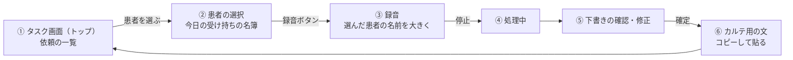
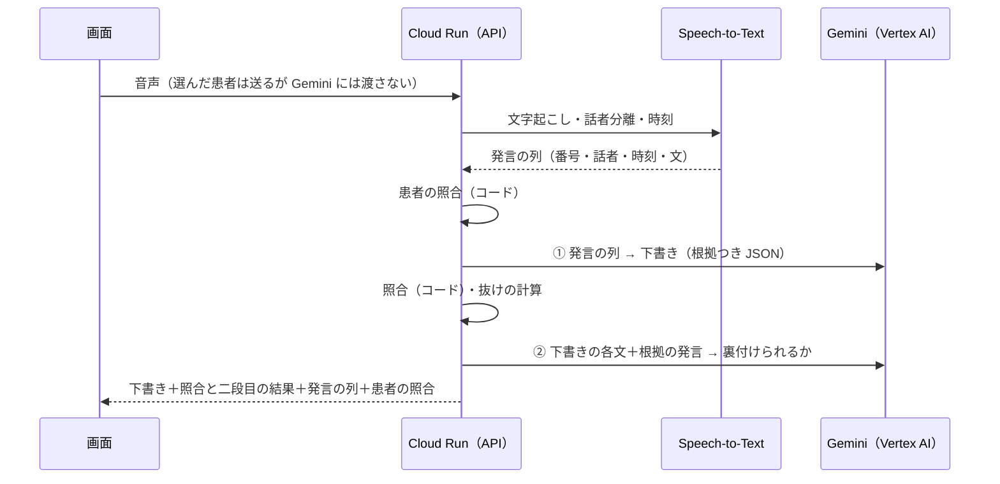

# 設計の叩き台（11/7 21:00 の打ち合わせ用）

11/7 21:00 の打ち合わせで直して決めるための案として書いた。**【未決】** の付いた所は決まったら【決定】に書き換える。

**11/7 の打ち合わせ後の注意**：保存先は Firestore に決まった（記録とタスクを保存し、会話の全文と音声は保存しない）。API と Firestore の形は [データの形](data-model.md)、守らせる決まりは [決まりの一覧](rules.md) が正で、この文書と食い違ったら rules.md → data-model.md の順に優先する。非機能要件は [nonfunctional.md](nonfunctional.md)。

- 何を作るか・なぜ作るか：[ADR-0006](../adr/0006-theme-nursing-record.md)
- 審査で何が見られるか：[審査基準との対応](../submission/judging-map.md)
- 具体的な使い方の例：[利用シーン](scenarios.md)（受け入れテストを兼ねる）
- この叩き台への批判と、直した点：[批判の記録](review-log.md)（**第3版**：3回の批判を反映）

## 1. なぜ作るか・何をもって成功とするか

- **困りごと**（[ヒアリング記録](../research/hearing.md)）：看護師は、聞いたこととバイタルを一度メモし、後でパソコンに入力し直している。その場で残せないと発言を忘れる。患者からの依頼は他の業務に埋もれる
- **成功の目安**：数値はすべて**仮置き**（根拠になる過去の測定がないため。技術検証と 11/8 の通しの結果で見直す）
  - **判断する日**：**11/9 20:00**（仮置き）。提出（11/10 19:00）までに直せる最後の時刻として置いた。【未決】誰が判断するか
  - 測り方は下の表の「測り方」。時間は [9章](#9-計測用の操作記録) の4つの時刻（録音開始・録音停止・下書き表示・確定）から出す

| 指標 | 測り方 | 続ける | 直す | やめる（方針を変える） |
|---|---|---|---|---|
| ① 録音を始めてから確定するまでの全体の時間 | 評価用に取り置いた台本で、3人がそれぞれ「手で書く」と「アプリ」を1回ずつ、**順番を人ごとに入れ替えて**測る（慣れの影響を減らすため）。この条件の限りの数字として出す | 3人中2人以上で、アプリが手で書くより短い | アプリの方が長い人が2人以上いるが、手で書く時間の1.5倍未満。時刻の記録から、処理中の待ちと確認の手間のどちらが長いかを見て直す | 3人とも手で書く時間の1.5倍以上。音声での入力をデモの中心から外し、テキスト入力と確認の画面に絞る |
| ② わざと壊した下書きを止める | **本番の照合（コード）で止めるべき種類**をすべて試す。コードで止められない種類は、二段目の確認と画面の全文表示で扱うと明記する（[批判の記録](review-log.md) 2回目の1） | コードで止めるべき種類を 100% 止める | 1種類でも通る。提出前に照合を直す（ここは「やめる」がない。止められない種類は限界として資料に書く） | — |
| ③ 利用シーンの依頼がタスクに出る | [利用シーン](scenarios.md) の場面1〜5を live で1回ずつ通す | 期待する依頼がすべて出て、依頼でないもの（答え終わった質問など）が出ない | 漏れか余計なものが1件以上。プロンプトか照合を直してもう一度通す | 直しても半分以上の場面で漏れる。依頼の取り出しはデモで「下書きの候補」と言い換え、確定前に人が足す前提にする |

## 2. 守ること（ADR-0001 より）

1. AI の出力は「下書き」。看護師が確定するまで記録にしない
2. 下書きの各文・各項目に、元の会話のどこから来たか（根拠）を付ける。根拠の文字に加え、元の音声も聞き直せるようにする
3. 根拠があっても「裏付け済み」とは表示しない。照合か二段目の確認で引っかかった文は目立たせ、看護師が1文ずつ「残す／消す」を選ぶまで確定できない
4. 診断、医療的な判断、依頼の優先順位、**薬の名前・量**は AI に書かせない。**コードでも薬の語を探し**、見つかったら「手で入力が必要」に回す
5. 患者は名簿から選ぶ。声で言った部屋番号・名前は、**コードで**名簿と照合する（Gemini は通さない）。選んだ患者は Gemini に渡さない（答えに写されるのを防ぐため）

## 3. 最小版（11/8 夜までに動かす範囲）

| 最小版（11/8） | 11/9 に回す | 今回はやらない |
|---|---|---|
| 名簿から選ぶ → 録音 → 下書き → 確認・修正 → 確定 → カルテ用の文 | 根拠の発言の**区間だけ**を再生（最小版は音声の全体を再生し、発言の開始時刻を表示） | 電子カルテとの連携 |
| 照合（コード）と二段目の確認（Gemini） | 話者の入れ替えの画面 | SOAP 以外の書式 |
| 照合で引っかかった文を目立たせ、1文ずつ残す／消す | 全文の色分け（使った／使わなかった発言） | 音声の長期保存 |
| 会話の全文の表示 | 医師への確認事項、SOAP で分ける | 文字起こしを2通りで行う |
| 抜け（コードで計算）、依頼をタスク画面に（確定した記録とタスクは Firestore） | 操作記録の残りの項目 | 会話の全文の保存 |
| 操作記録は4つの時刻だけ | 温度を上げて回す合格率の計測 | |
| モック／本番の印、合言葉 | | |

**【未決・提案】最小版は「文字起こし済みのテキストを入れる」形で先に通す**。音声（Speech-to-Text、話者分離、1分を超える音声）は 11/8 午前の技術検証の結果を見て足す。3回目の批判で、音声まで最小版に入れると 11/8 夜に間に合わない恐れが高いとされたため。デモ動画は音声で撮りたいので、11/9 までに音声を足すことを目標にする。

二段目の確認を最小版に入れるのは、差別化の中心（AI が補った部分を目立たせる）が、コードの照合だけでは成り立たないため（[批判の記録](review-log.md) 2回目の3）。画面の手間は増えず、バックエンドの呼び出しが1回増えるだけ。

## 4. 画面の流れ



| 画面 | 出すもの | 操作 |
|---|---|---|
| ① タスク画面 | 患者からの依頼の一覧（患者、内容、手がかり、元の会話）。**並びは発言の順で、AI の順位付けではない**と画面に書く | 依頼を「済み」にする。患者を選んで録音へ |
| ② 患者の選択 | 今日の受け持ちの名簿（デモは架空）。部屋・床番号・名前（かな付き） | 1人をタップ |
| ③ 録音 | **選んだ患者の名前を大きく**（隣の行を押した誤りに気づくため）、経過時間、停止 | 停止 |
| ⑤ 下書きの確認 | 上から：**患者の照合**、バイタル（言い直しがあれば注意）、自由記述、抜け、依頼、手で入力が必要なもの、会話の全文 | 文や値をタップすると根拠の発言と音声が出る。直すと照合をやり直す（8章 `/api/verify`）。引っかかった文は1文ずつ残す／消す。抜けは確定の直前に画面で計算し直す |
| ⑥ カルテ用の文 | **先頭に患者の氏名・部屋・日時**を入れた確定の文 | コピー |

**患者の照合の見せ方**：

| 結果 | 画面 |
|---|---|
| 部屋も名前も一致 | 緑で「照合済み」 |
| どちらかが照合できず（言っていない） | 黄色で選んだ患者の名前を大きく出し、「この患者で合っていますか」と確認させる |
| 食い違い（別の部屋番号、名簿の別の患者の名前） | **赤で止める**。選び直すか、「この患者で正しい」と確認するまで確定できない。**理由の入力は要らない**（確認だけで確定でき、記録に「照合で食い違いあり→看護師が確認」と残す。[rules.md](rules.md) S-03・S-04） |

- 音声は確定か破棄まで**ブラウザのメモリにだけ**置く。サーバーは処理が終わったら捨て、保存しない（P-01）
- 確定した記録とタスクは **Firestore**（`asia-northeast1`）に保存し、TTL で**作った日の翌日0時以降に消す**（患者名を含むため。P-03）。会話の全文は保存せず、記録に残った要素の根拠になった発言だけを一緒に残す（P-02）。形は [データの形](data-model.md) 4章
- 【未決】スマホ前提か PC 前提か（看護師の端末を確認中）

## 5. 処理の流れ



- 発言の区切りと番号は Speech-to-Text とサーバーが作る（Gemini に作らせると照合が循環するため）
- 話者の割り当て：最初に話した人を看護師とする案。**話者分離が使えない・外れたときは話者を「不明」にし、話者の照合を外して画面に「話者は未確認」と出す**
- 文字起こしがうまくいかないときの逃げ道：文字起こし済みのテキストを貼って入力する（画面に「音声なし」と出す）
- 発言の列も確定・破棄の後に消す
- **【要検証】音声の長さ**：Speech-to-Text の同期の認識は約1分までとされる。実際の会話は1分を超えそう。長い音声を扱う方法（区切って送る、非同期の認識）を技術検証で決める。非同期で Cloud Storage を通す場合は、処理後すぐ消す
- **【要検証】区間の再生**：ブラウザの録音（webm）は途中の時刻へ飛べないことがある。駄目なら全体の再生だけにする
- 【未決】リージョン。東京（`asia-northeast1`）で使えれば東京

### 照合の規則（コードで行う。AI を鵜呑みにしない仕組み）

| 対象 | 確かめること |
|---|---|
| 全要素 | 根拠の番号が実在し、**3発言まで** |
| バイタル | 項目の言葉（体温・血圧・脈・酸素・呼吸・血糖）がある発言から、**その項目の数をコードで取り出し**、AI の値と比べる。血圧は上と下を順番どおりに比べる。**同じ項目が2つあれば止める**。候補は**会話全体から発言の順に集め**、AI の値が**最新の値**でなければ止める（言い直しが別の発言にあっても、根拠の並べ方を変えても古い値は通らない）。「昨日は」「前回」などを含む文の値は今の値の候補から外す。会話に値が複数あれば必ず注意を出し、看護師に選ばせる |
| 数の読み替え | 全角、漢数字（三十六点八、千二百）、「36度8分」「36・8」を直してから比べる。「もう一度2分」は小数にしない |
| 自由記述・依頼・医師への確認 | 文の中の数がすべて根拠の発言にある。例外は尺度だけ：根拠の直前が看護師の「10段階で」の質問なら、「/10」「10段階中」の形に限って 10 を使える（「4/10」は通り、「10/10」は止まる） |
| 話者 | 患者の訴えの文の根拠は患者の発言、看護師の観察の文は看護師の発言。依頼の根拠には患者の発言が要る。話者が不明なら外す |
| 手がかり | 種類は「時間指定」「患者が急ぎと言った」の2つだけ。至急・優先などの語があれば止める |
| 薬 | 薬・内服・インスリンなどの語、錠・単位・mg などの単位がどこかにあれば止め、「手で入力が必要」に回す |
| 抜け | **照合に通ったバイタルだけ**から計算する。確定の直前に画面でも計算し直す |

**コードの照合では止まらないもの**と、その扱い：

| 止まらないもの | 扱い |
|---|---|
| 数を含まない推測（「脱水傾向あり」） | 二段目の確認 |
| 否定の取り違え（「腫れてない」→「腫れあり」） | 二段目の確認 |
| 無関係な発言を根拠にする（雑談の「3年生」の3を借りる） | 二段目の確認 |
| 雑談を記録に書く、雑談に埋もれた症状を落とす、答え終わった質問を依頼にする | 会話の全文を出し、人が見る。受け入れテストでは期待値と比べて確かめる |

**二段目の確認は「明示的に supported と判定された文だけ」を通す**。判定が返らなかった文、件数が合わないとき、呼び出しが失敗したときは、すべて「判断できない」として目立たせる（黙って通さない）。対象は自由記述・依頼・手がかり・医師への確認の全部。尺度の質問（「10段階で」）は文脈として二段目にも渡す。

二段目の確認でも見逃しはあり得る。画面では、引っかからなかった文にも「根拠の発言で確かめてください」と出す。

**実装しながら直す既知の穴**（[批判の記録](review-log.md) 3回目の4〜8）：手がかり「患者が急ぎと言った」の根拠が患者の発言か、薬の語の一覧が狭い、名簿の別の患者の名前の扱い、現場の言い方（サット・心拍数・「上が132で下が78」）、照合の結果を文字列でなく場所つきの構造で返す。

## 6. 出力の形（Gemini に返させる JSON）

```json
{
  "vitals": [{"item": "体温", "value": "36.8", "evidence": ["u7"]}],
  "narrative": [
    {"text": "夜間に創部痛あり、あまり眠れなかったとの訴え。", "source": "patient", "evidence": ["u9"]}
  ],
  "requests": [
    {"text": "着替えたい", "cue": null, "evidence": ["u8"]},
    {"text": "昼食が来たらすぐ食べたい", "cue": {"kind": "時間指定", "text": "昼食前", "evidence": ["u6"]}, "evidence": ["u6"]}
  ],
  "manual_needed": [{"text": "薬の話あり", "evidence": ["u7"]}],
  "doctor_questions": [{"text": "食事の開始時期", "evidence": ["u13", "u14"]}]
}
```

- 患者・抜けは Gemini に返させない（コードで決める）
- `item` は決まった一覧（体温、血圧、脈拍、呼吸数、SpO2、血糖）から選ばせる
- 二段目の確認の出力：文ごとに `supported`（言える）／`not_supported`（言えない）／`unclear`（分からない）と理由
- 【未決】自由記述を SOAP で分けるか（看護師の回答待ち）

## 7. 記録の項目

項目はコードの1か所の定数にする（`spike/draft_schema.py` の `VitalItem` と `REQUIRED`）。

| 種類 | 項目 |
|---|---|
| 必須のバイタル | 体温、血圧、脈拍、呼吸数、SpO2 |
| あれば記録 | 血糖 |
| 観察（自由記述で書く） | 痛み（部位・程度）、食事量、排泄、睡眠 |

**バイタルを声に出さない場合の逃げ道**：バイタルは画面で入れてもらい、AI は会話との食い違いだけを指摘する形に切り替える（看護師に確認中）。

## 8. API と安全対策

| メソッド | パス | 中身 |
|---|---|---|
| POST | `/api/drafts` | 音声（または文字起こし済みテキスト）と選んだ患者を受け取り、発言の列・下書き・照合と二段目の結果・患者の照合を返す |
| POST | `/api/verify` | 下書きと発言の列を受け取り、照合だけをやり直す（保存しない）。看護師が直したとき、話者を入れ替えたときに呼ぶ |

名簿（`GET /api/patients`）、確定（`POST /api/records`）、タスク（`GET /api/tasks`・`PATCH /api/tasks/{id}`）を含む API の全体と形は [データの形](data-model.md) 3章が正（ここと食い違ったら data-model.md、さらに rules.md を優先する）。

- **保存するのは確定した記録とタスクだけ**（Firestore、翌日0時以降に TTL で消す）。名簿も Firestore に置く。下書き・音声・会話の全文は保存しない。画面は Firestore に直接触れず、すべて API を通す（SEC-02）
- **費用の事故を防ぐ**：Cloud Run の最大インスタンス数を1にし、予算アラートを設定する（アラートは通知だけで、止めはしない）。1日の回数上限はインスタンスのメモリで数える（再起動で0に戻るが、最大1台なので大きくずれない）
- 応答時間・同時利用・可用性・失敗の扱い・費用・データの置き場所は [非機能要件](nonfunctional.md) にまとめた
- **合言葉**：画面のコードに埋め込まず、利用者が入力する。審査員向けに提出資料に書く。**11/14 まで審査員が止められない上限**にする
- **モック／本番の印**：画面の隅に常に出す（デモでモックのまま映すと偽装と見なされるため）
- **モックモード**：Gemini を呼ばずに利用シーンの決まった JSON を返す。Bさんは GCP がなくても画面を作れる

## 9. 計測用の操作記録

最小版は4つの時刻だけ（録音開始、録音停止、下書き表示、確定）。11/9 に残りを足す。記録は **Cloud Logging に構造化ログとして出す**（保存の仕組みが要らない）。会話の文は送らない。

| 記録すること（11/9） | 何に使うか |
|---|---|
| 下書きの文のうち、直した数・消した数・そのまま残した数 | AI の下書きがどれだけ使えたか |
| 引っかかった文の数と、そのうち消された数・**残された数** | 根拠表示が誤りを止めたか。残された数が多ければ誤った警告が多い |
| 患者の照合で止まった・確認させた回数 | 取り違えの防止が働いたか |
| 根拠をタップした回数 | 看護師が実際に根拠を見るか |

## 10. 技術構成（[ADR-0003](../adr/0003-runtime-and-stack.md)）

- 実行：Cloud Run（画面と API を1つのコンテナで配信、東京、最大1インスタンス）
- バックエンド：Python + FastAPI。Gemini は Vertex AI 経由（[ADR-0002](../adr/0002-gemini-via-vertex-ai.md)）、構造化出力。モデルは `gemini-3.5-flash` を `global` で使う（11/8 決定。予定の gemini-2.5-flash が 2026-10-20 に廃止されたため。[ADR-0004](../adr/0004-model.md)）
- 保存：Firestore（`asia-northeast1`）。確定した記録とタスクだけ、TTL で翌日0時以降に消す
- 文字起こし：Speech-to-Text（話者分離・時刻つき）
- 画面：HTML・CSS・素の JavaScript（Bさんが慣れた技術）。録音は MediaRecorder

**11/8 午前までの技術検証**（[spike/](../../spike/README.md)）：

1. テキストの会話 → 下書き → 照合 → 二段目（コードは用意済み。費用の承認後に実行）
2. **90秒の録音** → Speech-to-Text → 発言の列（番号・話者・時刻）→ ブラウザでその区間を再生（コードはまだない）

## 11. 打ち合わせで決めること（順番）

1. **役割分担**（最初に決める）
2. 最小版の範囲（3章）。**テキスト入力で先に通し、音声は後から足すか**
3. 患者を名簿から選ぶ形（ADR-0006 の「声で患者を指定」からの変更）
4. 画面の流れ（4章）。スマホか PC か
5. 出力の形（6章）と API（8章）
6. 技術構成（10章）
