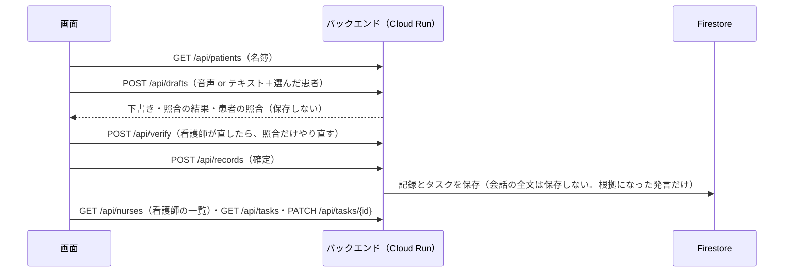

# データの形（API と Firestore）

画面（Bさん）とバックエンド（Cさん）のつなぎ目。**ここを変えるときは、必ず末尾の変更履歴に書いて Discord で知らせる**。画面はまず `backend/mock/` の JSON で作り、バックエンドができたら差し替える。

設計の本体は [README.md](README.md)、守らせる決まりは [rules.md](rules.md)（食い違ったら rules.md が優先）。11/7 の打ち合わせで決まったこと：

- 保存先は **Firestore**（東京リージョン）
- 記録は **SOAP**。AI が書くのは **S（患者の訴え）と O（観察・測定）だけ**。A（アセスメント）と P（計画）は看護師が書く欄として空で渡す（[ヒアリング記録](../research/hearing.md)：記録は SOAP で書いている）
- タスク画面は**パッと見てわかるよう、緊急度で3段に分ける**。緊急度は AI が判断せず、会話の手がかりでコードが振り分け、看護師が1タップで変えられる
- バイタルは、会話から拾った値に加えて**画面で手入力**もできる（術後はモニターで見て、値を声に出さないことがあるため）

## 1. 全体の流れ



- **画面は Firestore に直接つながない**。読み書きはすべてバックエンドの API を通す。理由：画面に Firebase の設定や認証を持たずに済む／提出後は設定を変えられないので、止まる要素を減らす／保存の規則（会話の全文を残さない等）をサーバー側で守れる
- **音声と、会話の文（発言の列）の全体は保存しない**（P-01・P-02）。確定した記録とタスクだけを保存し、記録には、確定した記録に残った要素の根拠になった発言の文だけを一緒に残す

## 2. 共通の約束

| 項目 | 約束 |
|---|---|
| 形式 | JSON（音声のアップロードだけ multipart） |
| 文字 | UTF-8 |
| 日時 | ISO 8601、日本時間（例 `2026-11-08T09:15:00+09:00`） |
| 合言葉 | すべての API で、ヘッダー `X-Passcode` に入れる。違えば `401` |
| モード | すべての応答に `"mode": "mock"` か `"live"` を入れる。画面の隅に常に出す |
| エラー | `{"mode": "...", "error": {"code": "...", "message": "..."}}`。`message` は画面にそのまま出せる日本語。主な状態コード：400 録音の同意の確認がない、401 合言葉、404 患者・タスクがない、409 確定できない、413 入力が大きすぎる（`body_too_large` JSON の本文が1MB 超、`audio_too_large` 録音が10MB 超、`too_many_utterances` 発言が201個以上、ほか `audio_too_long`・`transcript_too_long`）、422 入力の形・件数の上限（`invalid_request`）・読めない音声（`audio_unreadable`）、429 1日の上限（`daily_limit` 全体300回、`client_daily_limit` 接続元の IP ごと30回）、500 思わぬ失敗（中身は出さない）、502 Gemini・文字起こしの失敗（モックに切り替えない） |
| 動作確認 | `GET /api/health`（合言葉なし）→ `{"mode": "...", "status": "ok"}`。`/docs`・`/redoc`・`/openapi.json` は閉じている（404） |
| 入力の上限 | 超えたら `422`。根拠の発言は重複を除いて3件、発言の列は200個、各文・各発言は5,000字、`soap.S`・`soap.O` は50文ずつ、バイタル・依頼・手で入力が必要・医師への確認は30件ずつ、id は英数字・`_`・`-` の40字まで（`backend/app/models/limits.py`） |

## 3. API

### GET `/api/patients` 名簿

```json
{
  "mode": "mock",
  "patients": [
    {"id": "p302", "room": "302", "bed": "A", "name": "田中", "kana": "たなか", "full_name": "田中 一郎", "full_kana": "たなか いちろう", "ward": "東3病棟", "assigned_to": "n01"}
  ]
}
```

`assigned_to` は基本の受け持ちの看護師の id（S-08、`GET /api/nurses` の1人）。タスクの担当の初めの値になる。`PATCH /api/patients/{id}` で変えられるので、名簿は保存先の今の値を返す。

**患者の情報はアプリで持ち続けない方針**：名簿の持ち主は電子カルテで、本番では電子カルテから読む（読み方は未決）。今のデモは架空の名簿を起動時に入れているだけ。

### PATCH `/api/patients/{id}` 受け持ちを変える

その日の受け持ちの入れ替え（S-08）。

```json
// 入力
{"assigned_to": "n04", "reported_by": "n02"}
// 出力
{"mode": "mock", "patient": {"id": "p305", "...": "...", "assigned_to": "n04"}, "tasks_moved": ["t_demo2", "t_demo3"]}
```

- 担当を人が変えていない（`assigned_set_by` が `rule`）未完了・期限内のタスクも、新しい受け持ちに移す（`tasks_moved`）。移したタスクの `assigned_set_by` は `rule` のまま。看護師が回した・引き取ったタスクと、済みのタスクは動かさない
- `assigned_to` が看護師の一覧にない id なら `422`（`unknown_nurse`）、名簿にない患者なら `404`。担当を外す（`null`）ことはできない
- 任意の `reported_by` は、画面で選んだ「自分」（自己申告、本人の確かめはない）。名簿の `assigned_reported_by` に残す。一覧にない id なら `422`。送らなければ `null`
- 操作記録（`patient_assignee_changed`）には、新しい受け持ち・申告した人・移したタスクの数だけを出す（患者名は出さない）

`name`・`kana` は名字とその読みで、会話の照合（S-02）に使う（「田中さん」と呼ぶため）。画面とカルテ用の文には `full_name`（フルネーム）を出す。`full_name` はタスク（`GET /api/tasks`）と記録（`GET /api/records`）にも入る。

### GET `/api/nurses` 看護師の一覧

タスクの担当に選べる看護師（S-08）。デモは架空の4人で、起動時に `backend/seed/nurses.json` から読む（P-07。Firestore には入れない）。

```json
{"mode": "mock", "nurses": [{"id": "n01", "name": "青木 美咲", "kana": "あおき みさき"}]}
```

### POST `/api/drafts` 下書きを作る

入力は2通り。

- 音声：`multipart/form-data` で `patient_id`・`audio`（webm/opus・mp4/AAC・m4a など）・`consent_confirmed`（`true`。録音の前に患者の同意を確かめた印。なければ `400`、O-01）・`duration_seconds`（録音の秒数。あれば受け取る前に長さを確かめる）
- 音声の扱い（サーバー）：受け取った音声を ffmpeg で 16kHz モノラルに読み、55秒ずつ・前の区切りの最後の5秒を重ねて区切り、FLAC にして同期の認識（Speech-to-Text V2・`chirp_3`・`us`）に並べてかける。区切りをまたいだ話者は、重なった所の同じ言葉で対応づける。時刻（`start`・`end`）は録音の頭からの通しの秒。音声は保存しない（読むときの一時ファイルはすぐ消す、P-01）。読めない音声は `422`（`audio_unreadable`）
- 話者（`speaker`）：最初に話した人を `nurse`、次を `patient`、3人目以降と決められないときは `unknown`。患者の側が部屋番号・敬称つきの名前・バイタルの数を多く言っていれば入れ替える。それでも違うときは、画面で看護師と患者を入れ替えた発言の列を `POST /api/verify` に送り直す（照合はその話者でやり直される）
- テキスト（逃げ道・テスト用）：JSON `{"patient_id": "p302", "transcript": "看護師: …\n患者: …"}`。1行1発言、`看護師:` `患者:` で始める（無ければ話者は不明）
- 最初に話す人（任意）：音声・テキストの両方に `first_speaker`（`nurse`／`patient`／`auto`、既定は `auto`）を付けられる。録音の前に画面で選ぶもの。**Gemini に下書きを作らせる前に**話者を合わせる（確認画面で後から入れ替えても、S と O の振り分けや依頼の拾い方は作り直されないため）。音声は、最初に看護師か患者に決まった発言が指定と逆なら、看護師と患者を全部入れ替える（不明はそのまま）。テキストは、行の頭に「看護師:」「患者:」があればそれに従い、どの行にもなければ指定した人から交互に話したとみなす。`auto` は今までどおり（音声はサーバーが推定）。nurse・patient・auto 以外は `422`
- 大きさの上限（SEC-04）：音声は3分・10MB、テキストは5,000文字。超えたら `413`。音声の長さは、サーバーが読んだ実際の長さで、認識を呼ぶ前に確かめる
- 1日の上限（C-04）で数える回数：テキストは2回、音声は2回＋区切りの数（1分までは2〜3回、3分で4回）

出力（[mock/draft_s1.json](../../backend/mock/draft_s1.json) が完全な例）：

```json
{
  "mode": "mock",
  "patient": {"id": "p302", "room": "302", "bed": "A", "name": "田中", "kana": "たなか", "full_name": "田中 一郎", "full_kana": "たなか いちろう"},
  "patient_match": {"room": "一致", "name": "一致", "others": [], "level": "ok", "reasons": []},
  "input": "audio",
  "utterances": [
    {"id": "u1", "speaker": "nurse", "start": 0.0, "end": 3.1, "text": "302号室の田中さん、…"}
  ],
  "draft": {
    "vitals": [{"item": "体温", "value": "36.8", "evidence": ["u7"], "source": "conversation"}],
    "soap": {
      "S": [{"text": "夜間に創部痛あり…", "evidence": ["u9", "u11"]}],
      "O": [{"text": "創部に発赤・腫脹なし。", "evidence": ["u12"]}],
      "A": "",
      "P": ""
    },
    "requests": [
      {"text": "タオルをもう1枚", "urgency": "none", "cue": null, "evidence": ["u15"]}
    ],
    "manual_needed": [],
    "doctor_questions": [{"text": "食事の開始時期", "evidence": ["u13", "u14"]}]
  },
  "checks": [
    {"path": "vitals[0]", "level": "warn", "code": "multiple_values", "message": "会話に値が複数ある（36.8 → 36.6）。看護師が選ぶ"}
  ],
  "missing": ["呼吸数", "SpO2"],
  "entail_seals": [
    {"path": "soap.S[0]", "verdict": "supported", "reason": "…", "sig": "…"}
  ]
}
```

| 欄 | 中身 |
|---|---|
| `patient_match.level` | `ok`（緑：一致）／`confirm`（黄：照合できず＝部屋番号か名前を言っていない、または名簿にない部屋番号が聞こえた＝聞き違いの可能性）／`stop`（赤：食い違い＝名簿のほかの患者の部屋番号、名簿の別の患者の名前。雑談に出ただけでも赤）。黄・赤は看護師の確認1回で確定できる（S-02〜S-04）。決め方の表は `backend/app/checks/patient_match.py` |
| `patient_match.reasons` | `level` が `ok` でない理由（画面にそのまま出せる日本語の文の並び） |
| `utterances` | 会話の全文。`speaker` は `nurse` / `patient` / `unknown`。テキスト入力では `start`・`end` は `null` |
| `draft.vitals[].source` | `conversation`（会話から）／`manual`（看護師が手で入れた） |
| `draft.soap.S` / `O` | AI の下書き。各文に根拠の発言番号 |
| `draft.soap.A` / `P` | 常に空。看護師が書く |
| `draft.requests[].urgency` | `said_urgent`（患者が急ぎと言った）／`timed`（時間指定あり）／`none`。**AI ではなくコードが `cue` から決める**。画面の3段に対応 |
| `draft.requests[].cue` | `{"kind": "時間指定", "text": "昼食前", "evidence": [...]}` か `null` |
| `draft.requests[].category` / `role` | 依頼のラベル（A-13）。`category` は中身の種類（物品・食事・排泄・移動・付き添い・清潔・着替え・体調・痛みの訴え・医師への確認・その他）、`role` は誰が対応するか（職種：看護師・看護助手・医師・その他。人ではない）。AI が一覧から選ぶ。**仕分けのためで、優先度ではない**（緊急度は `urgency`）。どちらも仮置きの一覧で、送らなければ「その他」 |
| `draft.manual_needed` | 薬の話など、看護師が手で書くもの。AI は中身を書かない |
| `added_by` | S・O の文、`requests[]`、`doctor_questions[]`、`manual_needed[]` の各要素に付く。`ai`（既定）／`nurse`（看護師が足した要素、A-12）。nurse の要素は AI 向けの照合（根拠の数・話者・数・薬の語・優先度の語）と二段目をかけず、Gemini も呼ばない。根拠は任意で、付けるなら会話にある発言番号だけ（ない番号は `422` の `unknown_evidence`）。看護師が足した依頼の緊急度は、送った `urgency` をそのまま使う |
| `checks` | 照合と二段目の確認の結果。`path` で下書きのどこかを指す（例 `soap.S[0]`、`requests[1].cue`、`vitals[2]`）。`level` は `stop`（根拠なし：1件ずつ残す／消すを選ぶまで確定できない）か `warn`（注意） |
| `missing` | 必須のバイタルのうち、照合に通った値がない項目。確定の直前に画面でも計算し直す |
| `entail_seals` | 二段目の判定1件ごとの結果とサーバーの署名（`sig`）。**画面は中身を読まず、受け取ったまま `/api/records` に送り返す**。署名は文の中身と根拠の発言に結びついているので、文を直すと合わなくなる（A-04・A-05） |
| `draft_token` | AI が書いた要素の指紋（文のハッシュ）へのサーバーの署名。**画面は中身を読まず、受け取ったまま `/api/records` に送り返す**。確定のとき、`added_by: "nurse"` なのに下書きにあった文は AI の要素として照合する（A-12。看護師が足したと偽って照合を逃れられないように） |

`checks[].code` の一覧：

| code | level | 意味 |
|---|---|---|
| `no_evidence` | stop | 根拠がない。Gemini が根拠を4件以上付けた文も、根拠を空にしてこれで止める |
| `unknown_evidence` | stop | 存在しない発言番号 |
| `value_mismatch` | stop | 値が根拠の発言の値と違う／最新の値でない |
| `number_not_in_evidence` | stop | 文の中の数が根拠の発言にない |
| `speaker_mismatch` | stop | 患者の訴えの文に看護師の発言など |
| `medication` | stop | 薬の名前・量 → 手で入力が必要へ |
| `priority_word` | stop | 手がかりに至急・優先などの語 |
| `duplicate_item` | stop | 同じバイタルが2つ |
| `entail_not_supported` | stop | 二段目：根拠の発言だけからは言えない |
| `entail_unclear` | stop | 二段目：判断できない・判定が返らない・失敗 |
| `multiple_values` | warn | 会話に同じ項目の値が複数ある |

### POST `/api/verify` 照合だけやり直す

看護師が下書きを直したとき、手でバイタルを入れたときに呼ぶ。状態を持たない。

```json
// 入力
{"utterances": [...], "draft": {...}, "entail": true}
// 出力
{"mode": "mock", "checks": [...], "missing": [...], "entail_seals": [...]}
```

- `entail: true` なら、直した文に二段目の確認もかけ直す（Gemini を1回呼ぶ）。`false` ならコードの照合だけで、`entail_seals` は空（画面は前に受け取った分を使い続ける）
- `source: "manual"` のバイタルは会話との照合をしない（根拠は「看護師の手入力」）

### POST `/api/records` 確定する

```json
// 入力
{
  "confirm_id": "c_7f3a9e",
  "patient_id": "p302",
  "patient_confirmed": true,
  "utterances": [...],
  "draft": {...},
  "entail_seals": [...],
  "draft_token": "…",
  "decisions": [{"path": "soap.S[1]", "action": "delete"}],
  "timing": {"recording_started": "...", "recording_stopped": "...", "draft_shown": "...", "confirmed": "..."},
  "ui_counts": {"edited": 2, "evidence_taps": 5}
}
// 出力
{
  "mode": "mock",
  "record_id": "r_p302_c_7f3a9e",
  "chart_text": "【302号室A 田中様】2026-11-08 09:15\nT 36.8℃ BP 132/78 P 76\nS) 夜間に創部痛あり…\nO) 創部に発赤・腫脹なし。\nA) \nP) ",
  "tasks_created": ["t_..."]
}
```

- `confirm_id`（必須）は、**確定の操作ごとに画面が作る id**（英数字・`_`・`-` の40字まで）。`record_id` は `r_{patient_id}_{confirm_id}`、タスクの id は `t_{patient_id}_{confirm_id}_{連番}`。**同じ `confirm_id` で送り直すと上書きになり、その記録から作った前のタスクは消える**（通信の失敗で送り直しても二重にならないように）。別の確定には必ず新しい id を作る
- `utterances` は `/api/drafts` で受け取ったもの、`entail_seals` は最後に受け取ったもの（`/api/drafts` か、`entail: true` の `/api/verify`）を、受け取ったまま送る。`utterances` は照合のやり直しと、根拠になった発言の保存（P-02）にだけ使う
- サーバーはコードの照合を `utterances` でやり直す。二段目の結果は、**署名で裏付けられたものだけ**を使う。署名が合わない文（直した文、`entail_seals` を送らなかった文）は、確定のときに二段目を呼び直す（A-04・A-05 をサーバーで強制）。呼び直しは live で1回分を数え、1日の上限に達していたら「判断できない」で止める（確定の API そのものは 429 にしない）
- `draft_token` は `/api/drafts` で受け取ったものを、受け取ったまま送る（`/api/verify` は新しい token を返さない）。ない・署名が合わない（サーバーの再起動で鍵が変わった場合を含む）ときは、看護師が足した要素もすべて AI の要素として照合する（根拠がなければ `no_evidence` で止まり、看護師が「残す」を選べば確定できる）
- 看護師が足した要素（`added_by: "nurse"`）は照合で止まらず、記録にも `added_by: "nurse"` のまま残る（`kept_after_check` の「AI が補った文を看護師が認めた」とは別）。その依頼のタスクは `urgency_set_by: "nurse"`。根拠に選んだ発言は `evidence_utterances` とタスクの `patient_words` に入る。確定のログに足した数（`nurse_added`）と、AI の要素に戻した数（`relabelled_as_ai`）を出す
- `level: stop` の `checks` が残っていて、`decisions` で残す／消すが決まっていないものがあれば `409`（`undecided_checks`）
- `patient_match.level` が `ok` でない（`confirm` か `stop`）ときは、`patient_confirmed: true` が要る。なければ `409`（`patient_not_confirmed`）
- `chart_text` は「患者・日時 → バイタル（T・BP・P・R・SpO2、血糖はあれば最後）→ S) → O) → A) → P)」の順（R-01）。手で入力が必要なもの・看護師が残した根拠のない文の印は出さない（A-06）
- 記録のデータには、止まったのに「残す」を選んだ要素（`kept_after_check`、A-06）と、患者の照合を看護師が確かめたこと（`patient_check`、S-04）を残す
- `decisions[].action` は `keep`（根拠なしでも残す）か `delete`
- `timing` は計測用。Cloud Logging に出すだけで Firestore には入れない。受けるのは4項目だけ（他の項目は捨てる）で、値は ISO 8601 の時刻（形が違えば `422`）
- `ui_counts`（任意）は、画面でしか分からない数を計測用に送るもの（設計 9章）。受け付けるキーは `edited`（看護師が直した文の数）と `evidence_taps`（根拠をタップした回数）だけで、値は0以上 100,000 以下の整数（小数・文字列・ほかのキーは `422`）。送らなかったキーは `null` としてログに出る。`timing` と同じく Cloud Logging に出すだけで、Firestore には入れない
- `reported_by`（任意）は、確定した看護師として画面で選んだ「自分」（自己申告、S-08）。記録の `confirmed_reported_by` に残り、`GET /api/records/{id}` でも返る。本人の確かめはない。一覧にない id なら `422`。送らなければ `null`

### GET `/api/records?patient_id=p302` 保存した記録の一覧

`patient_id` は任意（なければ病棟の全員）。期限（翌日0時）を過ぎた記録は除くので、結果として当日分だけになる。並びは新しい順で、100件まで。

```json
{
  "mode": "mock",
  "records": [
    {
      "record_id": "r_p302_c_7f3a9e",
      "patient_id": "p302",
      "room": "302",
      "name": "田中",
      "created_at": "2026-11-08T09:15:12+09:00",
      "s_preview": "夜間に創部痛あり。",
      "o_preview": "創部に発赤・腫脹なし。",
      "request_count": 1
    }
  ]
}
```

- `s_preview`・`o_preview` は S・O の最初の文（60字まで）。なければ `null`
- Firestore の TTL は期限から削除まで最大で1日ほど遅れるので、読むときにも期限で除く（P-03。タスクと同じ）

### GET `/api/records/{record_id}` 保存した記録の全体

```json
{
  "mode": "mock",
  "record": {
    "record_id": "r_p302_c_7f3a9e",
    "patient_id": "p302", "room": "302", "name": "田中",
    "vitals": [...], "soap": {"S": [...], "O": [...], "A": "", "P": ""},
    "requests": [...], "manual_needed": [...], "doctor_questions": [...],
    "evidence_utterances": [{"id": "u9", "speaker": "patient", "text": "…"}],
    "kept_after_check": [{"path": "soap.S[1]", "codes": ["entail_not_supported"], "note": "看護師が確認して残した"}],
    "patient_check": {"level": "ok", "confirmed_by_nurse": false, "note": null},
    "created_at": "2026-11-08T09:15:12+09:00",
    "chart_text": "【302号室A 田中様】2026-11-08 09:15
..."
  }
}
```

- **会話の全文は返せない（保存していない、P-02）**。返すのは、確定した記録に残った要素の根拠になった発言（`evidence_utterances`）だけ。画面の「会話記録」はこれを出す
- `chart_text` は保存した記録から作り直したもの（確定のときの `chart_text` と同じ形、R-01）
- `record_id` の形は `r_` で始まる英数字・`_`・`-`（違えば `422`）。ない・期限切れなら `404`（`record_not_found`）
- 合言葉（`X-Passcode`）が要るのは、ほかの API と同じ

### GET `/api/tasks?status=open` タスク一覧

`status` は `open`（既定）／`done`／`all`。各件には `record_id`（元の記録）と `done_at` も入る。`assigned_to=n01` を付けると、その看護師が担当のタスクだけにする（S-08。一覧にない id なら空の一覧、形の誤った id は `422`）。

```json
{
  "mode": "mock",
  "tasks": [
    {
      "id": "t_001", "patient_id": "p305", "room": "305", "name": "佐藤",
      "text": "昼食が来たらすぐ食べたい",
      "patient_words": ["お昼ご飯が来たらすぐ食べたいんです"],
      "urgency": "timed", "urgency_set_by": "rule",
      "category": "食事", "role": "看護助手", "category_set_by": "ai", "role_set_by": "ai",
      "cue": {"kind": "時間指定", "text": "昼食前"},
      "status": "open",
      "assigned_to": "n02", "assigned_set_by": "rule",
      "created_at": "2026-11-08T11:40:00+09:00"
    }
  ]
}
```

並びは **緊急度（`said_urgent` → `timed` → `none`）→ 作った時刻の順**。画面は3段に分けて出す。

- `assigned_to` は担当の看護師の id（S-08）。確定から作るタスクも `POST /api/tasks` のタスクも、作ったときに**その患者の受け持ち**を写す。`assigned_set_by` は `rule`（受け持ちを写したまま）か `nurse`（看護師が `PATCH` で変えた）。前からあるタスクで欄がないものは `null`・`rule` で返す。ログインがないので、**誰が変えたか・確定したかは自己申告で残す**：画面で選んだ「自分」を `reported_by` で送り、タスク・名簿・記録に `*_reported_by` として残し、変更は操作記録にも出す。本人の確かめはなく、「誰がやったと言っているか」までしか言えない（証拠にはならない）。「自分」を選んでいなければ空（`null`）。合言葉を知っていれば誰でも誰の担当でも変えられる
- `category`・`role` は依頼のラベル（A-13、一覧は `draft.requests[].category` の欄）。`category_set_by`・`role_set_by` は `ai`（AI が付けた）か `nurse`（看護師が付けた・変えた）。看護師が足した依頼・直接作ったタスクは `nurse`。前からあるタスクでラベルがないものは「その他」・`ai` で返す

- `text` は AI がまとめた依頼の文。`patient_words` は、依頼（と手がかり）の根拠になった発言のうち、話者が `patient` か `unknown` の文を**発言の順に、そのまま**並べたもの（3件まで、各1,000字まで。なければ空の配列）。画面では `text` とは別に「患者の発言そのまま」として出す。AI のまとめを鵜呑みにせず、患者が実際に言ったことを確かめられるようにするため
- 保存するのは根拠になった発言だけなので、P-02 の範囲に収まる

### POST `/api/tasks` タスクを直接作る

AI が拾わなかった依頼などを、記録なしでタスクにする（A-12）。

```json
// 入力
{
  "patient_id": "p305",
  "text": "家族に電話してほしい",
  "urgency": "said_urgent",
  "cue": {"kind": "患者が急ぎと言った", "text": "今日中に"},
  "category": "その他",
  "role": "看護師",
  "patient_words": ["娘に今日中に電話したいの"]
}
// 出力（GET /api/tasks の1件と同じ形）
{"mode": "mock", "task": {"id": "t_manual_…", "record_id": null, "urgency_set_by": "nurse", ...}}
```

- `urgency`（既定 `none`）・`cue`・`patient_words` は任意。`text` は空白だけは不可（5,000字まで）、`cue.text` は100字まで、`patient_words` は3件・各1,000字まで（超えたら `422`）
- `patient_id` は名簿にいる患者だけ（いなければ `404`）。`record_id` は `null`、`urgency_set_by` は `nurse`、期限はほかのタスクと同じ翌日0時
- 担当（`assigned_to`）はその患者の**今の**受け持ち、`assigned_set_by` は `rule`（入力では受けない。変えるときは `PATCH`）
- AI を通さないので、照合も二段目もかけず、お金もかからない

### PATCH `/api/tasks/{id}` 済みにする・緊急度・ラベル・担当を変える

出力は `{"mode": "...", "task": {...}}`。`task` は `GET /api/tasks` の1件と同じ形（`patient_words` も入る）。

```json
{"status": "done"}
{"urgency": "said_urgent"}   // 看護師が段を変えた → urgency_set_by が "nurse" になる
{"role": "看護助手"}         // 看護師がラベルを変えた → role_set_by が "nurse" になる（category も同じ）
{"assigned_to": "n04", "reported_by": "n02"}  // 担当に回す・自分で引き取る → assigned_set_by が "nurse" になる
```

- `reported_by`（任意）は画面で選んだ「自分」（自己申告）。タスクの `assigned_reported_by` に残り、操作記録（`task_assignee_changed`：タスクの id・新しい担当・申告した人だけ）にも出る。一覧にない id なら `422`。送らなければ `null`

- `assigned_to` は看護師の一覧にいる id だけ（いなければ `422`・`unknown_nurse`）。担当を外す（`null` にする）ことはできない。送らなければ担当は変わらない（今の画面はそのまま動く）

## 4. Firestore の形

データベースは `(default)`、場所は `asia-northeast1`（東京）。

| コレクション | 1件の中身 | 備考 |
|---|---|---|
| `patients/{id}` | `room`, `bed`, `name`, `kana`, `full_name`, `full_kana`, `ward`, `assigned_to` | 病棟の患者一覧（S-08）。デモは架空の名簿で、起動時に `backend/seed/patients.json` から入れる。`assigned_to` は基本の受け持ちの看護師。起動時に seed から入れるが、画面で変えた受け持ち（`null` でない値）は残す（再起動で seed に戻さない） |
| `records/{id}` | `patient_id`, `room`, `name`, `full_name`, `vitals[]`, `soap{S[],O[],A,P}`, `requests[]`, `manual_needed[]`, `doctor_questions[]`, `evidence_utterances[]`, `decisions[]`, `kept_after_check[]`, `patient_check{level,confirmed_by_nurse,note}`, `created_at`, `expires_at` | **音声と、会話の文の全体は入れない**。`evidence_utterances` は確定した記録に残った要素の根拠になった発言だけ（`[{"id": "u9", "speaker": "patient", "text": "…"}]`。消した要素の根拠だけに使われた発言・雑談は入れない、P-02）。`kept_after_check` は `[{"path": "soap.S[1]", "codes": ["entail_not_supported"], "note": "看護師が確認して残した"}]`（場所は消した分を詰めた後の番号）。`patient_check.note` は赤なら「照合で食い違いあり→看護師が確認」 |
| `tasks/{id}` | `patient_id`, `room`, `name`, `full_name`, `record_id`, `text`, `patient_words[]`, `urgency`, `urgency_set_by`, `category`, `role`, `category_set_by`, `role_set_by`, `cue{kind,text}`, `status`, `assigned_to`, `assigned_set_by`, `created_at`, `done_at`, `expires_at` | `assigned_to` は担当の看護師、`assigned_set_by` は `rule`／`nurse`（S-08）。看護師の一覧は Firestore に入れない（seed から読む） |

- `expires_at` は作った日の翌日0時。Firestore の **TTL（期限切れの自動削除）**で消す。デモでも患者名入りのデータを残し続けない
- 読み書きは Cloud Run のサービスアカウントだけ。画面からの直接の読み書きはルールで全部拒否する

## 5. モックモード

環境変数 `MODE=mock` で、バックエンドは Gemini・Speech-to-Text・Firestore を一切呼ばない。

| API | モックの動き |
|---|---|
| `GET /api/patients` | `backend/seed/patients.json` を返す |
| `GET /api/nurses` | `backend/seed/nurses.json` を返す（live も同じ） |
| `PATCH /api/patients/{id}` | メモリの名簿の受け持ちを変える（再起動で seed に戻る） |
| `POST /api/drafts` | 選んだ患者に応じて `backend/mock/draft_*.json` を返す（302→場面1、305→場面2、308→場面3、310→場面4、312→場面5、ほか→場面1）。患者の照合だけは選んだ患者でやり直す |
| `POST /api/verify` | コードの照合は本物と同じに動く（Gemini は呼ばない）。`entail: true` は見本の判定を返し、見本にない文（直した文）は `entail_unclear` |
| `POST /api/records`・タスク | メモリに保存（再起動で消える）。タスクには3段の見本が最初から入っている（`backend/mock/tasks.json`） |
| `GET /api/records`・`GET /api/records/{id}` | メモリに保存した記録を返す（再起動で消える）。見本の記録は最初は入っていないので、確定してから見る |

画面だけを先に作るときは、バックエンドを動かさずに `backend/mock/*.json` を直接読んでもよい。

## 変更履歴

| 日付 | 変更 | 理由 |
|---|---|---|
| 11/7 | 初版 | 打ち合わせ（Firestore、SOAP、緊急度の3段、バイタルの手入力） |
| 11/7 | `POST /api/records` の入力に `utterances` と `checks` を足した | サーバーが照合をやり直して確定の可否を決めるため（画面から届いた結果だけを信じない）。会話の文は保存しない |
| 11/7 | `patient_match.level` が `confirm` でも確定に `patient_confirmed: true` を要るようにした | 利用シーン場面4「確認が済むまで確定できない」に合わせた |
| 11/7 | `patient_match` に `reasons` を足した。名前・部屋番号は冒頭3発言で照合し、雑談に出た別の患者は黄色にした | 批判の記録 3回目の7（雑談の名前で赤く止まる・選んだ患者の名前もあれば緑になる、の両方） |
| 11/7 | 名簿に `ward`、タスクに `record_id`・`done_at`、`GET /api/tasks` に `status=done`・`all` を足した。エラーにも `mode` を入れた。`GET /healthz` を足した | 4章の Firestore の形と合わせた／画面の隅のモード表示をエラー時にも出せるように |
| 11/7 | `record_id` を秒まで（`r_20261108_p302_091512`）にした | 同じ分に2回確定すると上書きされるため |
| 11/7 | モックで 308→場面3 を足した | AI が補った文（二段目で止まる）を画面で見られるように |
| 11/7 | rules.md に合わせた：名簿の別の患者の名前は雑談でも赤（S-02）、`chart_text` から「手で入力が必要」の行を外した（R-01・A-06） | rules.md を優先する |
| 11/7 | `records` に `evidence_utterances`・`kept_after_check`・`patient_check` を足した | P-02（根拠になった発言だけ残す）、A-06、S-04 |
| 11/7 | `patients`・`tasks` に `assigned_to`（最小版は常に `null`）を足した | S-08：11/9 に受け持ちの割り振りを足せるように |
| 11/7 | 音声の入力に `consent_confirmed`（必須、なければ 400）と `duration_seconds` を足した。入力の上限（音声3分・10MB、テキスト5,000文字、超えたら 413）を決めた | O-01・SEC-04 |
| 11/7 | 患者の照合で、名前は敬称（さん・様など）の直前にあるものだけを数え、名簿の名前を長い順に当てるようにした | 「小林さん」の中の「林」、「さとうきび」の「さとう」で赤になる不具合（S-02） |
| 11/8 | `GET /healthz` を `GET /api/health` に替えた。`/docs`・`/redoc`・`/openapi.json` を閉じた | バックエンドへの批判の直し（公開する URL で API の一覧を出さない） |
| 11/8 | `/api/drafts`・`/api/verify`（`entail: true` のときだけ）の出力に `entail_seals` を足した。`/api/records` の入力の `checks` をやめ、`entail_seals` を受け取ったまま返す形にした。署名で裏付けられない文は確定のときに二段目を呼び直す | 画面から届いた二段目の結果を信じない（A-04・A-05 をサーバーで強制） |
| 11/8 | `/api/records` に必須の `confirm_id` を足した。`record_id` を `r_{patient_id}_{confirm_id}` にし、同じ `confirm_id` は上書き（前のタスクは消す）にした。`timing` は4項目・ISO 8601 だけ | 送り直しで二重にならないように／ログに任意の文字列を出さない（P-04） |
| 11/8 | 入力の上限を足した（根拠3件、発言200個、各文5,000字、S・O 50文ずつ、ほか30件ずつ、JSON 本文1MB）。エラーに `body_too_large`・`audio_too_large`・`too_many_utterances`・`client_daily_limit` を足した。1日の上限は全体300回と IP ごと30回。Gemini が根拠を4件以上付けた文は `no_evidence` で止め、`too_many_evidence` は API から出なくなった | 大きな入力での停止と費用を防ぐ（SEC-04・C-04） |
| 11/8 | タスクに `patient_words`（依頼と手がかりの根拠のうち、患者か話者不明の発言の文。発言の順、3件・各1,000字まで）を足した。`GET /api/tasks`・`PATCH /api/tasks/{id}` の出力と Firestore の `tasks` に入る | AI がまとめた `text` とは別に、患者の発言そのままを看護師が見られるように。根拠の発言だけなので P-02 の範囲内 |
| 11/8 | `POST /api/records` の入力に任意の `ui_counts`（`edited`・`evidence_taps`、0〜100,000 の整数）を足した。ログに出すだけで Firestore には入れない | 設計 9章の計測（直した数・根拠をタップした回数）は画面でしか数えられないため |
| 11/8 | `GET /api/records`（一覧）と `GET /api/records/{id}`（全体と作り直した `chart_text`）を足した。期限切れは除き、会話は根拠になった発言（`evidence_utterances`）だけを返す | 画面の会話記録の表示のため（Bさんの依頼）。会話の全文は保存していないので返せない（P-02） |
| 11/8 | 音声を FLAC に直し、55秒ずつ5秒重ねて区切って続けて認識する形にした（同期の認識は60秒まで）。時刻は通しの秒。話者を部屋番号・名前・バイタルで推定して入れ替える。エラーに `audio_unreadable`（422）を足した。音声の下書きの回数は2回＋区切りの数 | 11/8 の音声の技術検証（m4a のままでは結果が空、63秒は 400、患者が先に話すと話者が逆） |
| 11/8 | 下書きの要素（S・O の文・依頼・医師への確認・手で入力が必要なもの）に `added_by`（`ai`／`nurse`）を足した。`/api/drafts` の出力と `/api/records` の入力に `draft_token` を足した。`POST /api/tasks`（タスクを直接作る）を足した | AI が拾い漏らした依頼などを看護師が足せるように（A-12）。下書きにあった要素を看護師が足したと偽れないように |
| 11/8 | `patient_match`：名簿にない部屋番号は黄（理由に「聞き違いの可能性」）、赤は名簿のほかの患者の部屋番号・名前のときだけにした | 音声で部屋番号の聞き違い（310→315）が出たため（rules.md S-02） |
| 11/8 | 名簿に表示用の `full_name`・`full_kana` を足し、タスク・記録・カルテ用の文の先頭（S-06）をフルネームにした。照合は今までどおり名字（`name`・`kana`）で行う | 画面で患者をフルネームで出すため（Bさんの要望） |
| 11/8 | `POST /api/drafts` に任意の `first_speaker`（nurse／patient／auto）を足した。Gemini に下書きを作らせる前に話者を合わせる | 画面で録音の前に最初に話す人を選べるようにするため（Bさんの提案）。後から入れ替えても下書きは直らないため |
| 11/8 | 依頼とタスクに `category`（中身の種類）・`role`（職種）、タスクに `category_set_by`・`role_set_by` を足した。`POST /api/tasks` と `PATCH /api/tasks/{id}` でも受ける（送らなければ「その他」） | 依頼を誰が・何として片づけるかを分けるため（A-13）。足すだけで、今の画面はそのまま動く |
| 11/9 | `GET /api/nurses`（架空の看護師の一覧）を足した。名簿の `assigned_to` に基本の受け持ちを入れた。タスクの `assigned_to` を作ったときに患者の受け持ちから写し、`assigned_set_by`（`rule`／`nurse`）を足した。`PATCH /api/tasks/{id}` で `assigned_to` を、`GET /api/tasks` で `assigned_to=` の絞り込みを受ける | 現場の声（その日の担当は変わる、担当外の依頼は担当に頼むか自分でやる）に、ログインなしで応えるため（S-08）。足すだけで、`assigned_to` を送らない今の画面はそのまま動く。誰が変えたかは残せない |
| 11/9 | `PATCH /api/patients/{id}`（受け持ちを変える）を足した。変えると rule の未完了のタスクも移す（`tasks_moved`）。`GET /api/patients` は保存先の今の受け持ちを返す。起動時に名簿を入れ直しても、画面で変えた受け持ちは残す | その日の受け持ちの入れ替えに合わせるため（S-08）。患者の情報はアプリで持ち続けない方針も書いた |
| 11/9 | `PATCH /api/tasks/{id}`・`PATCH /api/patients/{id}`・`POST /api/records` に任意の `reported_by`（画面で選んだ「自分」）を足し、タスク・名簿・記録に `assigned_reported_by`・`confirmed_reported_by` として残す。担当・受け持ちの変更を操作記録に出す | ログインなしの落としどころ：誰がやったと言っているかを、自己申告と明示して残す（S-08） |
