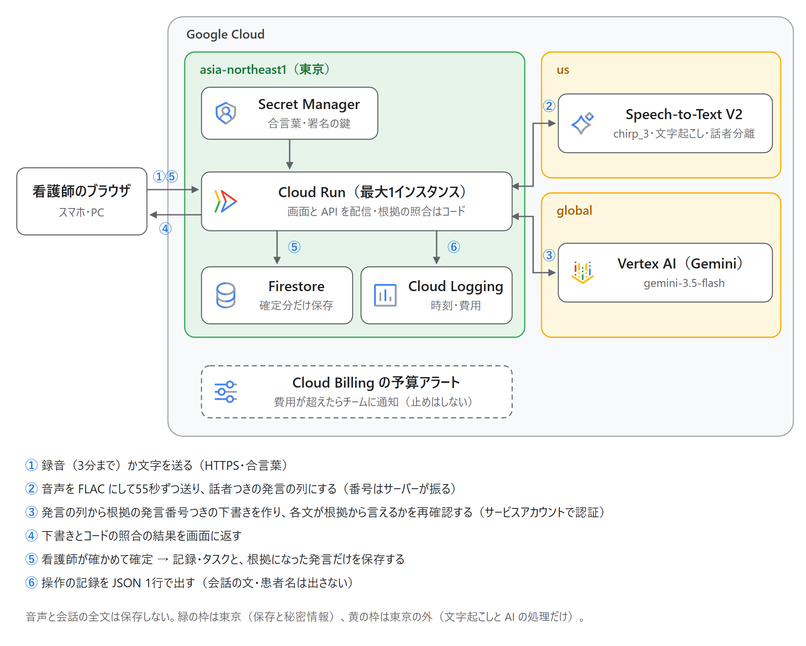
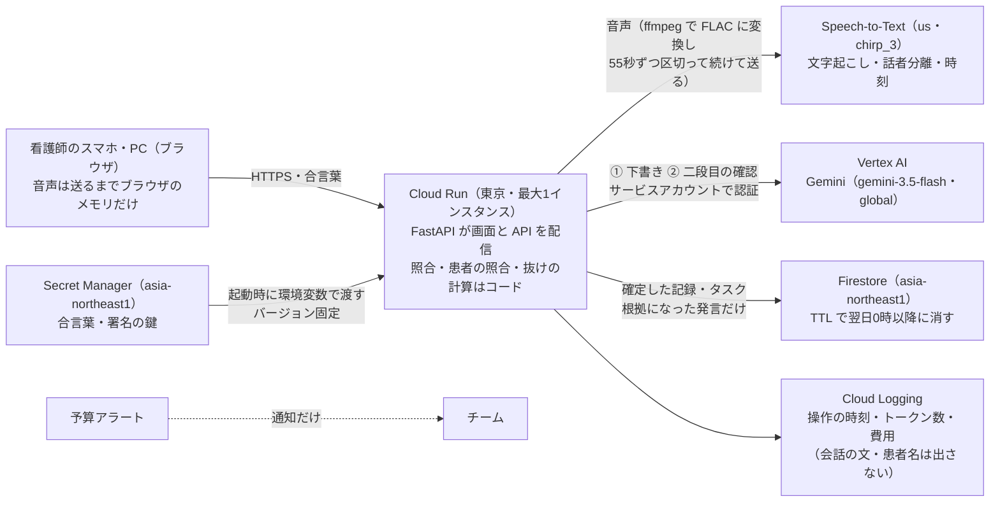

# アーキテクチャ図

アイコンは Google Cloud の公式プロダクトアイコン（https://cloud.google.com/icons 、2025年版）。固有のアイコンがないサービスは、公式の決まりどおりカテゴリのアイコンを使った（Speech-to-Text は AI・機械学習、Firestore はデータベース、Secret Manager はセキュリティ、Cloud Logging はオブザーバビリティ、Cloud Billing は管理ツール）。

上の図は要素を絞った全体像。細かい処理（音声の区切り方・秘密情報のバージョン固定・ログに出さないものなど）は、下の図と表に書く。中身は [設計](../design/README.md) 5・8・10章、API と保存の形は [データの形](../design/data-model.md)、守らせる決まりは [決まりの一覧](../design/rules.md)。技術構成は [ADR-0003](../adr/0003-runtime-and-stack.md)、モデルは [ADR-0004](../adr/0004-model.md)（`gemini-3.5-flash`・`global` に決定）。

## 図に入れるもの

| 要素 | 役割 | 決まっているか |
|---|---|---|
| Cloud Run | FastAPI が画面（`frontend/`）と API を1つのコンテナで配信する。照合・患者の照合・抜けの計算をコードで行う。リージョンは東京、最大1インスタンス（1日の回数上限をメモリで数えるため） | 決定（[ADR-0003](../adr/0003-runtime-and-stack.md)） |
| Vertex AI（Gemini） | ① 会話から下書き（バイタル・自由記述・依頼・手で入力が必要・医師への確認）を根拠つきで作る ② 下書きの各文が根拠の発言だけから言えるかを判定する（二段目の確認） | Vertex AI 経由は決定（[ADR-0002](../adr/0002-gemini-via-vertex-ai.md)）。モデルは `gemini-3.5-flash` を `global` で使う（11/8 決定。予定の gemini-2.5-flash が 2026-10-20 に廃止されたため。[ADR-0004](../adr/0004-model.md)） |
| Speech-to-Text | 文字起こし、話者分離、発言ごとの時刻。発言の番号はサーバーが振る。モデルは `chirp_3`、場所は `us`（東京では日本語の chirp_3 が使えなかったため。P-05 の例外）。1回の認識は60秒までなので、Cloud Run で ffmpeg を使って FLAC に変換し、55秒ずつ5秒重ねて区切って続けて送り、重なりで話者と発言をつなぐ。録音は3分まで。変換のときに受け取った音声をコンテナの一時ファイルに置き、読んだらすぐ消す。区切った音声はメモリだけで扱い、保存しない | 決定（11/8 の技術検証。[決まりの一覧](../design/rules.md) P-05・SEC-04） |
| Firestore | 看護師が確定した記録とタスクを保存する（`records`・`tasks`。名簿 `patients` も置く）。場所は `asia-northeast1`。`expires_at`（作った日の翌日0時）を TTL にして自動で消す。画面からは直接読み書きさせない | 決定（11/7 の打ち合わせ。[データの形](../design/data-model.md) 4章） |
| Cloud Logging | 操作の時刻、呼び出しごとのトークン数・費用。会話の文・患者名・例外の本文は出さない | 決定（標準出力に JSON 1行で出す） |
| 予算アラート | 費用が一定額を超えたらチームに知らせる。**通知だけで、利用を止めはしない** | 設定する |
| Secret Manager | 合言葉（`PASSCODE`）と、二段目の判定の署名の鍵（`ENTAIL_SEAL_KEY`）を置く。場所は `asia-northeast1`。Cloud Run の起動時に環境変数として渡し、**バージョンは番号で固定**（提出後に誰かが値を変えても、動いているサービスが起動できなくならないように）。読めるのは実行用のサービスアカウントだけ | 決定（11/8、[backend/README.md](../../backend/README.md)） |

使わないもの：Cloud Storage（長い音声を非同期で認識する案は、音声を一時的に保存する必要があり P-01 とぶつかるため、区切って続ける形にした）。

## 保存するもの・しないもの

| データ | 扱い |
|---|---|
| 音声 | **保存しない**。処理が終わったら捨てる（P-01） |
| 会話の全文（発言の列） | **保存しない**。確定した記録に残った要素の根拠になった発言の文だけを、記録と一緒に Firestore に残す（P-02） |
| 確定した記録・タスク | Firestore に保存し、翌日0時以降に TTL で消す（P-03） |
| 下書き | 保存しない。確定するまでは画面とやり取りするだけ（A-01） |
| 患者の名簿（名前・部屋・受け持ち） | **アプリで持ち続けない方針**。持ち主は電子カルテで、本番では電子カルテから読む（読み方は未決）。デモは架空の名簿を起動時に Firestore の `patients` に入れているだけ。受け持ちは画面で変えられる（S-08） |
| 看護師の一覧 | デモは架空の4人を起動時にメモリへ読むだけ（保存しない）。本番は病院の職員の情報とログインから取る |

患者の会話は病状を含む要配慮個人情報にあたる可能性が高いため、残すものを最小にした。デモとテストは架空の台本と架空の名簿だけで行う（P-07）。

## 限界（資料に書くこと）

| 限界 | 内容 |
|---|---|
| 二段目の確認は補助で、保証ではない | Gemini が「根拠の発言から言える」と判定しても、正しいとは限らない。患者の発言に指示のような文を混ぜられると、判定を誘導されるおそれがある（プロンプトインジェクション）。そのため、引っかからなかった文にも「根拠の発言で確かめてください」と出し、確定は看護師が行う |
| 回数の上限はメモリで数える | 1日の上限（全体300回、IP ごと30回）はインスタンスのメモリで数えるので、インスタンスが入れ替わると0に戻る。最大1インスタンスなので大きくはずれないが、厳密な上限ではない。IP ごとの上限は、送る側が `X-Forwarded-For` を書き換えればすり抜けられる。費用の歯止めは、全体の上限と最大1インスタンスの組み合わせで、予算アラートは知らせるだけ |
| 「誰が」は自己申告まで | ログインがないので、担当・受け持ちを変えた人と確定した人は、画面で選んだ「自分」を**自己申告として**残す（`*_reported_by`）。本人の確かめはなく、「誰がやったと言っているか」までで、証拠にはならない。合言葉を知っていれば、誰でも誰の担当でも変えられる。画面に出す看護師は名前だけなので、同姓同名は見分けられない。本番では病院の認証に置き換える |
| 合言葉は公開する前提 | 審査員が使えるように、合言葉は提出資料に書く。つまり資料を読んだ人は誰でも使える。守っているのは「URL を見つけただけの人に使わせない」ことまで。本番には病院のアカウントでの認証が要る |
| 保存する発言の範囲は画面に頼る | サーバーは会話を保存しないので、確定のときに画面が送る下書きと発言の列を元に、根拠の発言を選んで残す。画面が送る発言の列が元の文字起こしと同じかは、サーバーでは確かめられない |
| データを消す時刻 | Firestore の TTL は期限ちょうどに消すのではなく、期限を過ぎてから消す（遅れることがある）。翌日0時を過ぎてもしばらく残る場合がある |
| Vertex AI に送ったデータの扱い | 送った会話は、こちらが許可しない限り Google のモデルの学習に使われない（公式の [データガバナンスの説明](https://docs.cloud.google.com/vertex-ai/generative-ai/docs/data-governance)、11/8 確認。P-06）。ただし、キャッシュ（既定で有効）や不正利用の監視のために一時的に残る場合がある |

## 決めるときの論点

- 認証：最小版は合言葉（利用者が入力）。本番には病院のアカウントでの認証が要る
- モデルとリージョン：`gemini-3.5-flash` は東京（`asia-northeast1`）では従量課金で呼べないので、`global` で呼ぶ。データの置き場所を東京にする決まり（P-05）の例外として決めた（音声の文字起こしも `us` で処理する例外。保存（Firestore）とシークレットは東京）
